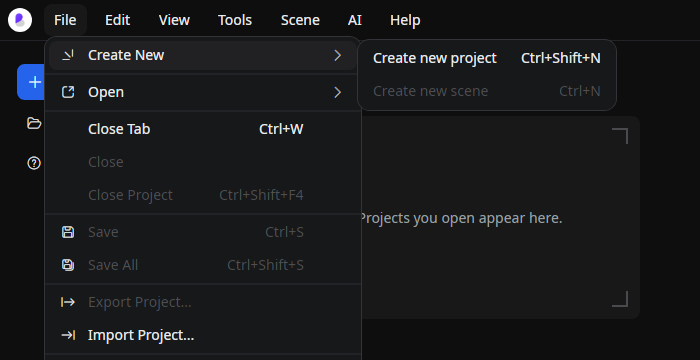
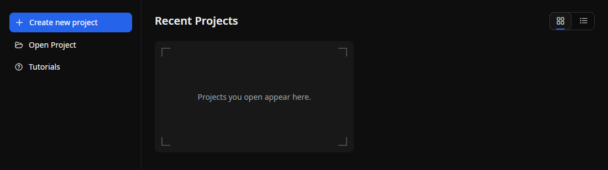
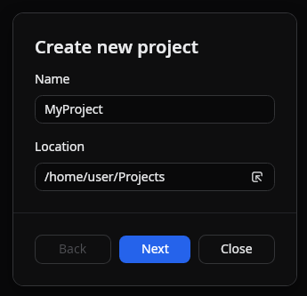
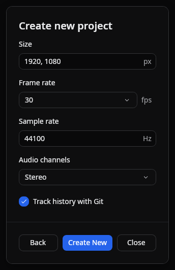

To create a project, go to the window menu and select __File > New > Project__, or  

Click __Create new project__ on the start screen.  

Specify the project's name and location.  

Click __[Next]__.  

Specify the frame rate, sample rate, audio channels, initial scene width, and height.  
  
The project sample rate is used for preview audio and as the default for new exports. Frame rate accepts a positive whole number or a fraction such as `30000/1001`, as well as the listed presets.

**Audio channels** sets the project's speaker layout: **Mono**, **Stereo** (the default), **5.1 surround**, or **7.1 surround**. You can change it later in [Scene settings](../reference/tool-tabs/scene-settings.md). See [Multichannel Audio](./multichannel-audio.md).

Click __[Create]__ to create the project.

When Git is available, choose **Track history with Git** to start recording versions when the project is created. See [Version Control](../reference/tool-tabs/version-control.md).

## The start screen and recent projects

The start screen offers **Create new project**, **Open Project**, and **Tutorials**. Beside them, **Recent Projects** shows the projects you opened, the most recently opened first, as a grid of thumbnails or as a list. Switch between them with the **Grid View** and **List View** buttons; Beutl remembers the choice.

- A single click on a project opens it, and `Enter` opens the selected one. A right click opens only the menu.
- A thumbnail is the frame on screen when the project was last closed, or, when nothing shows at the playhead, the frame from the middle of the scene's elements. A project that has not been closed since the update shows a placeholder. Thumbnails are kept in the project's `.beutl/thumbnails` folder.

To open another kind of file or create a scene, use the **File** menu. A new scene needs an open project.

Right-click a project for **Open**, **Open in Finder** (**Open in File Explorer** on Windows, **Open in File Manager** on Linux), **Remove**, and **Delete from Disk**. Choose **Delete from Disk** to permanently delete it. The confirmation dialog shows whether Beutl will delete the project's own folder and its contents, or only the project file when it is in a shared location. Close an open project before deleting it.

**Remove** only removes the entry from the recent list; it leaves the files on disk.

## Source

- [`EditorHostFallback.axaml`](https://github.com/b-editor/beutl/blob/dadee0db956ddb874ab88f48329bc84a5ce5cf6b/src/Beutl/Views/EditorHostFallback.axaml) / [`.axaml.cs`](https://github.com/b-editor/beutl/blob/dadee0db956ddb874ab88f48329bc84a5ce5cf6b/src/Beutl/Views/EditorHostFallback.axaml.cs)
- [`ProjectThumbnailService.cs`](https://github.com/b-editor/beutl/blob/dadee0db956ddb874ab88f48329bc84a5ce5cf6b/src/Beutl/Services/ProjectThumbnailService.cs)
- [`ProjectDiskDeletion.cs`](https://github.com/b-editor/beutl/blob/v2.0.0-preview.8/src/Beutl/Services/ProjectDiskDeletion.cs)
- [`CreateNewProjectViewModel.cs`](https://github.com/b-editor/beutl/blob/fb0eb00b07159f8c1a96c308b38958e29590686a/src/Beutl/ViewModels/Dialogs/CreateNewProjectViewModel.cs)
- [`EditViewModel.cs`](https://github.com/b-editor/beutl/blob/f9cbaeef9da0077f6745010a2d69955e12c45187/src/Beutl/ViewModels/EditViewModel.cs)
- [`OutputViewModel.cs`](https://github.com/b-editor/beutl/blob/f9cbaeef9da0077f6745010a2d69955e12c45187/src/Beutl/ViewModels/Tools/OutputViewModel.cs)
