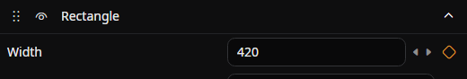
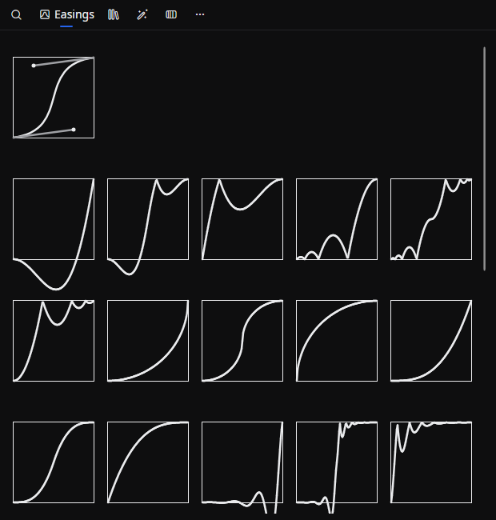
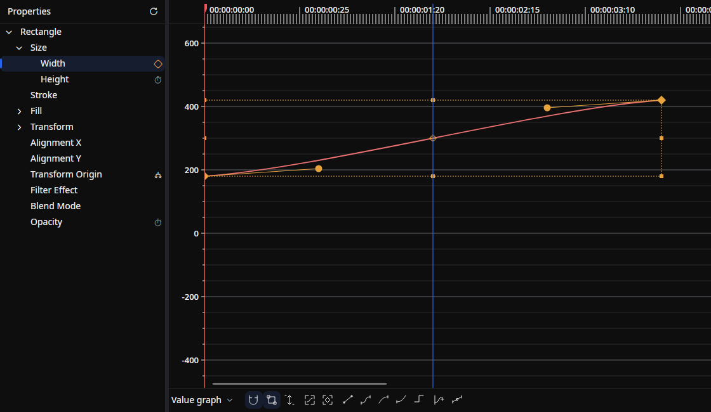

In Beutl, you can add animation effects to various objects using keyframes.

This guide assumes you already understand what keyframes are.

## Preparation
Here's how to enable animation:
1. Click the ︙ (vertical ellipsis) on the property you want to animate.

2. Click __Edit animation in inline view__ or __Edit animation__.

3. Animation is now enabled, and the ︙ (vertical ellipsis) changes to a ◇ (diamond) icon. In this state, you can right-click to open the menu.

<video controls muted playsInline title="" src="_images/6.keyframe/enable-animation.mp4" />

## Adding/Removing Keyframes

To add a keyframe at a specific frame, click the ◇ icon.
It will change to ◆, indicating that a keyframe has been added.

You can also drag and drop the desired easing from the easing list to add it.

Click the ◆ icon again to remove the keyframe.

<video controls muted playsInline title="" src="_images/6.keyframe/edit-keyframe.mp4" />

## Navigating to Keyframes
When animation is enabled on a property, it should look like this:

Clicking the `<` or `>` buttons will move you to the previous or next keyframe.

## Easing

You can edit easing by opening the animation editor from the __Edit animation__ menu.

To change the easing of an existing keyframe, drop the desired easing from the easing list onto the keyframe.

The default easing is spline easing, which allows you to adjust acceleration and deceleration using the green circle control points.

The easing list also includes a **Hold** easing, which keeps the value fixed until the next keyframe (step interpolation). Use it to switch between discrete states with no in-between animation.

<video controls muted playsInline title="" src="_images/6.keyframe/easing.mp4" />

:::tip
If the control points overlap with the keyframe display and you cannot move the control points, hold down the `Alt` key while dragging to move the control points.
:::

## Animating Components Separately {/* #separate-components */}

Properties with several values, such as a position's X and Y or a color's channels, share one set of keyframe times and easings by default. To give each value its own animation:

1. Click the ︙ on the property. If it is already animated, right-click the ◇ instead.
2. Click __Separate components__.

Each component then has its own row and its own menu for keyframes, easing, and expressions. Existing keyframes and easing are kept. Points and rectangles with relative values keep a shared unit selector, **Relative (1 = 100%)** or **Absolute (px)**.

__Unseparate components__ keeps the value at the current time and removes the component keyframes and expressions. Undo restores them.

In the [Graph Editor](../reference/tool-tabs/graph-editor.md#properties-with-multiple-components), the toggle to the left of a property's timer button does the same.

## Values Shown in One Row {/* #joined-rows */}

Some values that belong together are stored as separate properties, such as a Translate's X and Y or a shape's Width and Height. The property panel shows them in one row with a box for each, and the inline view and the [Graph Editor](../reference/tool-tabs/graph-editor.md) show them as one lane or row with a channel for each value. Each property still keeps its own value, keyframes, and expression.

- A typed value goes to its own property and follows that property's range.
- Reset and the row's keyframe commands (the ◇ button, the `<` and `>` buttons, and editing or deleting the animation) act on all of the values as one undo step.
- A row takes one expression that returns the values together, such as `new Point(Sin(Time) * 100, 0)` for a position or `new Size(Sin(Time) * 100, 100)` for a size. The three values of a Rotation 3D take a `System.Numerics.Vector3`, such as `new System.Numerics.Vector3((float)Sin(Time) * 100, 100, 100)`.
- In the row's menu, **Copy property path** and **Copy GetProperty code** open a submenu that lists each property.

When the values differ in keyframe times, easings, or clock, or do not share one expression, they stand apart: the property panel lists them as plain rows, such as **Width** and **Height**, and the inline view and the Graph Editor show a lane or a row for each. They join again once they match. You can also choose __Separate components__ from the row's menu to show them apart; this only changes the view and takes no undo step. To join them again, choose __Unseparate components__ from the menu of either row. It is available while the values have the same keyframe times and easings and share one expression or have none, and it keeps every value and keyframe. In a node graph, each property keeps a row and a port of its own.

| Row | Properties | Objects |
|-----|------------|---------|
| Position | X, Y | Translate, Displacement Map's translate |
| Scale XY | Scale X, Scale Y | Scale, Displacement Map's scale |
| Skew | Skew X, Skew Y | Skew |
| Rotation | Rotation X, Rotation Y, Rotation Z | Rotation 3D |
| Center | Center X, Center Y (and Center Z) | Rotation 3D, Displacement Map's scale and rotation |
| Size | Width, Height | Rectangle, Ellipse, Rounded rectangle, their geometries, audio visualizers, Plane |
| Emitter Size | Emitter Width, Emitter Height | Particle Emitter |
| Render Size | Render Width, Render Height | 3D Scene |
| Texture Size | Texture Width, Texture Height | Drawable Texture |
| Radius | Radius X, Radius Y | Dilate, Erode |
| Strength | Strength X, Strength Y | Shake |
| Base Frequency | Base Frequency X, Base Frequency Y | Perlin noise brush |

A joined expression is saved as a new kind of expression, which is why projects saved by 2.0.0-preview.11 do not open in earlier versions. See [Version compatibility](./project-structure.md#version-compatibility).

## Deleting Animation
To delete all keyframes and disable animation, right-click the ◇ icon and click __Remove animation__ from the menu.

In complex scenes, deleting unused animations can improve rendering speed.

## Expressions {/* #expressions */}

An expression computes a property's value with a line of C#, such as `Sin(Time) * 100`. To set one:

1. Click the ︙ on the property. If it is animated, right-click the ◇ instead.
2. Click __Edit expression__, type the expression, and confirm it with ✓ or `Ctrl + Enter` (`Cmd + Enter` on macOS).

On a property without keyframes, the ︙ then turns into an fx icon; click it to edit the expression again. Confirming an empty expression removes it, as __Remove expression__ in the menu does.

The editor's **Help** tab lists what an expression can use. Among them:

| Name | Meaning |
|------|---------|
| `Value` | The property's value without the expression: its keyframes at the current time, or its set value when it has none |
| `ValueAtTime(time)` | The same at another time |
| `Time`, `Start`, `Duration` | The time from the element's start, the element's start, and its length, in seconds |
| `Progress` | How far the current time is into the element, from `0` to `1` |
| `GetProperty<T>(path)`, `GetProperty<T>(path, time)` | Another property's value, now or at another time. __Copy GetProperty code__ in a property's menu copies the call for it. |
| `Wiggle(frequency, amplitude, octaves = 1, seed = null)` | A smooth random offset |
| `WiggleValue(frequency, amplitude, octaves = 1, seed = null)` | `Value` with a smooth random offset on each of its components |
| `LoopOut(mode = LoopMode.Cycle, keyframes = 0)`, `LoopIn(mode = LoopMode.Cycle, keyframes = 0)` | The keyframes repeated after the last one, or before the first. See [Looping keyframes](#looping-keyframes). |

Times are in seconds from the element's start, like `Time`. `Value + 10` raises an animation by 10, and `ValueAtTime(Time - 0.5)` follows the property's own animation half a second behind.

`Wiggle` changes about `frequency` times per second and stays within `amplitude` either way, so `Value + Wiggle(2, 10)` shakes a value by up to 10 around its animation. More `octaves`, up to 16, add finer detail. Each property wiggles in its own way, and it wiggles the same way in the preview and in the export. To make several properties wiggle together, give them the same `seed`.

`Wiggle` gives a single number, and calls with the same arguments give the same one, so adding it to both X and Y moves a position only along a diagonal. `WiggleValue(frequency, amplitude, octaves = 1, seed = null)` returns `Value` with a separate offset on each of its components, so `WiggleValue(2, 40)` on a position moves X and Y independently, each by up to 40. It works on numbers and on values made of numbers, such as positions, sizes, rectangles, and colors, and stops the expression with an error on other kinds of values. A color wiggles its red, green, and blue by up to `amplitude` on their 0 to 255 scale and keeps its opacity. On a single number, `WiggleValue(2, 10)` gives the same result as `Value + Wiggle(2, 10)`.

In a row that joins several values, `Value` holds them together, such as a `Point` for a position, so `Value + new Point(10, 0)` moves an animated position 10 pixels to the right.

### Keyframes and an expression together {/* #keyframes-and-expressions */}

A property can have keyframes and an expression at once. Adding keyframes to a property with an expression keeps the expression, and the first keyframe takes the value under it, so nothing changes on screen. Setting an expression keeps the keyframes. The expression decides the value; write `Value` in it to build on the keyframes.

The property's button then shows the ◇ with a small fx badge, and its tooltip says that both are set. A click on it still adds or removes the keyframe at the playhead, and a right-click opens the menu. In the [Graph Editor](../reference/tool-tabs/graph-editor.md), the properties tree marks a property that has an expression with fx too.

### Looping keyframes {/* #looping-keyframes */}

`LoopOut` repeats a property's keyframes after the last keyframe, and `LoopIn` before the first, so a few keyframes can keep a motion going for the whole element. Set one of them as the expression of a property with keyframes:

- `LoopOut(mode = LoopMode.Cycle, keyframes = 0)`
- `LoopIn(mode = LoopMode.Cycle, keyframes = 0)`

`LoopOut` returns `Value` up to the last keyframe, and `LoopIn` from the first keyframe on, so the keyframes play as they are. `mode` chooses how the animation goes on beyond them:

- `LoopMode.Cycle`: plays the keyframes again and again.
- `LoopMode.PingPong`: plays them backward and forward in turn.
- `LoopMode.Offset`: plays them again, each time starting from where the last time ended, so the change adds up.
- `LoopMode.Continue`: keeps moving at the speed and in the direction the animation has at the last keyframe, or at the first for `LoopIn`. If the animation eases to a stop there, the value stays put.

`keyframes` limits the loop to that many keyframe times from the end for `LoopOut`, or from the start for `LoopIn`; `0` uses them all. When components are animated separately, or a row joins several values, the keyframe times of all of them count together. With fewer than two keyframe times, both functions return `Value`.

For example:

- `LoopOut()` repeats the whole animation until the element ends.
- `LoopOut(LoopMode.PingPong)` swings back and forth between the first and the last keyframe.
- `LoopOut(LoopMode.Offset)` on a rotation keyframed from `0` to `90` keeps turning 90 degrees further each time.
- `LoopOut(LoopMode.Cycle, 2)` plays the earlier keyframes once and then repeats only the last two.
- `LoopIn(LoopMode.Continue)` keeps a motion going before the first keyframe at its starting speed.

`Offset` and `Continue` add values up, so they work on numbers and on values made of numbers, such as positions, sizes, and colors. On other kinds of values, such as switches, they stop the expression with an error, and the property shows its value without the expression. `Cycle` and `PingPong` work on every kind of value.

### Editing under an expression {/* #editing-under-an-expression */}

While a property has an expression, its field shows the expression's result, and you can still edit the value under it:

- A value you type or pick replaces the value under the expression: the keyframe at the playhead, or between keyframes the next one, or the set value when there are no keyframes. Between keyframes, the field shows the result at the keyframe it edits.
- Typing into one box of a point, size, or rectangle, or into one of the R, G, and B boxes of a color wheel, changes only that component of the value under the expression. The other components keep their own values.
- Dragging a box moves the value under the expression by the amount you drag. With `Value + 50` over `100`, the field shows `150`, and dragging it to `160` makes the value `110`.
- When you click into a box to type, it shows the value under the expression, and it shows the result again when you leave it.

This works for numbers, the boxes of points, sizes, and rectangles, colors and the color wheels of the [Color Grading](../reference/tool-tabs/color-grading.md) tab, switches, choices, times, fonts, and easings. Editors that change an object, such as brushes, pens, transforms, and lists, and text fields stay disabled while an expression is set.

## Source

- [`ComponentAnimations.cs`](https://github.com/b-editor/beutl/blob/fb0eb00b07159f8c1a96c308b38958e29590686a/src/Beutl.Engine/Animation/ComponentAnimations.cs)
- [`PropertyEditorMenu.axaml`](https://github.com/b-editor/beutl/blob/fb0eb00b07159f8c1a96c308b38958e29590686a/src/Beutl.Editor.Components/PropertyEditors/Views/PropertyEditorMenu.axaml)
- [`CombinedEditorAttribute.cs`](https://github.com/b-editor/beutl/blob/dadee0db956ddb874ab88f48329bc84a5ce5cf6b/src/Beutl.Core/CombinedEditorAttribute.cs) / [`PropertyPair.cs`](https://github.com/b-editor/beutl/blob/dadee0db956ddb874ab88f48329bc84a5ce5cf6b/src/Beutl.Editor.Components/PropertyEditors/ViewModels/PropertyPair.cs)
- [`ComponentExpression.cs`](https://github.com/b-editor/beutl/blob/dadee0db956ddb874ab88f48329bc84a5ce5cf6b/src/Beutl.Engine/Engine/Expressions/ComponentExpression.cs)
- [`ExpressionGlobals.cs`](https://github.com/b-editor/beutl/blob/002aefdf04748db026dfeaf506d5e465576ca08c/src/Beutl.Engine/Engine/Expressions/ExpressionGlobals.cs) / [`ExpressionGlobals{T}.cs`](https://github.com/b-editor/beutl/blob/002aefdf04748db026dfeaf506d5e465576ca08c/src/Beutl.Engine/Engine/Expressions/ExpressionGlobals%7BT%7D.cs) / [`WiggleNoise.cs`](https://github.com/b-editor/beutl/blob/002aefdf04748db026dfeaf506d5e465576ca08c/src/Beutl.Engine/Engine/Expressions/WiggleNoise.cs)
- [`ExpressionGlobals{T}.cs`](https://github.com/b-editor/beutl/blob/2c662378061e338f16e0f6f70e03704c172c5891/src/Beutl.Engine/Engine/Expressions/ExpressionGlobals%7BT%7D.cs) / [`LoopMode.cs`](https://github.com/b-editor/beutl/blob/2c662378061e338f16e0f6f70e03704c172c5891/src/Beutl.Engine/Engine/LoopMode.cs) / [`KeyFrameContinuation.cs`](https://github.com/b-editor/beutl/blob/2c662378061e338f16e0f6f70e03704c172c5891/src/Beutl.Engine/Animation/KeyFrameContinuation.cs) / [`ComponentAnimations.cs`](https://github.com/b-editor/beutl/blob/2c662378061e338f16e0f6f70e03704c172c5891/src/Beutl.Engine/Animation/ComponentAnimations.cs) (`LoopOut`, `LoopIn`, and `WiggleValue`)
- [`VectorValues.cs`](https://github.com/b-editor/beutl/blob/2c662378061e338f16e0f6f70e03704c172c5891/src/Beutl.Controls/PropertyEditors/VectorValues.cs) / [`GradingColorComponentsEditor.cs`](https://github.com/b-editor/beutl/blob/2c662378061e338f16e0f6f70e03704c172c5891/src/Beutl.Controls/PropertyEditors/GradingColorComponentsEditor.cs) (editing one component under an expression)
- [`PropertyEditorMenu.axaml.cs`](https://github.com/b-editor/beutl/blob/002aefdf04748db026dfeaf506d5e465576ca08c/src/Beutl.Editor.Components/PropertyEditors/Views/PropertyEditorMenu.axaml.cs) / [`ExpressionEditorFlyout.cs`](https://github.com/b-editor/beutl/blob/002aefdf04748db026dfeaf506d5e465576ca08c/src/Beutl.Editor.Components/PropertyEditors/Views/ExpressionEditorFlyout.cs) / [`PropertyEditorViewModel.cs`](https://github.com/b-editor/beutl/blob/002aefdf04748db026dfeaf506d5e465576ca08c/src/Beutl.Editor/PropertyEditors/PropertyEditorViewModel.cs)
- [`Strings.resx`](https://github.com/b-editor/beutl/blob/002aefdf04748db026dfeaf506d5e465576ca08c/src/Beutl.Language/Strings.resx)
