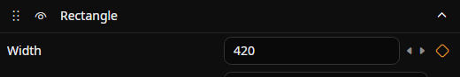
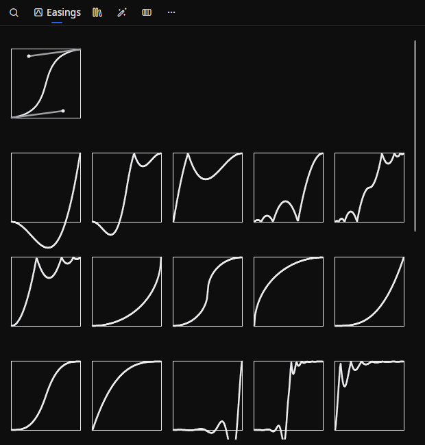
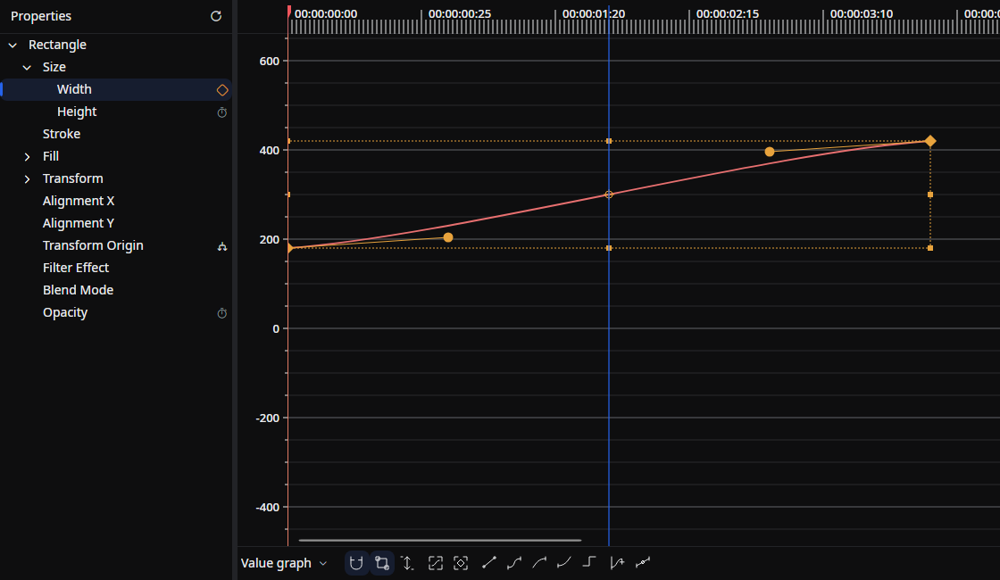

In Beutl, you can add animation effects to various objects using keyframes.

This guide assumes you already understand what keyframes are.

## Preparation
Here's how to enable animation:
1. Click the ︙ (vertical ellipsis) on the property you want to animate.

2. Click __Edit Animation Inline__ or __Edit Animation__.

3. Animation is now enabled, and the ︙ (vertical ellipsis) changes to a ◇ (diamond) icon. In this state, you can right-click to open the menu.

<video controls muted playsInline title="" src="_images/6.keyframe/enable-animation.mp4" />

## Adding/Removing Keyframes

To add a keyframe at a specific frame, click the ◇ icon.
It will change to ◆, indicating that a keyframe has been added.

You can also drag and drop the desired easing from the easing list to add it.

Click the ◆ icon again to remove the keyframe.

<video controls muted playsInline title="" src="_images/6.keyframe/edit-keyframe.mp4" />

## Navigating to Keyframes
When animation is enabled on a property, it should look like this:

Clicking the `<` or `>` buttons will move you to the previous or next keyframe.

## Easing

You can edit easing by opening the animation editor from the __Edit Animation__ menu.

To change the easing of an existing keyframe, drop the desired easing from the easing list onto the keyframe.

The default easing is spline easing, which allows you to adjust acceleration and deceleration using the green circle control points.

The easing list also includes a **Hold** easing, which keeps the value fixed until the next keyframe (step interpolation). Use it to switch between discrete states with no in-between animation.

<video controls muted playsInline title="" src="_images/6.keyframe/easing.mp4" />

:::tip
If the control points overlap with the keyframe display and you cannot move the control points, hold down the `Alt` key while dragging to move the control points.
:::

## Animating Components Separately {/* #separate-components */}

Properties with several values, such as a position's X and Y or a color's channels, share one set of keyframe times and easings by default. To give each value its own animation:

1. Click the ︙ on the property. If it is already animated, right-click the ◇ instead.
2. Click __Separate components__.

Each component then has its own row and its own menu for keyframes, easing, and expressions. Existing keyframes and easing are kept. Points and rectangles with relative values keep a shared unit selector, **Relative (1 = 100%)** or **Absolute (px)**.

__Unseparate components__ keeps the value at the current time and removes the component keyframes and expressions. Undo restores them.

In the [Graph Editor](../reference/tool-tabs/graph-editor.md#properties-with-multiple-components), the toggle to the left of a property's timer button does the same.

## Values Shown in One Row {/* #joined-rows */}

Some values that belong together are stored as separate properties, such as a Translate's X and Y or a shape's Width and Height. The property panel shows them in one row with a box for each, and the inline view and the [Graph Editor](../reference/tool-tabs/graph-editor.md) show them as one lane or row with a channel for each value. Each property still keeps its own value, keyframes, and expression.

- A typed value goes to its own property and follows that property's range.
- Reset and the row's keyframe commands (the ◇ button, the `<` and `>` buttons, and editing or deleting the animation) act on all of the values as one undo step.
- A row takes one expression that returns the values together, such as `new Point(Sin(Time) * 100, 0)` for a position or `new Size(Sin(Time) * 100, 100)` for a size. The three values of a Rotation 3D take a `System.Numerics.Vector3`, such as `new System.Numerics.Vector3((float)Sin(Time) * 100, 100, 100)`.
- In the row's menu, **Copy property path** and **Copy GetProperty code** open a submenu that lists each property.

When the values differ in keyframe times, easings, or clock, or do not share one expression, they stand apart: the property panel lists them as plain rows, such as **Width** and **Height**, and the inline view and the Graph Editor show a lane or a row for each. They join again once they match. You can also choose __Separate components__ from the row's menu to show them apart; this only changes the view and takes no undo step. To join them again, choose __Unseparate components__ from the menu of either row. It is available while the values have the same keyframe times and easings and share one expression or have none, and it keeps every value and keyframe. In a node graph, each property keeps a row and a port of its own.

| Row | Properties | Objects |
|-----|------------|---------|
| Position | X, Y | Translate, Displacement Map's translate |
| Scale XY | Scale X, Scale Y | Scale, Displacement Map's scale |
| Skew | Skew X, Skew Y | Skew |
| Rotation | Rotation X, Rotation Y, Rotation Z | Rotation 3D |
| Center | Center X, Center Y (and Center Z) | Rotation 3D, Displacement Map's scale and rotation |
| Size | Width, Height | Rectangle, Ellipse, Rounded rectangle, their geometries, audio visualizers, Plane |
| Emitter Size | Emitter Width, Emitter Height | Particle Emitter |
| Render Size | Render Width, Render Height | 3D Scene |
| Texture Size | Texture Width, Texture Height | Drawable Texture |
| Radius | Radius X, Radius Y | Dilate, Erode |
| Strength | Strength X, Strength Y | Shake |
| Base Frequency | Base Frequency X, Base Frequency Y | Perlin noise brush |

A joined expression is saved as a new kind of expression, which is why projects saved by 2.0.0-preview.11 do not open in earlier versions. See [Version compatibility](./project-structure.md#version-compatibility).

## Deleting Animation
To delete all keyframes and disable animation, right-click the ◇ icon and click __Delete Animation__ from the menu.

In complex scenes, deleting unused animations can improve rendering speed.

## Source

- [`ComponentAnimations.cs`](https://github.com/b-editor/beutl/blob/fb0eb00b07159f8c1a96c308b38958e29590686a/src/Beutl.Engine/Animation/ComponentAnimations.cs)
- [`PropertyEditorMenu.axaml`](https://github.com/b-editor/beutl/blob/fb0eb00b07159f8c1a96c308b38958e29590686a/src/Beutl.Editor.Components/PropertyEditors/Views/PropertyEditorMenu.axaml)
- [`CombinedEditorAttribute.cs`](https://github.com/b-editor/beutl/blob/dadee0db956ddb874ab88f48329bc84a5ce5cf6b/src/Beutl.Core/CombinedEditorAttribute.cs) / [`PropertyPair.cs`](https://github.com/b-editor/beutl/blob/dadee0db956ddb874ab88f48329bc84a5ce5cf6b/src/Beutl.Editor.Components/PropertyEditors/ViewModels/PropertyPair.cs)
- [`ComponentExpression.cs`](https://github.com/b-editor/beutl/blob/dadee0db956ddb874ab88f48329bc84a5ce5cf6b/src/Beutl.Engine/Engine/Expressions/ComponentExpression.cs)
