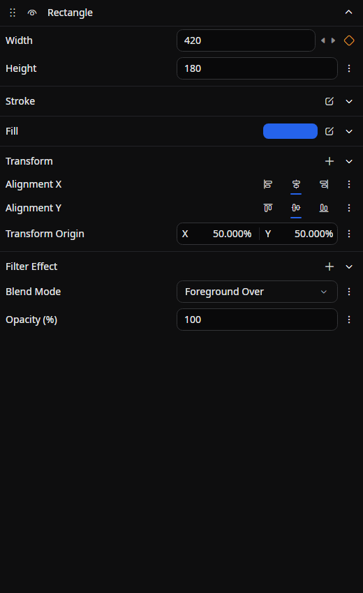

# Element Property

This tab stacks the **drawables, sounds, and other engine objects** contained in the element selected on the timeline (the unit corresponding to a `*.belm` file) and lets you edit them vertically.
The element's own name, color, start time, and other timeline-level attributes are managed from the timeline; this tab is where you build out the element's contents.

## Tab characteristics

- **Open by default**: Yes
- **Allow multiple instances**: Yes

## How to open

Select an element on the timeline to open this tab and show its contents. It is not listed in **View → Tools** or the empty-tab picker.

Use **Pin Tab** in the tab header's right-click menu to keep that element visible. Selecting another element then uses another unpinned tab, or opens one when needed. See [Keeping a tab on one object](./index.md#keeping-a-tab-on-one-object).

## Layout

The objects contained in the selected element are listed vertically as **expandable panels**.
Each panel consists of the following parts.

- **Reorder handle** (dots at the far left): Drag vertically to change the object's order
- **Visibility toggle**: Enable or disable the object
- **Name label**: The object's type name (hover to see a tooltip with its description)
- **Expand/collapse button**: Click to open or close the property area
- **Property area**: Shows a dedicated editor for each property when expanded

If the element contains many objects, scroll the tab vertically to browse them all.

Lists inside a panel, such as transforms, filter effects, audio effects, and path figures, show their items the same way. An expanded item's rows start under its name, and a line under its grip runs beside them. The items of a nested group start under their group's name, with a line for each level.

## Working with objects

### Reordering

Drag the handle on the left edge of a panel up or down to rearrange objects within the same element. The order directly affects the order in which drawing and effects are applied.

### Toggling enabled / disabled

Use the eye icon in the header (the visibility toggle) to enable or disable the object. Disabled objects are excluded from drawing and processing.

### Expanding / collapsing

Click the button at the right end of the header to open or close the property area. The expand/collapse state is saved per element and restored the next time you open the same element.

### Right-click menu (on a panel header)

| Item | Action |
|------|--------|
| **Remove** | Removes this object from the element |
| **Save as Template** | Names the object and registers it in the library as a template |

## Adding objects

### Drag and drop from the library

Drop items (drawables, sounds, etc.) from the [Library](./library.md) onto this tab to add objects to the selected element. The drop position determines where the new object is inserted.

## Transforms and effects

### Starting transforms

A new object starts with **Translate**, **Rotation**, and **Scale** transforms, whether you add it from the timeline, the preview, or the library, drop it on this tab, or paste an image. The position you drop it at goes into its Translate. When you expand the **Transform** section, each of these transforms is open.

### Adding with `+`

The `+` button and drops always add. On a **Transform**, **Filter Effect**, or **Audio Effect** section, a single transform or effect moves into a new group together with the new one, in one undo step, so nothing is replaced. A new transform goes where the preview's handles would put it: the first Translate on top, the first Rotation right below it, and anything else at the end, so the order you add them in gives the same result. While an expression decides the value, adding from the panel does nothing. **Change** and **Null** appear in the section's right-click menu only to repair a value that could not be loaded.

### Picking from tiles {/* #picking-from-tiles */}

The picker that the `+` button opens on a **Filter Effect** section shows the effects as tiles. Each tile has a moving thumbnail of the effect on the object you add it to, as the object looks at the playhead, drawn on its own. A tile plays while you point at it or while it is selected, and the arrow keys move between tiles and rows. The grid button at the top of the picker switches between tiles and a list, and Beutl remembers the choice for every picker. With nothing to draw, the tiles use sample pictures that come with Beutl.

The [Transition](./transition.md) tab's type picker shows its transitions the same way, on the elements at the edge it sets. Pickers for other kinds of items, such as transforms and audio effects, show a list.

### Transforms in a list

An open transform shows its first property beside its type's icon, in place of a name row, and its other properties below it, beside a line. Click the icon to close or open the transform, and drag the icon to reorder it. Right-click anywhere on the transform for **Visible** and **Remove**, along with copy, paste, and templates. A hidden transform is dimmed.

A closed transform, a group, and a transform whose type could not be loaded keep the row with the name, the eye, and the trash button. In a node, a transform also keeps that row.

## Editing properties

Expanding an object reveals a per-property editor.

For animated properties, use the **vertical three-dot menu (⋮)** on the right side of the property to open the [Graph Editor](./graph-editor.md) or to inline-expand the animation onto the timeline.

Reference properties offer a picker for existing targets, and properties with unit metadata show `%`, `°`, or `×` in their labels. See [Choosing reference targets](../../get-started/edit-element.md#reference-targets) and the following section for details.

On properties with several values, such as a point or a color, the same menu offers **Separate components** to animate each value on its own. See [Animating components separately](../../get-started/keyframe.md#separate-components). Values stored as separate properties, such as a Translate's X and Y, share one row; see [Values shown in one row](../../get-started/keyframe.md#joined-rows).

Sounds also have collapsible **Panner** and **Channel assignment** sections. See [Multichannel Audio](../../get-started/multichannel-audio.md).

File fields also accept drag-and-drop: drop a local file of a supported type onto the field to select it. Easing properties provide a preset selector and a curve preview; for spline easing, drag the curve's control points to adjust it directly. The curve also takes the keyboard: `Tab` moves between its two control points and then on, the arrow keys move the selected one by `0.01`, and `Shift` makes that `0.1`. Each key press is one undo step. When the value column is too narrow, the curve spans the whole row.

### Scrubbing number values

Drag a number box, or its label, horizontally to scrub its value up or down. Hold **`Shift`** while scrubbing for coarse steps (10×) or **`Alt`** (`Command` on macOS) for fine steps (0.1×). With [Enable Pointer Lock](../../settings/editor.md#enable-pointer-lock) on, the cursor hides during the drag on Windows and macOS and comes back where the drag began. On a macOS trackpad, a scrub gives [haptic feedback](./timeline.md#trackpad-haptic-feedback) at zero and at the property's default value.

A press on a box becomes a drag only after it moves 3 pixels sideways, so a click still edits the text, with all of it selected; `Enter` confirms the new value. While the box shows text that does not parse, a drag does not change the value, and the release edits the text so you can correct it.

A number that has a range, such as Opacity, shows where its value sits while you point at it: the box fills up to the value, from zero when the range spans zero and from the minimum otherwise, and a slim thumb marks the value. At rest it looks like any other box.

The boxes of points, sizes, vectors, thicknesses, corner radii, and color components take a drag too. Each box moves its own component, and the single box of a uniform value moves them all. Relative points and rectangles move by 1% per pixel for a relative value and by 1 per pixel for an absolute one. Number boxes in list items, nodes, and settings pages stay plain text boxes.

### Picking colors and palettes

A color field opens Beutl's color picker. The same picker opens for element, layer, and marker colors, gradient stops, the preview guide color, and the accent color. Its palette tab lists, under a **New palette** button:

- **Recent colors**: the last 20 colors a picker applied, newest first.
- The open project's palettes, marked **Saved in this project**.
- Your own palettes, which every project shows.
- **Default palette**: the CSS named colors and Transparent, from neutrals through red, orange, yellow, green, cyan, blue, purple, and pink, each from light to dark.

Click a color to pick it. Colors equal to the current one are ringed, a tooltip shows the color's name and hex value, and translucent colors show a checkerboard. In the brush editor, picking a color while the brush is unset makes a solid brush of it.

- **New palette** adds one of your own palettes, named **Palette 1**, **Palette 2**, and so on.
- **+** on a palette adds the current color.
- The palette's **…** button or right-click menu offers **Rename**, **Move up**, **Move down**, **Save in this project** or **Use in all projects**, and **Delete**.
- Right-click a color of a palette for **Rename**, **Replace with the current color**, **Move to** another palette, and **Delete**.
- Right-click a recent or default color for **Add to palette** (or **Add to a new palette**). A recent color also offers **Remove from recent colors**, and the **Recent colors** menu offers **Clear recent colors**.

Your palettes and the recent colors are kept in Beutl's preferences. A project's palettes are written to [a file of their own beside the project file](../../get-started/project-structure.md#palettes-file) as soon as they change, and those edits cannot be undone.

From the keyboard, `Tab` stops once in each palette, at the color focused last. The arrow keys move between its colors, `Left` and `Right` in order and `Up` and `Down` a row at a time. `Enter` or `Space` picks the focused color, and the menu key opens its menu.

## Objects of unknown type

When the object's type cannot be resolved — for example because the providing extension is not installed — the view falls back to a placeholder. It shows the original type name along with a command bar for editing and saving the JSON directly, so you can still inspect and make minimal fixes on the spot.

Unrecognized data that can be preserved is kept on save. Common properties remain editable when the placeholder can save those changes. If an element is protected because some data could not be preserved, editing is restricted to repairing, replacing, or removing that content; see [Recovering damaged elements](../../get-started/edit-element.md#recovering-damaged-elements).

## Related documents

- [Edit an element](../../get-started/edit-element.md)
- [Project structure](../../get-started/project-structure.md)
- [Library](./library.md)
- [Graph Editor](./graph-editor.md)

## Source

- [`ElementPropertyTabExtension.cs`](https://github.com/b-editor/beutl/blob/f9cbaeef9da0077f6745010a2d69955e12c45187/src/Beutl.Editor.Components/ElementPropertyTab/ElementPropertyTabExtension.cs)
- [`ElementPropertyTabViewModel.cs`](https://github.com/b-editor/beutl/blob/f9cbaeef9da0077f6745010a2d69955e12c45187/src/Beutl.Editor.Components/ElementPropertyTab/ViewModels/ElementPropertyTabViewModel.cs)
- [`EngineObjectPropertyViewModel.cs`](https://github.com/b-editor/beutl/blob/f9cbaeef9da0077f6745010a2d69955e12c45187/src/Beutl.Editor.Components/ElementPropertyTab/ViewModels/EngineObjectPropertyViewModel.cs)
- [`ElementPropertyTabView.axaml`](https://github.com/b-editor/beutl/blob/f9cbaeef9da0077f6745010a2d69955e12c45187/src/Beutl.Editor.Components/ElementPropertyTab/Views/ElementPropertyTabView.axaml) / [`.axaml.cs`](https://github.com/b-editor/beutl/blob/f9cbaeef9da0077f6745010a2d69955e12c45187/src/Beutl.Editor.Components/ElementPropertyTab/Views/ElementPropertyTabView.axaml.cs)
- [`EngineObjectPropertyView.axaml`](https://github.com/b-editor/beutl/blob/f9cbaeef9da0077f6745010a2d69955e12c45187/src/Beutl.Editor.Components/ElementPropertyTab/Views/EngineObjectPropertyView.axaml) / [`.axaml.cs`](https://github.com/b-editor/beutl/blob/f9cbaeef9da0077f6745010a2d69955e12c45187/src/Beutl.Editor.Components/ElementPropertyTab/Views/EngineObjectPropertyView.axaml.cs)
- [`FallbackObjectView.axaml`](https://github.com/b-editor/beutl/blob/f9cbaeef9da0077f6745010a2d69955e12c45187/src/Beutl.Editor.Components/Views/FallbackObjectView.axaml) / [`.axaml.cs`](https://github.com/b-editor/beutl/blob/f9cbaeef9da0077f6745010a2d69955e12c45187/src/Beutl.Editor.Components/Views/FallbackObjectView.axaml.cs)
- [`StorageFileEditor.cs`](https://github.com/b-editor/beutl/blob/f9cbaeef9da0077f6745010a2d69955e12c45187/src/Beutl.Controls/PropertyEditors/StorageFileEditor.cs)
- [`EasingEditor.cs`](https://github.com/b-editor/beutl/blob/f9cbaeef9da0077f6745010a2d69955e12c45187/src/Beutl.Controls/PropertyEditors/EasingEditor.cs)
- [`EasingCurveEditor.cs`](https://github.com/b-editor/beutl/blob/dadee0db956ddb874ab88f48329bc84a5ce5cf6b/src/Beutl.Controls/PropertyEditors/EasingCurveEditor.cs)
- [`ComponentEditors.cs`](https://github.com/b-editor/beutl/blob/fb0eb00b07159f8c1a96c308b38958e29590686a/src/Beutl.Editor.Components/PropertyEditors/Views/ComponentEditors.cs)
- [`SoundPannerEditor.axaml`](https://github.com/b-editor/beutl/blob/fb0eb00b07159f8c1a96c308b38958e29590686a/src/Beutl.Editor.Components/SoundPannerProperties/Views/SoundPannerEditor.axaml)
- [`ChannelMapEditor.axaml`](https://github.com/b-editor/beutl/blob/fb0eb00b07159f8c1a96c308b38958e29590686a/src/Beutl.Editor.Components/ChannelMapProperties/Views/ChannelMapEditor.axaml)
- [`TransformListItemEditor.axaml`](https://github.com/b-editor/beutl/blob/dadee0db956ddb874ab88f48329bc84a5ce5cf6b/src/Beutl.Editor.Components/PropertyEditors/Views/TransformListItemEditor.axaml) / [`ListItemRowsPanel.cs`](https://github.com/b-editor/beutl/blob/dadee0db956ddb874ab88f48329bc84a5ce5cf6b/src/Beutl.Editor.Components/PropertyEditors/Views/ListItemRowsPanel.cs)
- [`AddToGroupHelper.cs`](https://github.com/b-editor/beutl/blob/dadee0db956ddb874ab88f48329bc84a5ce5cf6b/src/Beutl.Editor.Components/Helpers/AddToGroupHelper.cs) / [`CanonicalTransformLayout.cs`](https://github.com/b-editor/beutl/blob/dadee0db956ddb874ab88f48329bc84a5ce5cf6b/src/Beutl.Engine/Graphics/Transformation/CanonicalTransformLayout.cs)
- [`ColorPaletteView.cs`](https://github.com/b-editor/beutl/blob/dadee0db956ddb874ab88f48329bc84a5ce5cf6b/src/Beutl.Controls/PropertyEditors/ColorPaletteView.cs) / [`ColorPaletteService.cs`](https://github.com/b-editor/beutl/blob/dadee0db956ddb874ab88f48329bc84a5ce5cf6b/src/Beutl.Controls/PropertyEditors/ColorPaletteService.cs) / [`DefaultColorPalette.cs`](https://github.com/b-editor/beutl/blob/dadee0db956ddb874ab88f48329bc84a5ce5cf6b/src/Beutl.Controls/PropertyEditors/DefaultColorPalette.cs)
- [`LibraryItemPickerFlyoutPresenter.axaml`](https://github.com/b-editor/beutl/blob/70d09a97d4491bf6616e248fec809faa58e47db7/src/Beutl.Controls/Styling/PropertyEditors/LibraryItemPickerFlyoutPresenter.axaml) / [`SelectLibraryItemDialogViewModel.cs`](https://github.com/b-editor/beutl/blob/70d09a97d4491bf6616e248fec809faa58e47db7/src/Beutl.Editor.Components/PropertyEditors/ViewModels/SelectLibraryItemDialogViewModel.cs) / [`LibraryThumbnailCapture.cs`](https://github.com/b-editor/beutl/blob/70d09a97d4491bf6616e248fec809faa58e47db7/src/Beutl.Editor.Components/LibraryThumbnails/LibraryThumbnailCapture.cs)
- [`NumberSliderEditor.cs`](https://github.com/b-editor/beutl/blob/70d09a97d4491bf6616e248fec809faa58e47db7/src/Beutl.Controls/PropertyEditors/NumberSliderEditor.cs) / [`ValueSliderField.cs`](https://github.com/b-editor/beutl/blob/70d09a97d4491bf6616e248fec809faa58e47db7/src/Beutl.Controls/PropertyEditors/ValueSliderField.cs) / [`NumberBoxDrag.cs`](https://github.com/b-editor/beutl/blob/70d09a97d4491bf6616e248fec809faa58e47db7/src/Beutl.Controls/PropertyEditors/NumberBoxDrag.cs) / [`NumberEditorViewModel.cs`](https://github.com/b-editor/beutl/blob/70d09a97d4491bf6616e248fec809faa58e47db7/src/Beutl.Editor.Components/PropertyEditors/ViewModels/NumberEditorViewModel.cs)
- [`VectorEditorBase.cs`](https://github.com/b-editor/beutl/blob/70d09a97d4491bf6616e248fec809faa58e47db7/src/Beutl.Controls/PropertyEditors/VectorEditorBase.cs) / [`HeaderScrubGesture.cs`](https://github.com/b-editor/beutl/blob/70d09a97d4491bf6616e248fec809faa58e47db7/src/Beutl.Controls/PropertyEditors/HeaderScrubGesture.cs)
