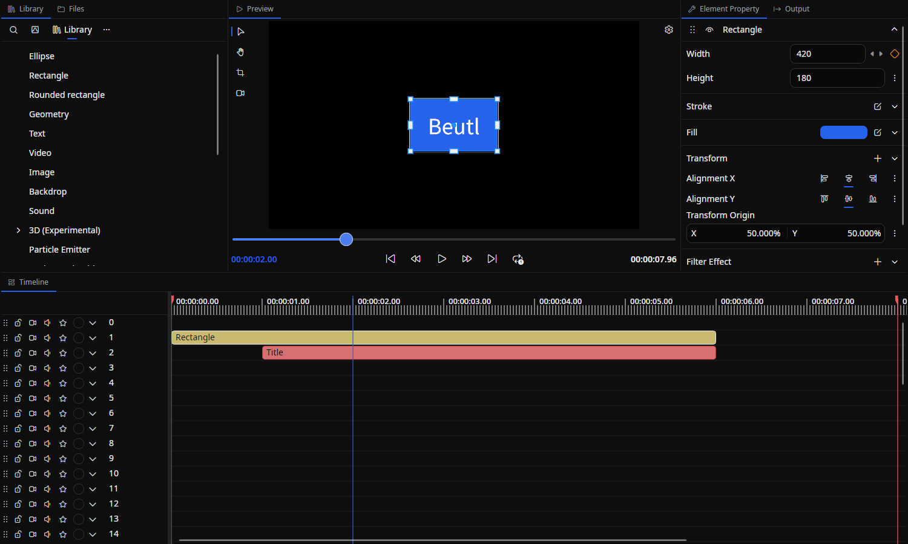

# Tool Tabs

Tool tabs are dockable workspaces around the scene editor.
Each tab serves a specific purpose, such as the Timeline, Library, or Properties.
Drag the tabs to rearrange, stack, or tile them as needed.

## Opening and resetting tabs

- Reopen a closed tab from the menu bar via **View → Tools**.
- Hover a dock's tab header and press the `+` button to open an empty tab in **that** dock. Search for a tool and select it to replace the empty tab. Single-instance tools that are already open appear disabled under **Already open**. Use **Pin** to keep a frequently used tool at the top of this picker.
- Drag a tab's header to move it to a different dock area.
- Choose **View → Reset dock layout** to restore the tab arrangement to its initial state.
- Save the current arrangement under a name and re-apply it to any scene from the [Dock layout](./dock-layout.md) tab.

Some tabs open from their editing context rather than **View → Tools**: **Element Property**, **Properties**, **Scene settings**, **Graph Editor**, **Transition**, and **Relink missing media**. See their respective pages for instructions on opening them.

- Hover the selected tab to show its close button. The extension icon appears to the left of the tab title.

## Switching tabs with the keyboard

| Action | Shortcut |
|--------|----------|
| Next / previous tab | `Ctrl + Tab` / `Ctrl + Shift + Tab` |
| Next / previous tool tab | `Alt + F7` / `Alt + Shift + F7` |
| Create tool tab | `Ctrl + T` (`Cmd + T` on macOS) |

The switcher groups open tabs into **Tool tabs** and **Files**. Use the left/right arrows to change groups and the up/down arrows to select a tab. Release the shortcut's modifier key or press `Enter` to activate it; `Esc` cancels. **Create tool tab** opens a list of tools and waits for `Enter`. `Alt + Tab` / `Alt + Shift + Tab` are also registered for tool switching when the operating system passes those keys to Beutl.

## Keeping a tab on one object

Right-click a tab header and enable **Pin Tab** to keep it on its current target while selecting something else. This is available for Element Property, Properties, Node Graph, Path editor, Color Grading, Curves, and Transition. A pinned tab shows a pin beside its title; click it to **Unpin Tab**. Removing its target also releases the pin.

Pinning a tool in the empty-tab picker only adds it to that picker's favorites; **Pin Tab** keeps an already open tab on its target.

## Tab list

| Tab | Overview |
|-----|----------|
| [Timeline](./timeline.md) | Arrange, split, and group elements on the time axis |
| [Library](./library.md) | Drag drawables and effects into the scene |
| [Files](./file-browser.md) | Browse files in the project folder or any folder |
| [Element Property](./element-property.md) | Edit the drawables, sounds, and other objects inside an element |
| [Output](./output.md) | Manage encoding settings and output profiles |
| [Scene settings](./scene-settings.md) | Configure scene size, start time, length, and layer count |
| [Graph Editor](./graph-editor.md) | Edit time curves of animations |
| [Node Graph](./node-graph.md) | Place and connect nodes to edit a processing graph |
| [Scopes](./color-scopes.md) | Waveform / Histogram / Vectorscope / False Color / Zebra displays for video |
| [Color Grading](./color-grading.md) | Perform color correction and color grading |
| [Curves](./curves.md) | Adjust tones with tone curves |
| [Audio Visualizer](./audio-visualizer.md) | Waveform / Spectrum / Meter / Spectrogram / Phase Scope displays for audio |
| [Path editor](./path-editor.md) | Edit control points of path shapes |
| [Preview Settings](./preview-settings.md) | Preview render quality, onion skin, and the render caches |
| [History](./history.md) | Browse the edit history and jump back to any step |
| [Terminal](./terminal.md) | Run a shell in the project folder without leaving the editor |
| [Proxies](./proxies.md) | Generate and manage low-resolution proxy media for smooth preview |
| [Dock layout](./dock-layout.md) | Save the tab arrangement under a name and re-apply it to any scene |
| [Version Control](./version-control.md) | Record, compare, and restore project versions with Git |
| [Browser](./web-browser.md) | Browse websites and download media for the project |
| [AI](./ai-workspace.md) | Generate and edit images and videos, create subtitles, and manage jobs |
| [Relink missing media](./missing-media.md) | Repair references to moved or missing media and fonts |
| [Transition](./transition.md) | Edit transitions at the start or end of a clip |

The source of truth for this document is `src/Beutl/Services/StartupTasks/LoadPrimitiveExtensionTask.cs` and the `*TabExtension.cs` files under `src/Beutl.Editor.Components/` in the [Beutl repository](https://github.com/b-editor/beutl).

## Source

- [`MainViewExtension.cs`](https://github.com/b-editor/beutl/blob/f9cbaeef9da0077f6745010a2d69955e12c45187/src/Beutl/Services/PrimitiveImpls/MainViewExtension.cs)
- [`TabSwitcherViewModel.cs`](https://github.com/b-editor/beutl/blob/f9cbaeef9da0077f6745010a2d69955e12c45187/src/Beutl/ViewModels/TabSwitcherViewModel.cs) / [`TabSwitcherView.axaml.cs`](https://github.com/b-editor/beutl/blob/f9cbaeef9da0077f6745010a2d69955e12c45187/src/Beutl/Views/TabSwitcherView.axaml.cs)
- [`NewToolTabDockable.cs`](https://github.com/b-editor/beutl/blob/f9cbaeef9da0077f6745010a2d69955e12c45187/src/Beutl/ViewModels/Dock/NewToolTabDockable.cs)
- [`DockStyles.axaml`](https://github.com/b-editor/beutl/blob/f9cbaeef9da0077f6745010a2d69955e12c45187/src/Beutl/Views/Dock/DockStyles.axaml) / [`ToolTabPin.cs`](https://github.com/b-editor/beutl/blob/f9cbaeef9da0077f6745010a2d69955e12c45187/src/Beutl.Editor.Components/Helpers/ToolTabPin.cs)
