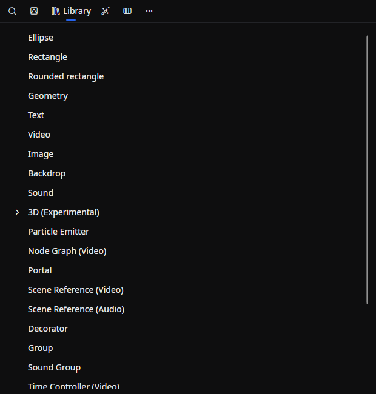
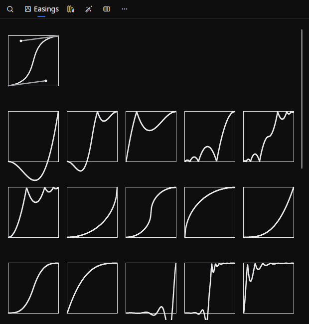

# Library

A tab for browsing the available **drawables, effects, transforms, easings, nodes**, and other items, and dragging them onto the timeline or element properties to add them.

## Tab characteristics

- **Open by default**: Yes
- **Allow multiple instances**: No

## How to open

Open it from the menu bar via **View → Tools → Library**.

## Layout

The top of the tab shows the tab switcher and the bottom shows the contents of the selected tab. There are six tabs:

| Tab | Role |
|-----|------|
| **Search** | Search across the entire library by keyword |
| **Easings** | List easing functions used to interpolate animations |
| **Library** | Browse drawables, effects, and other items in a category tree (selected by default) |
| **Filter Effect** | Browse filter effects as tiles with moving thumbnails |
| **Transition** | Browse transitions as tiles with moving thumbnails |
| **Node Graph** | List nodes used in node-based rendering (hidden by default) |

When the tabs do not fit on screen, you can scroll horizontally with the mouse wheel.

### Showing or hiding tabs

You can toggle the visibility of each tab from the right-click context menu on a tab, or from the **"…" button** at the right edge of the tab strip (each entry is the **Always display** toggle).

- **Search / Easings / Library / Filter Effect / Transition**: Shown by default
- **Node Graph**: Hidden by default. Show it when you want to use the node graph

## Tab contents

### Search

Type a keyword into the input box to search across the items in every tab. Results show the item name, description, and type (drawable, effect, etc.), sorted by relevance.

When the input box is empty, all registered items are listed in a flat view.

### Easings

A list of easing functions used to interpolate between animation keyframes. Each tile shows a preview of the curve shape.

- The first tile in the list is **spline interpolation** (a Bezier-style icon with four control points),
- followed by the standard Linear / Quad / Cubic / Quart / Quint / Sine / Expo / Circ / Back / Elastic / Bounce easings, and **Hold**
- Drag a tile to assign it to a keyframe in the graph editor

### Library

Drawables, effects, and similar items are shown in a **tree**. Hovering over an item shows its description.

Representative categories:

- **Shapes, text, and media**: Ellipse, rectangle, rounded rectangle, geometry, text, video, image, backdrop, and more
- **Audio**: Sound, scene sound, sound group, and more
- **3D (experimental)**: 3D scene, cube, sphere, plane, model, and various lights
- **Particles, node-graph rendering, scene rendering, groups, decorators, time control**, and other objects used for compositing and control
- **Audio visualizers**: Audio waveform, spectrum, spectrogram
- **Transforms**: Translate, scale, rotate, 3D rotate, skew
- **Filter effects**: Blur, motion blur, bloom, drop shadow, stroke, color correction, curves, LUT, blend, mosaic, displacement map, scripted effects (C# / SKSL / GLSL), and more
- **Audio effects**: Delay, equalizer, and more

For details on each item, see the [Library reference](../library/index.md).

### Filter Effect and Transition {/* #filter-effect-and-transition */}

These tabs show the filter effects and the transitions as tiles, in the library's order, including those that extensions add. Each tile has a moving thumbnail and the item's name. Point at a tile to play its thumbnail and see its description.

A tile drags like the same item in the **Library** tree. Drop an effect on a **Filter Effect** section in the [Element Property](./element-property.md) tab, or a transition on an element on the timeline, where it goes on the edge nearer the pointer.

The thumbnails show each effect on the frame the preview shows, without selection outlines or handles. A transition takes that frame out and brings it back in. The thumbnails are drawn again once the preview shows another frame and playback has stopped for a moment. When the preview shows nothing, they use sample pictures that come with Beutl.

The pickers that add an effect or change a transition can show tiles too; see [Picking from tiles](./element-property.md#picking-from-tiles).

### Node Graph

A category tree of nodes available for node-based rendering. Nodes are grouped by type, and you place them by dragging onto the node graph.

## Related documents

- [Adding elements](../../get-started/add-element.md)
- [Editing elements](../../get-started/edit-element.md)
- [Keyframes](../../get-started/keyframe.md)
- [Graph Editor](./graph-editor.md)
- [Library reference](../library/index.md) — Details for each object

## Source

- [`LibraryTabExtension.cs`](https://github.com/b-editor/beutl/blob/main/src/Beutl.Editor.Components/LibraryTab/LibraryTabExtension.cs)
- [`LibraryTabViewModel.cs`](https://github.com/b-editor/beutl/blob/main/src/Beutl.Editor.Components/LibraryTab/ViewModels/LibraryTabViewModel.cs)
- [`LibraryTabView.axaml`](https://github.com/b-editor/beutl/blob/main/src/Beutl.Editor.Components/LibraryTab/Views/LibraryTabView.axaml) / [`.axaml.cs`](https://github.com/b-editor/beutl/blob/main/src/Beutl.Editor.Components/LibraryTab/Views/LibraryTabView.axaml.cs)
- [`SearchView.axaml`](https://github.com/b-editor/beutl/blob/main/src/Beutl.Editor.Components/LibraryTab/Views/LibraryViews/SearchView.axaml) / [`.axaml.cs`](https://github.com/b-editor/beutl/blob/main/src/Beutl.Editor.Components/LibraryTab/Views/LibraryViews/SearchView.axaml.cs)
- [`EasingsView.axaml`](https://github.com/b-editor/beutl/blob/main/src/Beutl.Editor.Components/LibraryTab/Views/LibraryViews/EasingsView.axaml) / [`.axaml.cs`](https://github.com/b-editor/beutl/blob/main/src/Beutl.Editor.Components/LibraryTab/Views/LibraryViews/EasingsView.axaml.cs)
- [`LibraryView.axaml`](https://github.com/b-editor/beutl/blob/main/src/Beutl.Editor.Components/LibraryTab/Views/LibraryViews/LibraryView.axaml) / [`.axaml.cs`](https://github.com/b-editor/beutl/blob/main/src/Beutl.Editor.Components/LibraryTab/Views/LibraryViews/LibraryView.axaml.cs)
- [`NodesView.axaml`](https://github.com/b-editor/beutl/blob/main/src/Beutl.Editor.Components/LibraryTab/Views/LibraryViews/NodesView.axaml) / [`.axaml.cs`](https://github.com/b-editor/beutl/blob/main/src/Beutl.Editor.Components/LibraryTab/Views/LibraryViews/NodesView.axaml.cs)
- [`LibraryGalleryView.axaml`](https://github.com/b-editor/beutl/blob/70d09a97d4491bf6616e248fec809faa58e47db7/src/Beutl.Editor.Components/LibraryTab/Views/LibraryViews/LibraryGalleryView.axaml) / [`.axaml.cs`](https://github.com/b-editor/beutl/blob/70d09a97d4491bf6616e248fec809faa58e47db7/src/Beutl.Editor.Components/LibraryTab/Views/LibraryViews/LibraryGalleryView.axaml.cs)
- [`LibraryGalleryItemViewModel.cs`](https://github.com/b-editor/beutl/blob/70d09a97d4491bf6616e248fec809faa58e47db7/src/Beutl.Editor.Components/LibraryTab/ViewModels/LibraryGalleryItemViewModel.cs) / [`LibraryPreviewCapture.cs`](https://github.com/b-editor/beutl/blob/70d09a97d4491bf6616e248fec809faa58e47db7/src/Beutl.Editor.Components/LibraryThumbnails/LibraryPreviewCapture.cs) / [`LibraryThumbnailSet.cs`](https://github.com/b-editor/beutl/blob/70d09a97d4491bf6616e248fec809faa58e47db7/src/Beutl.Editor.Components/LibraryThumbnails/LibraryThumbnailSet.cs)
