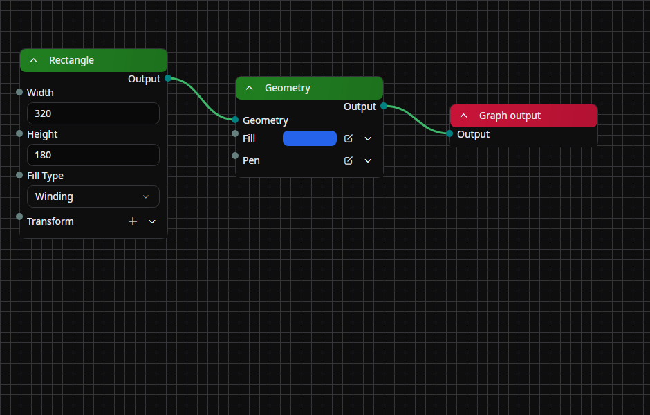

# Node Graph

A tab for **placing and connecting nodes** in node-based drawables (node graph drawables and filter effects).
Add, move, and delete nodes, and wire ports together to build up the processing flow.

## Tab characteristics

- **Open by default**: No
- **Allow multiple instances**: Yes (each graph being edited can be opened in its own tab)

## How to open

There are two ways to open this tab.

- From the menu bar, choose **View → Tools → Node Graph** to open the node graph for the currently selected element.
- In the Properties tab, click the **Open in tab** button on a graph property of a node-based drawable or filter effect to open the same graph in this tab.



## Layout

- **Breadcrumb bar (top)**: Shows the hierarchy of the graph currently being edited. After entering a group node, click an item to return to a parent graph.
- **Graph panel (center)**: A workspace with a dotted background where nodes and connection lines are placed. The background scrolls together with panning and zooming.
- **Selection overlay**: A semi-transparent blue rectangle is shown only while you are box-selecting.

## Adding nodes

### From the right-click menu

Right-clicking on an empty area of the graph panel shows the following items.

- **Add node**: Lists the registered nodes in category submenus. The selected node is placed at the click position.
- **Reset zoom**: Returns the graph panel zoom level to 100%.

### Drag and drop

Drop a node entry from the Library onto the graph panel to add that node at the drop position.

## Working with nodes

Each node has a colored header at the top, with ports, property editors, and monitor items lined up below it.

### Header

- **Expand toggle** (arrow on the left): Toggles the visibility of the node's contents (ports and properties). When collapsed, connection lines emerge from the center of the left and right edges of the node.
- **Name**: Shows the node name in the center. When the name is empty, the display name registered for the node is used.
- **Open** button (right side, group nodes only): Navigates into the inner graph of a group node. The breadcrumb bar is updated; click a breadcrumb to go back.

### Moving

- Left-drag the header to move the node.
- If multiple nodes are selected, all selected nodes move together.
- The node being dragged is brought to the front and returns to its original z-order after release.

### Selecting

- Click a header to select that node alone.
- **`Ctrl` + click** to add to or remove from the selection.
- **`Ctrl` + drag** on an empty area of the graph panel to box-select multiple nodes at once.

### Right-click menu (header)

- **Delete** (`Delete`): Deletes the node together with all of its connections.
- **Rename**: Opens a flyout for editing the node name.

## Working with ports and connections

The small circles at the left and right ends of each row inside a node are ports. Their color depends on the value type; they are filled when something is connected and shown in a faint color when unconnected.

### Connecting

- Left-drag a port to draw a wire, and release it anywhere on the row that shows the other port: its label, its value field, the blank part of the row, or the indent of a nested row. Over a port it can connect to, the wire's end snaps to that port's circle, so you can see where it will connect before you release.
- Only input/output combinations can be connected. If the types differ, an automatic conversion is attempted; when no conversion is possible, the connection line is shown in an error color.
- Rows without a port, disabled ports, inputs that already have a connection, and the node's title bar take no wire. An expanded editor's header is its row, so a drop on a list item without a port of its own connects nothing.
- A connection that would close a cycle, such as a node's output to its own input, is refused.
- On a macOS trackpad, a wire gives [haptic feedback](./timeline.md#trackpad-haptic-feedback) when it snaps to a port it can connect to.

### Disconnecting

- **Double-click** a port to disconnect every connection attached to it.
- The right-click menu on a port also has **Disconnect** (removes all connections).

### Connection line colors

Connection lines change color according to the connection state.

- **Unconnected** (only while dragging): Default color
- **Connected, valid**: Green
- **Type-converted**: Yellow
- **Error**: Red

### Dynamic ports (addable ports)

Group nodes and some other nodes have ports that can be added or removed dynamically. An empty placeholder port is provided; dragging from another port to connect to it adds a new port.

Right-click menu on a port (when it is a dynamic port)

- **Delete**: Deletes that port. Any connection attached to it is also removed.
- **Rename**: Renames the port.

### List-type ports

On a list-type port that accepts multiple ordered connections, each connection has its own point arranged vertically.

- A wire dropped on a list port's row or its slots snaps to the free place after the slots, where the new connection goes.
- **Vertical drag** reorders the connection slots within the list.
- **Horizontal drag** reconnects that connection to a different output in one undo step. The connection keeps its place in the list, and if the target cannot take it the slot stays connected as it was.
- **Double-click** disconnects only that single connection.

## Nested properties and node guidance

Input ports can target nested object properties. Drag a port onto an empty area to open a menu of compatible nodes. Hover a port’s label to inspect its description, type, and property range.

Nodes that cannot be loaded, such as those from an unavailable extension, appear as fallbacks that preserve their original data. An unavailable node is not an ordinary executable node.

## AI generation nodes

**AI Generation** contains **Prompt**, **Generate Image**, **Edit Image**, **Generate Video**, and **Edit Video**. The prompt node combines prompt, style, composition, motion, and exclusions so several generation nodes can share them.

Normal preview and playback show saved results without automatically sending paid requests. Explicitly choose **Run AI nodes** from the canvas menu to start, or **Stop** to cancel. Dependencies run upstream first; unchanged complete requests reuse their results. Explicit regeneration forces new results for its target.

Generation nodes offer result history, pinning, pruning, and variation comparisons. Result changes are recorded in undo history. Save a group as a template to reuse it from the **Templates** menu on an empty area.

Video-generation and editing nodes output a `VideoSource`. Connect it to a video-source node’s `Source`, then connect its time input and output into the drawing flow to display the video. Available models and inputs depend on the account and model; see the [AI workspace](./ai-workspace.md).

## Shader nodes {/* #shader-nodes */}

**Shaders** contains nodes that build shader graphs, GPU passes that read and write images, without writing C#. Most shaders need only one pass between **Effect input** and **Graph output** in a [Node Graph (Effect)](../library/filter-effects/node-graph-effect.md):

1. Add **Fullscreen pass (GLSL)** from **Shaders**.
2. Connect **Effect input** to the pass's `source` sampler, and the pass's `color` output to **Graph output**.
3. Edit the pass's **Code**. The starting code passes its input through:

```glsl
#version 450
layout(location = 0) in vec2 uv;
layout(location = 0) out vec4 color;
layout(set = 0, binding = 0) uniform sampler2D source;

void main() {
    color = texture(source, uv);
}
```

**A pass's code declares its ports.** A pass compiles its GLSL and shows what it finds: samplers, images, and buffers as wire ports, block members and specialization constants as value ports, and what it writes as outputs. A port keeps its value and connections while its name and type stay the same. Code that does not compile keeps every port and connection, and the node shows the compiler's message.

The nodes are grouped as follows:

- **Shaders**: Fullscreen pass (GLSL), Compute pass (GLSL), Render pass (GLSL), and Render pass with geometry and tessellation (GLSL).
- **Resources**: Image, Fixed-size image, Image view, Buffer, Data from text, and Pack values.
- **Operations**: Clear image, Clear buffer, Copy image, Copy buffer, Generate mipmaps, and Convert color encoding.
- **Loops**: Repeat, Replay simulation, Iteration info, Loop inputs, and Loop outputs.
- **Pass inputs**: Sampling, Input region, Image parameters, Vector, and Color as vec4.
- **Pass settings**: Blending, Draw, Dispatch, Rasterizer, Depth and stencil, Stencil face, Vertex buffer, Vertex attribute, Index buffer, Output starting contents, Partial rendering, and Partial images. Connect these to a pass's **Settings** port.

How a shader graph behaves:

- **Connections decide what runs.** A wire carries a recipe that is evaluated once it reaches a picture, so a node that nothing reaches records nothing. There are no ordering ports.
- **Pictures and image wires connect directly.** **Effect input**, or any other picture, connects straight to a pass's sampler, and a pass's output straight to **Graph output** or any other input that takes pictures. These wires show the color of a converting wire. The first picture a graph reads is its source, which decides what the output covers; any other picture lines up with the source. A sampler left unconnected reads the source. **Render targets** takes image wires only, and a picture wired there turns the wire red.
- **`uv` reads every input at the same place.** An input that covers a different area gets a copy that lines up with the pass's output, so padding an output does not shift its inputs. Fixed-size images, meshes, and passes wired to **Image parameters** keep their own coordinates.
- **Loops are groups.** **Repeat** and **Replay simulation** evaluate their contents once per iteration, and each state output feeds the state input at the same position. A replay rebuilds from its start time in fixed steps, so a seek shows the same picture as playing, in the preview and in exports. It recalculates on every frame, and above 100,000 steps the node reports an error instead of running. Padding inside a loop grows with every iteration, so pad before the loop.
- **Failures stay on the node.** A mistake in the code or the wiring shows on the node as soon as the graph is recorded. What only the GPU can refuse, such as a geometry stage on macOS or an image over the size limit, shows on the node whose output became the picture, or on the node inside a group whose output reaches the group's. The wire turns red, that graph draws nothing, and the rest of the frame renders. An export does not stop either.
- **Partial rendering and Partial images.** **Partial rendering** lets a pass render only the part of its output that a frame needs, and **Input region** says what part of an input each output pixel reads. **Partial images** goes further: the pass's images hold only that part, so a picture far wider than the frame, such as a large [Repeat](../library/filter-effects/repeat.md) grid, keeps its resolution. With it, the pass must find each pixel through **Image parameters**. The starting code keeps working when the pass has no padding, and an input without an input region stays whole.

## Monitor nodes

Monitor nodes that visualize execution results display the values of the graph being edited as follows.

- **Text display**: Shows the current value as-is in a monospace font.
- **Image display**: Drawn inside the node as a thumbnail up to 200×200 in size.

During playback, monitor updates are paused for performance, and they are only updated while the node is **expanded**.

## Working with the graph panel

### Mouse

- **Left-drag** an empty area to pan the entire graph.
- Use the wheel to zoom in/out (centered on the pointer position).
- Touchpad scrolling pans; pinch gestures zoom.

### Keyboard

- With nodes selected, press `Delete` to delete them (the same behavior as the context menu).

## Navigating group nodes

A group node has its own inner node graph.

- The **Open** button on the right side of the node header enters the inside of the group. The breadcrumb bar at the top of the tab gains one more level.
- Click a higher-level breadcrumb item to return to that level. Levels below it are closed.
- Inside a group, dedicated nodes correspond to the group's inputs and outputs; only one of each can be placed.

## Persistence

Node positions, expansion states, and the graph's pan/zoom position are kept even after the scene is closed. The next time the tab is opened, the graph hierarchy and view state that were last shown are restored.

## Related documents

- [Library reference: node-based](../library/drawables/index.md)

## Source

- [`NodesRegistrar.cs`](https://github.com/b-editor/beutl/blob/dadee0db956ddb874ab88f48329bc84a5ce5cf6b/src/Beutl.NodeGraph/Nodes/NodesRegistrar.cs) / [`ShaderNodesRegistrar.cs`](https://github.com/b-editor/beutl/blob/dadee0db956ddb874ab88f48329bc84a5ce5cf6b/src/Beutl.NodeGraph/Nodes/Shaders/ShaderNodesRegistrar.cs)
- [`ShaderPassNode.cs`](https://github.com/b-editor/beutl/blob/dadee0db956ddb874ab88f48329bc84a5ce5cf6b/src/Beutl.NodeGraph/Nodes/Shaders/ShaderPassNode.cs) / [`ShaderSettingsNodes.cs`](https://github.com/b-editor/beutl/blob/dadee0db956ddb874ab88f48329bc84a5ce5cf6b/src/Beutl.NodeGraph/Nodes/Shaders/ShaderSettingsNodes.cs) / [`ShaderLoopNode.cs`](https://github.com/b-editor/beutl/blob/dadee0db956ddb874ab88f48329bc84a5ce5cf6b/src/Beutl.NodeGraph/Nodes/Shaders/ShaderLoopNode.cs)
- [`NodeGraph README`](https://github.com/b-editor/beutl/blob/dadee0db956ddb874ab88f48329bc84a5ce5cf6b/src/Beutl.NodeGraph/README.md#shader-nodes)
- [`GenerativeNode.cs`](https://github.com/b-editor/beutl/blob/v2.0.0-preview.8/src/Beutl.NodeGraph/Generative/GenerativeNode.cs)
- [`GenerativeGraphRunner.cs`](https://github.com/b-editor/beutl/blob/v2.0.0-preview.8/src/Beutl.NodeGraph/Generative/GenerativeGraphRunner.cs)
- [`GraphNodeView.axaml.cs`](https://github.com/b-editor/beutl/blob/v2.0.0-preview.8/src/Beutl.Editor.Components/NodeGraphTab/Views/GraphNodeView.axaml.cs)

- [`NodeGraphTabExtension.cs`](https://github.com/b-editor/beutl/blob/main/src/Beutl.Editor.Components/NodeGraphTab/NodeGraphTabExtension.cs)
- [`NodeGraphTabViewModel.cs`](https://github.com/b-editor/beutl/blob/main/src/Beutl.Editor.Components/NodeGraphTab/ViewModels/NodeGraphTabViewModel.cs)
- [`NodeGraphViewModel.cs`](https://github.com/b-editor/beutl/blob/main/src/Beutl.Editor.Components/NodeGraphTab/ViewModels/NodeGraphViewModel.cs)
- [`GraphNodeViewModel.cs`](https://github.com/b-editor/beutl/blob/main/src/Beutl.Editor.Components/NodeGraphTab/ViewModels/GraphNodeViewModel.cs)
- [`NodePortViewModel.cs`](https://github.com/b-editor/beutl/blob/main/src/Beutl.Editor.Components/NodeGraphTab/ViewModels/NodePortViewModel.cs)
- [`InputPortViewModel.cs`](https://github.com/b-editor/beutl/blob/main/src/Beutl.Editor.Components/NodeGraphTab/ViewModels/InputPortViewModel.cs) / [`OutputPortViewModel.cs`](https://github.com/b-editor/beutl/blob/main/src/Beutl.Editor.Components/NodeGraphTab/ViewModels/OutputPortViewModel.cs)
- [`ConnectionViewModel.cs`](https://github.com/b-editor/beutl/blob/main/src/Beutl.Editor.Components/NodeGraphTab/ViewModels/ConnectionViewModel.cs)
- [`NodeMemberViewModel.cs`](https://github.com/b-editor/beutl/blob/main/src/Beutl.Editor.Components/NodeGraphTab/ViewModels/NodeMemberViewModel.cs) / [`NodeMonitorViewModel.cs`](https://github.com/b-editor/beutl/blob/main/src/Beutl.Editor.Components/NodeGraphTab/ViewModels/NodeMonitorViewModel.cs)
- [`NodeGraphTabView.axaml`](https://github.com/b-editor/beutl/blob/main/src/Beutl.Editor.Components/NodeGraphTab/Views/NodeGraphTabView.axaml) / [`.axaml.cs`](https://github.com/b-editor/beutl/blob/main/src/Beutl.Editor.Components/NodeGraphTab/Views/NodeGraphTabView.axaml.cs)
- [`NodeGraphView.axaml`](https://github.com/b-editor/beutl/blob/main/src/Beutl.Editor.Components/NodeGraphTab/Views/NodeGraphView.axaml) / [`.axaml.cs`](https://github.com/b-editor/beutl/blob/main/src/Beutl.Editor.Components/NodeGraphTab/Views/NodeGraphView.axaml.cs)
- [`GraphNodeView.axaml`](https://github.com/b-editor/beutl/blob/main/src/Beutl.Editor.Components/NodeGraphTab/Views/GraphNodeView.axaml) / [`.axaml.cs`](https://github.com/b-editor/beutl/blob/main/src/Beutl.Editor.Components/NodeGraphTab/Views/GraphNodeView.axaml.cs)
- [`NodePortView.axaml`](https://github.com/b-editor/beutl/blob/main/src/Beutl.Editor.Components/NodeGraphTab/Views/NodePortView.axaml) / [`.axaml.cs`](https://github.com/b-editor/beutl/blob/main/src/Beutl.Editor.Components/NodeGraphTab/Views/NodePortView.axaml.cs)
- [`NodeGraphBackground.cs`](https://github.com/b-editor/beutl/blob/main/src/Beutl.Editor.Components/NodeGraphTab/Views/NodeGraphBackground.cs) / [`NodeGraphOverlay.cs`](https://github.com/b-editor/beutl/blob/main/src/Beutl.Editor.Components/NodeGraphTab/Views/NodeGraphOverlay.cs)
- [`ConnectionLine.cs`](https://github.com/b-editor/beutl/blob/main/src/Beutl.Editor.Components/NodeGraphTab/Views/ConnectionLine.cs) / [`NodePortPoint.cs`](https://github.com/b-editor/beutl/blob/main/src/Beutl.Editor.Components/NodeGraphTab/Views/NodePortPoint.cs)
- [`ListPortDragBehavior.cs`](https://github.com/b-editor/beutl/blob/main/src/Beutl.Editor.Components/NodeGraphTab/Views/ListPortDragBehavior.cs)
- [`GraphModelEditor.axaml`](https://github.com/b-editor/beutl/blob/main/src/Beutl.Editor.Components/PropertyEditors/Views/GraphModelEditor.axaml) / [`.axaml.cs`](https://github.com/b-editor/beutl/blob/main/src/Beutl.Editor.Components/PropertyEditors/Views/GraphModelEditor.axaml.cs) (entry point for opening the tab from the property side)
