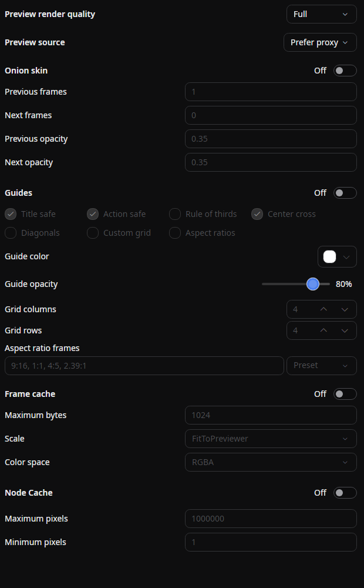

# Preview Settings

A tab that gathers the **options that affect only the editor preview** — preview render quality, the onion-skin overlay, guides, and the frame/node render caches. None of these settings are part of the scene, so they do not change the encoded output.

## Tab characteristics

- **Open by default**: No
- **Allow multiple instances**: No

## How to open

Open it from the menu bar via **View → Tools → Preview Settings**, or with the gear button on the preview.

## Preview render quality

Selects the resolution at which the editor renders the preview, trading image quality for speed. Lowering it makes playback and scrubbing smoother on heavy scenes.

- **Full** — render at the project resolution (output scale `1.0`).
- **Half (1/2)** — render at half resolution (`0.5`).
- **Quarter (1/4)** — render at quarter resolution (`0.25`).
- **Fit to previewer** — scale the frame to fit the on-screen previewer, capped at full resolution.

In this tab the setting **cannot be changed during playback**. The [resolution box](#controls-on-the-preview) on the preview pauses playback first. The setting is not saved with the project. Thanks to the [resolution-independent rendering pipeline](../../advanced/rendering-process.md), lowering the preview quality keeps vector shapes, text, and most effects sharp at the reduced size rather than simply pixelating the result.

## Preview source

Selects whether the preview plays [proxy media](./proxies.md) or the original files.

- **Prefer proxy** *(default)* — use a clip's proxy when one is available; fall back to the original otherwise.
- **Force original** — always decode the original media.

The change takes effect on the next frame without reloading the project. The same option is available in **Settings → Editor → Proxy media**, and export always uses the originals regardless of this setting.

## Onion skin

Overlays neighboring frames as translucent ghosts so you can see motion across frames — useful for hand-drawn animation and timing. Toggle it from this tab, with the **Onion skin** button on the preview, or with the **`Alt + O`** shortcut.

- **Onion skin** — master switch (off by default).
- **Previous frames** — how many frames before the current one to overlay (default `1`).
- **Next frames** — how many frames after the current one to overlay (default `0`).
- **Previous opacity** — opacity of the previous-frame ghosts (default `0.35`).
- **Next opacity** — opacity of the next-frame ghosts (default `0.35`).

## Guides

Draws safe areas and composition guides over the preview so you can check framing while you edit. Toggle them from this tab, with the **Guides** button on the preview, or with the **`Alt + G`** shortcut. Guides are off by default. The same settings are on the [Editor settings](../../settings/editor.md#guides) page.

Guides are drawn over the editor's preview only, including the HDR preview. They never appear in an export, the [preview window](#show-the-preview-in-another-window), or the [mobile preview](./mobile-preview.md).

- **Title safe** — the centered 90% of the frame (on by default).
- **Action safe** — the centered 95% of the frame (on by default).
- **Rule of thirds** — lines at each third of the frame.
- **Center cross** — a cross at the center of the frame (on by default).
- **Diagonals** — lines between opposite corners.
- **Custom grid** — a grid of **Grid columns** by **Grid rows**, from `1` to `64` each (default `4` by `4`).
- **Aspect ratios** — centered frames for the ratios in **Aspect ratio frames**.
- **Guide color** — the color of the lines (default white). Each line has a dark halo so it stays visible over any frame.
- **Guide opacity** — the opacity of the lines (default 80%).

**Aspect ratio frames** takes ratios separated by commas (default `9:16, 1:1, 4:5, 2.39:1`). Each one is outlined as the largest frame of that shape, centered. **Preset** fills in the frames of a platform: YouTube, YouTube Shorts, TikTok, Instagram Feed, Instagram Reels, or X.

## Controls on the preview {/* #controls-on-the-preview */}

The preview has its own controls for the settings you change most often.

- **Zoom box** (beside the transport buttons): Shows the current zoom. Choose **Fit preview** to fit the frame to the panel, or `10%` to `800%`. At `100%`, one pixel of the frame takes one pixel of the screen.
- **Resolution box**: The same choices as [Preview render quality](#preview-render-quality). **Fit to previewer** shows as **Auto** in the box.
- **Guides**, **Onion skin**, and **Checkerboard** buttons (in the column right of the frame): Toggle those overlays. The column also has **Show Preview in Another Window** and **Preview Settings**.

### Zooming and panning

| Action | How |
|--------|-----|
| Zoom in / out | `Ctrl` + wheel (`Cmd` + wheel on macOS) with any tool, a pinch, or `Alt + =` / `Alt + -` |
| Fit the frame to the panel | `Alt + 0`, or **Fit preview** in the zoom box |
| Pan a zoomed frame | The wheel with the **Move** or **Crop selection** tool (`Shift` for horizontal), or a drag with the **Hand** tool |

Zoom ranges from 0.05× to 64× of the fitted size. With the **Move** or **Crop selection** tool, the plain wheel does nothing while the frame fits; with the **Hand** tool it zooms. With **3D camera control**, `Ctrl` + wheel (`Cmd` + wheel) zooms the preview rather than moving the camera. Zoomed in far enough that a frame pixel is two screen pixels wide or more, the preview draws the frame's pixels as sharp squares. At fit, the frame stays smooth.

### Checkerboard

The **Checkerboard** button, or **`Alt + T`**, shows the frame's transparent parts over a checkerboard instead of black, so they stand apart from black ones. The squares are 8 pixels on screen in two grays, keep their size at any zoom, and move with the frame. Only the editor's preview changes: the preview window, exports, and saved images keep their transparency as before. The setting applies to every editor and is off by default.

### Seek bar and time

- The current and total times show in the [time display format](../../settings/editor.md#time-display-format): a timecode such as `00:00:02:15` by default, a time such as `00:00:02.50`, or a frame number such as `75`. Right-click the time to switch the format for the whole editor.
- Click the current time, or press `G`, to type a position to jump to. See [Playback and playhead navigation](./timeline.md#playback-and-playhead-navigation).
- Each marker shows as a mark in its color on the seek bar.
- Hover the seek bar to see the time under the pointer. Near a mark, the tip shows the marker's name above its time.
- A click on a mark moves the playhead exactly to the marker's time.
- The seek bar takes no keyboard focus, so after a click the arrow keys still step one frame.
- While you shuttle with `J` / `L`, the rate, such as `2×` or `−4×`, appears in place of the total time.
- Each transport button's tooltip shows its current shortcut.

## Show the preview in another window {/* #show-the-preview-in-another-window */}

The display button on the preview (**Show Preview in Another Window**) opens the preview's output in its own window, for example on a second monitor. The window shares the editor's playback, audio, and position, and leaves out selection boundaries, onion skin, and 3D editing handles. It keeps the HDR and tone-mapping settings.

- **Open in a Window** opens it on the editor's display.
- **Full Screen: *display* (*width* × *height*)** opens it full screen on that display. Each connected display is listed.
- While it is open, the menu offers **Toggle Full Screen (F11)** and **Close Preview Output**.
- **Mobile preview** opens the [Mobile preview](./mobile-preview.md) tab.

| Key in the preview window | Action |
|---------------------------|--------|
| `Space` | Play / pause |
| `←` / `→` | Pause, then step one frame back / forward |
| `F11` | Toggle full screen |
| `Esc` | Close the window |

Switching editor tabs, closing the source tab, or closing the editor also closes the window. Closing the window alone does not pause playback.

## Tone mapping and the HDR preview

**HDR Preview** and the tone mapping mode, including **Fit to display**, are in the [Editor settings](../../settings/editor.md#tone-mapping).

## Frame cache / Node cache

These two sections enable and tune the editor's render caches. See [Render cache](../../advanced/render-cache.md) for what each cache stores and how to size it.

## Source

- [`PreviewSettingsTabExtension.cs`](https://github.com/b-editor/beutl/blob/main/src/Beutl.Editor.Components/PreviewSettingsTab/PreviewSettingsTabExtension.cs)
- [`PreviewSettingsTabViewModel.cs`](https://github.com/b-editor/beutl/blob/main/src/Beutl.Editor.Components/PreviewSettingsTab/ViewModels/PreviewSettingsTabViewModel.cs)
- [`PreviewSettingsTabView.axaml`](https://github.com/b-editor/beutl/blob/main/src/Beutl.Editor.Components/PreviewSettingsTab/Views/PreviewSettingsTabView.axaml)
- [`PreviewGuideSettingsViewModel.cs`](https://github.com/b-editor/beutl/blob/fb0eb00b07159f8c1a96c308b38958e29590686a/src/Beutl.Editor.Components/PreviewSettingsTab/ViewModels/PreviewGuideSettingsViewModel.cs)
- [`PreviewGuideOverlay.cs`](https://github.com/b-editor/beutl/blob/fb0eb00b07159f8c1a96c308b38958e29590686a/src/Beutl/Views/PreviewGuideOverlay.cs)
- [`PlayerView.axaml.Presentation.cs`](https://github.com/b-editor/beutl/blob/fb0eb00b07159f8c1a96c308b38958e29590686a/src/Beutl/Views/PlayerView.axaml.Presentation.cs) / [`PresentationWindow.cs`](https://github.com/b-editor/beutl/blob/fb0eb00b07159f8c1a96c308b38958e29590686a/src/Beutl/Views/PresentationWindow.cs)
- [`EditorConfig.cs`](https://github.com/b-editor/beutl/blob/main/src/Beutl.Configuration/EditorConfig.cs) (onion-skin and cache settings)
- [`PlayerView.axaml`](https://github.com/b-editor/beutl/blob/dadee0db956ddb874ab88f48329bc84a5ce5cf6b/src/Beutl/Views/PlayerView.axaml) / [`PlayerView.axaml.Viewport.cs`](https://github.com/b-editor/beutl/blob/dadee0db956ddb874ab88f48329bc84a5ce5cf6b/src/Beutl/Views/PlayerView.axaml.Viewport.cs)
- [`PlayerSeekBar.cs`](https://github.com/b-editor/beutl/blob/dadee0db956ddb874ab88f48329bc84a5ce5cf6b/src/Beutl.Controls/PlayerSeekBar.cs) / [`PreviewCheckerboard.cs`](https://github.com/b-editor/beutl/blob/dadee0db956ddb874ab88f48329bc84a5ce5cf6b/src/Beutl.Engine/Media/PreviewCheckerboard.cs)
- [`SceneEditorExtension.Commands.cs`](https://github.com/b-editor/beutl/blob/dadee0db956ddb874ab88f48329bc84a5ce5cf6b/src/Beutl/Services/PrimitiveImpls/SceneEditorExtension.Commands.cs) (preview shortcuts)
- [`PlayerView.axaml.TimeDisplayFormat.cs`](https://github.com/b-editor/beutl/blob/70d09a97d4491bf6616e248fec809faa58e47db7/src/Beutl/Views/PlayerView.axaml.TimeDisplayFormat.cs) / [`Player.CurrentTimeEditor.cs`](https://github.com/b-editor/beutl/blob/70d09a97d4491bf6616e248fec809faa58e47db7/src/Beutl.Controls/Player.CurrentTimeEditor.cs) (the time on the preview)
