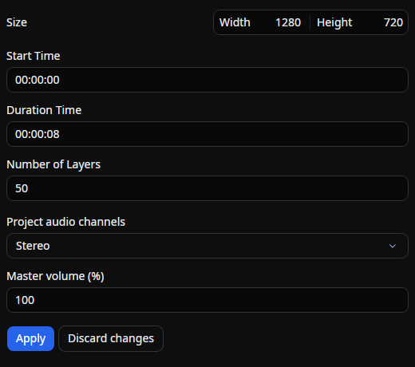

# Scene settings

A tab for configuring scene-wide settings of the open scene, such as **resolution, start time, duration, and layer count**, and the project's audio channels.
The values you enter are not applied to the scene immediately; they are committed together **when you press the Apply button**.

## Tab characteristics

- **Open by default**: No
- **Allow multiple instances**: No

## How to open

The Scene settings tab does not appear in the **View → Tools** menu. Open it in one of the following ways:

- From the menu bar via **Scene → Scene settings**
- From the context menu shown when you right-click on an empty area of the timeline, choose **Scene settings**

If it is already open, that tab will simply be selected.

## Layout

The settings are listed vertically, with the **Apply** and **Discard changes** buttons at the bottom.

- **Size**: The width and height of the scene (in pixels).
- **Start Time**: The start time of the scene. Specified as a string in `hh:mm:ss` format.
- **Duration Time**: The length of the scene. Specified as a string in `hh:mm:ss` format.
- **Number of Layers**: The maximum number of layers available on the timeline.
- **Project audio channels**: The speaker layout the whole project mixes in: **Mono**, **Stereo**, **5.1 surround**, or **7.1 surround**. See [Multichannel Audio](../../get-started/multichannel-audio.md).
- **Apply**: Commits the entered values to the scene. Available only when every field holds a valid value.
- **Discard changes**: Reverts the entered values to those currently saved in the scene.

## Input constraints

Each field has the following constraints. If a value does not satisfy them, an error is shown and the **Apply** button cannot be pressed.

- **Width / Height / Number of Layers**: Integer of 1 or greater
- **Start Time**: A duration that can be parsed as `hh:mm:ss`, and must be 0 or greater.
- **Duration Time**: A duration that can be parsed as `hh:mm:ss`, and must be greater than 0.

## Apply and history

When you press **Apply**, if the size, start time, duration, or project audio channels have changed, the change is recorded in the **undo/redo** history as one step. Changes to the number of layers are not recorded in the history and take effect immediately. A change of audio channels applies to every scene in the project and is written to the project file at once, including when you undo or redo it.

## Related documents

- [Create a project](../../get-started/create-project.md)
- [Project structure](../../get-started/project-structure.md)
- [Timeline](./timeline.md)

## Source

- [`SceneSettingsTabExtension.cs`](https://github.com/b-editor/beutl/blob/main/src/Beutl.Editor.Components/SceneSettingsTab/SceneSettingsTabExtension.cs)
- [`SceneSettingsTabViewModel.cs`](https://github.com/b-editor/beutl/blob/main/src/Beutl.Editor.Components/SceneSettingsTab/ViewModels/SceneSettingsTabViewModel.cs)
- [`SceneSettingsTabView.axaml`](https://github.com/b-editor/beutl/blob/main/src/Beutl.Editor.Components/SceneSettingsTab/Views/SceneSettingsTabView.axaml) / [`.axaml.cs`](https://github.com/b-editor/beutl/blob/main/src/Beutl.Editor.Components/SceneSettingsTab/Views/SceneSettingsTabView.axaml.cs)
- [`SceneSettingsService.cs`](https://github.com/b-editor/beutl/blob/fb0eb00b07159f8c1a96c308b38958e29590686a/src/Beutl.Editor/Services/SceneSettingsService.cs)
- [`MenuBarViewModel.Scene.cs`](https://github.com/b-editor/beutl/blob/main/src/Beutl/ViewModels/MenuBarViewModel.Scene.cs) (launched from the menu)
