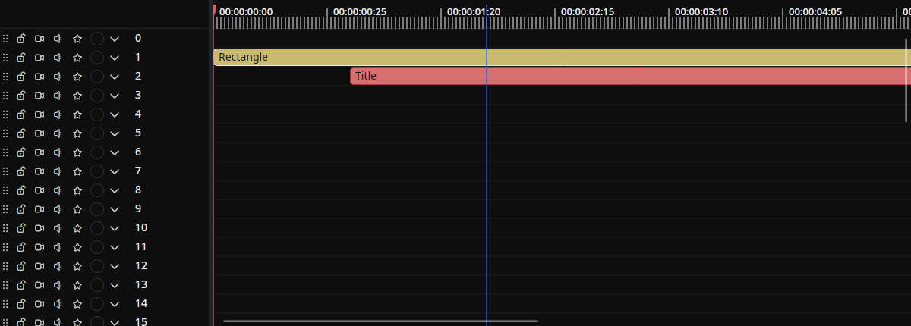

# Timeline

Use this tab to **arrange and edit the elements in a scene along the time axis**.
You can add, move, split, and group elements on each layer. The tab also lets you control the playback position and manage the frame cache and markers.

## Tab characteristics

- **Open by default**: Yes
- **Allow multiple instances**: No

## How to open

Open it from the menu bar via **View → Tools → Timeline**.

## Layout

- **Timeline scale (top)**: The time-axis ruler. Shows the playback position, scene start/end bars, markers, and the frame cache.
- **Layer headers (left)**: Toggle each layer's lock / video mute / audio mute / solo state, and change its color and name.
- **Timeline panel (center)**: The work area where elements are laid out across time and layers.

You can drag the splitters between the columns to change their widths.

## Working with elements

### Placing, moving, and resizing

- Drag an element's body to move it across layers or along the time axis.
- Hover near the left or right edge of an element to resize it (drag the edge to change the start time or duration).
- Hold **`Alt`** while dragging an element's body to drop a **duplicate** at the new position; the original stays in place. (When you drag an element's edge to resize it, holding **`Alt`** disables snapping instead.)
- If an element is so small that only the resize handles are visible, hold **`Ctrl`** while dragging to move it without resizing.
- While dragging, the edges snap to other elements, the scene start/end, the playhead, and the timeline origin. Toggle snapping from the empty-area right-click menu (**Snap**).

### Selection

- Click an element to select it; `Ctrl` (or `Cmd` on macOS) + click to add to or remove from the selection.
- `Ctrl` (`Cmd`) + drag on an empty area to select with a rectangular marquee.
- `Ctrl + A` (`Cmd + A`) selects every clip, and `Ctrl + Shift + A` (`Cmd + Shift + A`) clears the selection.

When **Move the playhead with a click on the timeline** is turned off in the [Editor settings](../../settings/editor.md#move-the-playhead-with-a-click-on-the-timeline), a click on the timeline leaves the playhead where it is, and a plain drag on an empty area selects clips. The playhead then moves from the ruler, or by dragging its line, where the cursor shows that it can be taken.

### Keyboard shortcuts

| Action | Windows / Linux | macOS |
|------|------|------|
| Copy | `Ctrl + C` | `Cmd + C` |
| Cut | `Ctrl + X` | `Cmd + X` |
| Paste | `Ctrl + V` | `Cmd + V` |
| Duplicate selected elements | `Ctrl + D` | `Cmd + D` |
| Select all / deselect all | `Ctrl + A` / `Ctrl + Shift + A` | `Cmd + A` / `Cmd + Shift + A` |
| Zoom in / out around the playhead | `Ctrl + =` / `Ctrl + -` | `Cmd + =` / `Cmd + -` |
| Reset zoom | `Ctrl + 0` | `Cmd + 0` |
| Delete selected elements | `Delete` or `Ctrl + Delete` | `Back` or `Cmd + Back` |
| Split by current frame | `Ctrl + K` | `Cmd + K` |
| Toggle group / ungroup | `Ctrl + G` | `Cmd + G` |
| Rename element | `F2` | `Enter` |
| Snap scene start time to current frame | `[` | `[` |
| Snap scene end time to current frame | `]` | `]` |
| Switch to Razor Tool | `C` | `C` |
| Switch to Slip Tool | `S` | `S` |
| Switch to Roll Tool | `R` | `R` |
| Switch to Slide Tool | `D` | `D` |
| Exit the current tool mode | `V` or `Esc` | `V` or `Esc` |
| Toggle Ripple Edit | `B` | `B` |
| Close gap after the selected element | `;` | `;` |
| Close all gaps | `Shift + Alt + ;` | `Shift + Alt + ;` |
| Go to next gap | `Shift + ;` | `Shift + ;` |
| Go to previous gap | `Alt + ;` | `Alt + ;` |
| Add / remove marker | `M` | `M` |
| Nudge element 1 frame left / right | `,` / `.` | `,` / `.` |
| Nudge element 10 frames left / right | `Shift + ,` / `Shift + .` | `Shift + ,` / `Shift + .` |
| Nudge element 1 second left / right | `Alt + ,` / `Alt + .` | `Alt + ,` / `Alt + .` |

You can also rename an element by double-clicking its body. Double-clicking a shared boundary or a transition performs a transition operation instead. The former **Exclude** command has been merged into **Delete**.

### Playback and playhead navigation

| Action | Windows / Linux | macOS |
|------|------|------|
| Play / pause | `Space` | `Space` |
| Step one frame back / forward | `←` / `→` | `←` / `→` |
| Jump to start / end | `Home` / `End` | `Cmd + ←` / `Cmd + →` |
| Shuttle backward / stop / forward | `J` / `K` / `L` | `J` / `K` / `L` |
| Shuttle backward / forward (fine) | `Shift + J` / `Shift + L` | `Shift + J` / `Shift + L` |
| Toggle loop playback | `/` | `/` |
| Previous / next marker | `Ctrl + ←` / `Ctrl + →` | `Alt + ←` / `Alt + →` |
| Previous / next keyframe (selected element) | `Ctrl + Shift + ←` / `Ctrl + Shift + →` | `Cmd + Shift + ←` / `Cmd + Shift + →` |

Press **`J`** / **`L`** to shuttle backward / forward — press again to go faster — and **`K`** to stop; add **`Shift`** for finer speed steps. Toggle looped playback with **`/`**.

Press **`G`** to open the **Goto timecode** dialog and jump the playhead to an exact position. It accepts a timecode (`hh:mm:ss.fff` or `mm:ss.fff`), an absolute frame (`#120` or `120f`), a relative offset (`+5s`, `-10f`, `+2m`), or a marker-name prefix (`@intro`).

### Command palette

Press **`Ctrl + Shift + P`** (`Cmd + Shift + P` on macOS) to open a searchable command palette that lists the available editor and tool-tab commands, so you can find and run an action — and see its shortcut — without hunting through the menus.

Commands can ask for text or a selection inside the palette. For example, open a recent project, change the theme, or rename the selected element. Rename, split at the current frame, and save as a template can run for the selected element even when the Timeline tab is closed. With the tab closed, saving as a template takes the selection the editor keeps, with each clip's group.

### Element right-click menu

- Toggle **Enable element**
- Toggle **Lock** (a locked element cannot be moved, trimmed, split, or deleted)
- Toggle **Razor Tool**
- Toggle **Ripple Edit**
- **Split** / **Split by current frame**
- **Auto Split by Silence** (for elements with audio; opens the [Auto Split by Silence](./silence-split.md) tab)
- **Cut** / **Copy** / **Delete**
- **Track Matte** submenu (see [Track mattes](#track-mattes))
- **Transition** submenu: **Start Transition** / **End Transition**
- **Group selected elements** / **Ungroup selected elements**
- **Rename**
- **Change to original length** (restore media elements and the like to their original duration)
- **Change color**
- Toggle **Disable Thumbnails**
- **Save as Template** (see [Saving clips as a template](#saving-clips-as-a-template))
- **Animation** submenu: **Finish editing** / **Bring to the top**

## Clip transitions

Right-click a clip and choose **Transition → Start Transition** or **End Transition** to open the [Transition](./transition.md) tab. If that edge has no transition, this adds a cross dissolve. Double-click a shared boundary between adjacent clips on the same layer to add a cross dissolve, or double-click an existing transition ramp to edit it. Drag a ramp's handle to adjust its duration.

## Track mattes

A track matte uses another layer's alpha or luminance to decide which parts of a clip show. For example, a hidden text clip can cut lettering out of a video, and an animated source updates with each frame.

1. Right-click the clip to mask and open **Track Matte**.
2. Choose a mode: **Alpha**, **Luma**, **Inverted Alpha**, or **Inverted Luma**. **None** (the default) turns the matte off.
3. Under **Source layer**, choose **Layer above** (the default), **Layer below**, or a specific layer. Choosing a source while the mode is **None** switches the mode to **Alpha**. Choosing **None** as the source turns the matte off.
4. To keep the source from drawing, right-click the source clip and turn off **Track Matte → Show in output**.

How the source is chosen:

- **Layer above** and **Layer below** use the nearest layer in that direction that has a clip at the current frame. They skip empty layers, so the source changes as clips begin and end.
- A specific layer stays selected when you reorder layers.

When there is no source clip at a frame, **Alpha** and **Luma** show nothing and the inverted modes show the whole clip.

A matte source ignores **Solo** and **Show in output**, but a layer with **Video** (video mute) on supplies nothing. **Show in output** affects the picture only, so a hidden clip's audio still plays. The masked clip keeps its blend mode against the layers below it.

A clip with a matte shows its source on the timeline: **↑** for the layer above, **↓** for the layer below, or an arrow and a layer number such as **↑ 3** for a specific layer. All of these settings are recorded in the undo history and are unavailable on a locked clip.

## Saving clips as a template

**Save as Template** saves the clips **Copy** would take, which are the selection plus every group it touches. A single clip saves on its own. Several clips save as one template, which the [Files](./file-browser.md) tab identifies as **Multiple Elements**.

Add it with **Add from Template**, from the Library, or by dropping the template file. Beutl recreates every clip with new IDs and keeps their relative start times, layers, names, lengths, and groups as one undo step. If the requested place is taken, the clips go to the nearest free place together; a locked requested layer refuses the template. Clips that overlap on one layer stay overlapped. A matte that names its source layer moves with the set, so it keeps the same source.

## Editing modes

Choose a tool mode from the **Editing Mode** submenu in the empty-area right-click menu, or use one of the keyboard shortcuts above. Only one tool mode can be active at a time. The timeline shows a colored border and the mode's name while it is active; press `V` or `Esc` to return to the normal selection tool.

- **Razor Tool** (`C`): Click an element to split it at that position.
- **Slip Tool** (`S`): Drag a clip to shift its source-media window (in/out points) without moving the clip on the timeline.
- **Roll Tool** (`R`): Drag a clip edge to move the boundary with its neighbor while preserving the total length.
- **Slide Tool** (`D`): Drag a clip to move it while the neighboring clips compensate, preserving the total length.

### Ripple Edit

**Ripple Edit** (`B`) is an on/off setting, not a tool mode. It stays enabled until you turn it off, and Beutl remembers its state between sessions. When enabled, the following operations shift later clips on the same layer to close (or open) the resulting space:

- **Delete** / **Cut**
- Trimming an element's edge

Locked layers stay in place. A locked clip acts as an anchor, so the ripple does not propagate past it.

## Closing and navigating gaps

Empty spaces between clips on the same layer are treated as **gaps**. Use the **Gaps** submenu in the empty-area right-click menu or the keyboard shortcuts below:

- **Close Gap**: closes one gap. The menu command uses the gap at the right-click position; the shortcut (`;`) uses the gap after the selected element. The clips move by exactly the gap's width. If a clip would then overlap a locked clip, nothing moves and Beutl shows **There are no gaps to close**.
- **Close All Gaps** (`Shift + Alt + ;`): closes every gap on every layer. Locked layers are skipped. A locked clip stops the shift: nothing moves across it, the gaps after it close towards it, and a gap stays open if closing it would overlap a locked clip.
- **Go to Next Gap** (`Shift + ;`) / **Go to Previous Gap** (`Alt + ;`): moves the playback position to the next or previous gap from the current frame.

## Locking, muting, and soloing

### Locking elements

Use **Lock** in an element's right-click menu to lock or unlock it. A locked element appears semi-transparent with a lock icon and cannot be moved, trimmed, split, renamed, or deleted. It also acts as an anchor for ripple and gap operations.

### Layer toggles

Each layer header includes four toggle buttons:

- **Lock**: locks every clip on the layer. Locked layers are also excluded from ripple and gap operations.
- **Video** (video mute): the layer is skipped when compositing video; its audio still plays.
- **Audio** (audio mute): the layer is skipped when compositing audio; its video is still shown.
- **Solo**: when at least one layer is soloed, layers that are not soloed are neither shown nor heard. You can solo multiple layers at the same time.

## Working in the timeline panel

### Mouse wheel

- Wheel scrolls along the time axis.
- `Ctrl` (`Cmd`) + wheel zooms in and out.
- `Shift` + wheel scrolls vertically.

### Right-click menu on empty area

- **Editing Mode** submenu: toggle **Razor Tool** / **Slip Tool** / **Roll Tool** / **Slide Tool** / **Ripple Edit**
- **Add Element** / **Add from Template** (pick from items registered in the library)
- **Add Adjustment Layer** (adds a [Backdrop](../library/drawables/sources/backdrop.md)-based element; filter effects you add to it apply to the layers below it)
- **Paste** (elements, files, or images on the clipboard). When nothing can be pasted, for example onto a locked layer or before the project is saved, the timeline says why.
- **Set start time** / **Set end time** (snap to the click position)
- **Gaps** submenu: **Close Gap** (the gap at the click position) / **Close All Gaps** / **Go to Next Gap** / **Go to Previous Gap**
- Toggle **Automatically adjusts scene duration**
- Toggle **Snap**
- **Settings** (open the Scene settings tab)
- **BPM Grid** (configure BPM, beat, and offset)
- **Zoom**: 20% / 50% / 70% / 100% / 120% / 150% / 170% / 200%

### Drag and drop

- Drop an item from the Library (drawables, templates, etc.) to add an element.
- Drop a file (image, including [SVG](../library/drawables/sources/image.md), video, audio, or template JSON) to add an element.
- Drop several files to add them all in one undo step. They line up one after another from the drop point, in name order with numbers in order (`1`, `2`, `10`). Sound-only files go on a layer of their own from the same frame, so background music runs under the pictures. Files that no decoder can open are left out.
- Drop a subtitle file (SRT, WebVTT, or ASS/SSA) to add one text clip per cue at the times the file gives, on new layers above the scene. See [Subtitle files](#subtitle-files).

### Subtitle files {/* #subtitle-files */}

A dropped subtitle file becomes one text clip per cue, named after the file. Cues that overlap in time go on separate layers, and locked layers are skipped. One undo removes the whole drop. Files written by Windows subtitle tools also read correctly: UTF-16 with a byte order mark, and the system's legacy code page.

When you have saved [templates](#saving-clips-as-a-template) that hold text, a **Text template** menu opens where you dropped the file. Click **Default** or a template to add the clips; press `Esc` or click elsewhere to give up the whole drop. The template you chose last comes first, under the pointer. A template can be a saved text object, an element, or several elements:

- Every text object in the template takes the cue's text, including those inside a drawable group.
- A single element follows the cue's start and length and keeps its position.
- In a set of elements, elements as long as a text element fit the cue with it, like a band behind the text. Other elements, such as a flourish, keep their length and lose only what would outlast the cue. A set keeps its relative layers, groups, and track mattes.

## Inline animation editing

This feature shows a property-specific lane directly under an element so you can edit keyframe animations on the timeline without opening the Graph Editor tab.

### Opening and closing

- Click the **vertical three-dot menu (⋮)** to the right of a property and choose **Edit animation in inline view** to add an inline lane below that element.
- The same property's animation cannot be opened inline twice at once.
- Close it with the **× button** in the inline lane's header (the property's animation itself remains).
- The element's right-click menu → **Animation → Finish editing** closes all of that element's inlines at once.

### Inline lane layout

- **Header (layer-header side)**
  - Reorder handle (drag vertically to change the order of inlines within the same element)
  - **× (close)** button
  - **Open** button: open the same animation in the Graph Editor tab
  - Property name text box (read-only)
- **Timeline side**
  - A border showing the element's frame
  - The **easing curve** between adjacent keyframes (drawn upward or downward depending on whether the next value is higher, lower, or the same)
  - A **diamond icon** for each keyframe

### Working with keyframes

- **Left-drag** to change a keyframe's time.
  - On release, the time is snapped (rounded) to the scene's frame rate.
  - The post-drop value is recorded in the undo/redo history.
- **`Shift` + drag** moves the other keyframes in the same inline along with the dragged one (preserving their relative offsets).
- Keyframe right-click menu:
  - **Copy** — copies just that keyframe to the clipboard as JSON.
  - **Paste** — pastes at that keyframe's position (if the type doesn't match, only the easing is applied).
  - **Delete** — deletes that keyframe.

### Inline lane right-click menu

Right-clicking an empty area of the lane (not on a keyframe) shows the following:

- **Copy All** — copy this property's entire animation as JSON.
- **Paste** — paste a keyframe or animation at the mouse position.
  - If the clipboard holds a keyframe: insert the keyframe at the mouse position. If a keyframe already exists at the same time, its value and easing are overwritten.
  - If the clipboard holds an entire animation: replace the existing animation in its entirety.
  - If the pasted keyframe's property type doesn't match, only the easing is applied.
- **Delete** — delete this property's animation in its entirety (the property reverts to a static value).

### Drag-and-dropping easings

Dropping a Library easing item onto an inline lane behaves differently depending on the drop position:

- If there is an existing keyframe near the drop position, it **changes that keyframe's easing**.
- If there is no nearby keyframe, it **inserts a new keyframe** at the drop position and applies the specified easing to that transition.

### Reordering and display order

- When multiple inlines are open on the same layer, drag the reorder handle on the header vertically to change the order.
- The element's right-click menu → **Animation → Bring to the top** moves all of that element's inlines to the top of the layer at once.

### Global clock and element clock

When an animation's **Use the Global Clock** is enabled, moving the element does not change where keyframes appear — they are always drawn at the same time position regardless of the element's start time.

## Timeline scale (top ruler)

- Click or drag on the scale to move the playhead.
- Drag the red scene start/end bars to change the scene's start time and duration.
- Click a marker on the upper part of the scale to edit it; drag to move it.
- Right-click the frame-cache display along the bottom edge for **Delete All / Delete / Lock / Unlock**.

## Layer headers

- Drag the handle at the left edge up or down to change the layer's height.
- Toggle **Lock** / **Video** (video mute) / **Audio** (audio mute) / **Solo** with the four buttons (see [Locking, muting, and soloing](#locking-muting-and-soloing)).
- Change the layer color with the color picker.
- Change the layer name in the text box.

## Trackpad haptic feedback

On a macOS trackpad, Beutl gives a haptic pulse when a drag reaches an alignment target:

- **Timeline**: a clip move, an edge trim, or a roll or slide trim reaches a new snap target.
- **Preview**: a `Shift` rotation with the transform handles reaches a new 15° step.
- **Number fields**: a [scrub](./element-property.md#scrubbing-number-values) reaches or crosses zero or the property's default value, including each component of a vector.
- **[Node Graph](./node-graph.md)**: a wire snaps to a port it can connect to.

Staying on a target, releasing the drag, keyboard edits, and undo or redo do not repeat the pulse. Beutl has no setting for it; macOS applies your own trackpad feedback settings.

## Auto-scroll during playback

Depending on the **Settings > Editor > Timeline auto-scroll during playback** setting, the timeline scrolls automatically to follow the playback position during playback.

## Related documents

- [Add Elements](../../get-started/add-element.md)
- [Edit Elements](../../get-started/edit-element.md)
- [Keyframes](../../get-started/keyframe.md)
- [Scene settings](./scene-settings.md)
- [Graph Editor](./graph-editor.md)

## Source

- [`TimelineTabExtension.cs`](https://github.com/b-editor/beutl/blob/f9cbaeef9da0077f6745010a2d69955e12c45187/src/Beutl.Editor.Components/TimelineTab/TimelineTabExtension.cs)
- [`TimelineTabViewModel.cs`](https://github.com/b-editor/beutl/blob/f9cbaeef9da0077f6745010a2d69955e12c45187/src/Beutl.Editor.Components/TimelineTab/ViewModels/TimelineTabViewModel.cs)
- [`TimelineTabView.axaml`](https://github.com/b-editor/beutl/blob/f9cbaeef9da0077f6745010a2d69955e12c45187/src/Beutl.Editor.Components/TimelineTab/Views/TimelineTabView.axaml) / [`.axaml.cs`](https://github.com/b-editor/beutl/blob/f9cbaeef9da0077f6745010a2d69955e12c45187/src/Beutl.Editor.Components/TimelineTab/Views/TimelineTabView.axaml.cs)
- [`ElementView.axaml`](https://github.com/b-editor/beutl/blob/f9cbaeef9da0077f6745010a2d69955e12c45187/src/Beutl.Editor.Components/TimelineTab/Views/ElementView.axaml) / [`.axaml.cs`](https://github.com/b-editor/beutl/blob/f9cbaeef9da0077f6745010a2d69955e12c45187/src/Beutl.Editor.Components/TimelineTab/Views/ElementView.axaml.cs)
- [`InlineAnimationLayerViewModel.cs`](https://github.com/b-editor/beutl/blob/f9cbaeef9da0077f6745010a2d69955e12c45187/src/Beutl.Editor.Components/TimelineTab/ViewModels/InlineAnimationLayerViewModel.cs)
- [`InlineKeyFrameViewModel.cs`](https://github.com/b-editor/beutl/blob/f9cbaeef9da0077f6745010a2d69955e12c45187/src/Beutl.Editor.Components/TimelineTab/ViewModels/InlineKeyFrameViewModel.cs)
- [`InlineAnimationLayer.axaml`](https://github.com/b-editor/beutl/blob/f9cbaeef9da0077f6745010a2d69955e12c45187/src/Beutl.Editor.Components/TimelineTab/Views/InlineAnimationLayer.axaml) / [`.axaml.cs`](https://github.com/b-editor/beutl/blob/f9cbaeef9da0077f6745010a2d69955e12c45187/src/Beutl.Editor.Components/TimelineTab/Views/InlineAnimationLayer.axaml.cs)
- [`InlineAnimationLayerHeader.axaml`](https://github.com/b-editor/beutl/blob/f9cbaeef9da0077f6745010a2d69955e12c45187/src/Beutl.Editor.Components/TimelineTab/Views/InlineAnimationLayerHeader.axaml) / [`.axaml.cs`](https://github.com/b-editor/beutl/blob/f9cbaeef9da0077f6745010a2d69955e12c45187/src/Beutl.Editor.Components/TimelineTab/Views/InlineAnimationLayerHeader.axaml.cs)
- [`InlineEasingGraphControl.cs`](https://github.com/b-editor/beutl/blob/f9cbaeef9da0077f6745010a2d69955e12c45187/src/Beutl.Editor.Components/TimelineTab/Views/InlineEasingGraphControl.cs)
- [`PropertyEditorMenu.axaml.cs`](https://github.com/b-editor/beutl/blob/f9cbaeef9da0077f6745010a2d69955e12c45187/src/Beutl.Editor.Components/PropertyEditors/Views/PropertyEditorMenu.axaml.cs) (entry point for the inline view)
- [`LayerHeader.axaml`](https://github.com/b-editor/beutl/blob/f9cbaeef9da0077f6745010a2d69955e12c45187/src/Beutl.Editor.Components/TimelineTab/Views/LayerHeader.axaml) / [`LayerHeaderViewModel.cs`](https://github.com/b-editor/beutl/blob/f9cbaeef9da0077f6745010a2d69955e12c45187/src/Beutl.Editor.Components/TimelineTab/ViewModels/LayerHeaderViewModel.cs) (layer lock / mute / solo)
- [`RippleHelper.cs`](https://github.com/b-editor/beutl/blob/f9cbaeef9da0077f6745010a2d69955e12c45187/src/Beutl.Editor/Services/RippleHelper.cs) (ripple edit)
- [`ElementGapService.cs`](https://github.com/b-editor/beutl/blob/f9cbaeef9da0077f6745010a2d69955e12c45187/src/Beutl.Editor/Services/ElementGapService.cs) (gap operations)
- [`ElementSlipService.cs`](https://github.com/b-editor/beutl/blob/f9cbaeef9da0077f6745010a2d69955e12c45187/src/Beutl.Editor/Services/ElementSlipService.cs) / [`ElementResizeService.cs`](https://github.com/b-editor/beutl/blob/f9cbaeef9da0077f6745010a2d69955e12c45187/src/Beutl.Editor/Services/ElementResizeService.cs) (slip / roll / slide trims)
- [`TimelineTabExtension.Commands.cs`](https://github.com/b-editor/beutl/blob/dadee0db956ddb874ab88f48329bc84a5ce5cf6b/src/Beutl.Editor.Components/TimelineTab/TimelineTabExtension.Commands.cs)
- [`MainViewExtension.cs`](https://github.com/b-editor/beutl/blob/f9cbaeef9da0077f6745010a2d69955e12c45187/src/Beutl/Services/PrimitiveImpls/MainViewExtension.cs)
- [`ElementStructureService.cs`](https://github.com/b-editor/beutl/blob/f9cbaeef9da0077f6745010a2d69955e12c45187/src/Beutl.Editor/Services/ElementStructureService.cs)
- [`Scene.Gaps.cs`](https://github.com/b-editor/beutl/blob/fb0eb00b07159f8c1a96c308b38958e29590686a/src/Beutl.ProjectSystem/ProjectSystem/Scene.Gaps.cs)
- [`ElementView.TrackMatte.cs`](https://github.com/b-editor/beutl/blob/fb0eb00b07159f8c1a96c308b38958e29590686a/src/Beutl.Editor.Components/TimelineTab/Views/ElementView.TrackMatte.cs) / [`SceneCompositor.TrackMatte.cs`](https://github.com/b-editor/beutl/blob/fb0eb00b07159f8c1a96c308b38958e29590686a/src/Beutl.ProjectSystem/SceneCompositor.TrackMatte.cs)
- [`TemplateSaving.cs`](https://github.com/b-editor/beutl/blob/fb0eb00b07159f8c1a96c308b38958e29590686a/src/Beutl.Editor.Components/Helpers/TemplateSaving.cs) / [`ElementSet.cs`](https://github.com/b-editor/beutl/blob/fb0eb00b07159f8c1a96c308b38958e29590686a/src/Beutl.ProjectSystem/ProjectSystem/ElementSet.cs)
- [`NativeHapticFeedback.cs`](https://github.com/b-editor/beutl/blob/fb0eb00b07159f8c1a96c308b38958e29590686a/src/Beutl.Controls/Helpers/NativeHapticFeedback.cs)
- [`FileDropLayout.cs`](https://github.com/b-editor/beutl/blob/dadee0db956ddb874ab88f48329bc84a5ce5cf6b/src/Beutl.Editor.Components/TimelineTab/FileDropLayout.cs) / [`CaptionFileDrop.cs`](https://github.com/b-editor/beutl/blob/dadee0db956ddb874ab88f48329bc84a5ce5cf6b/src/Beutl.Editor.Components/TimelineTab/CaptionFileDrop.cs) (dropped files and subtitle files)
- [`ElementCaptionTemplateAdapter.cs`](https://github.com/b-editor/beutl/blob/dadee0db956ddb874ab88f48329bc84a5ce5cf6b/src/Beutl.Editor/Services/Captions/ElementCaptionTemplateAdapter.cs) (element templates as subtitle templates)
