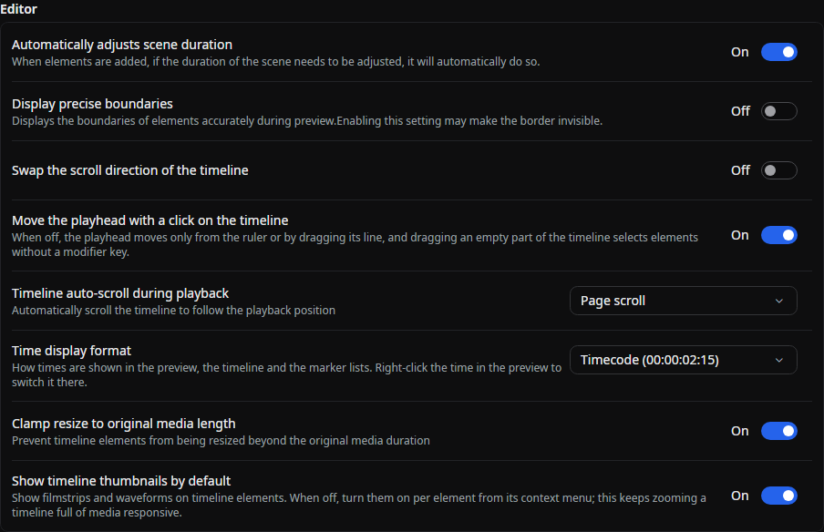
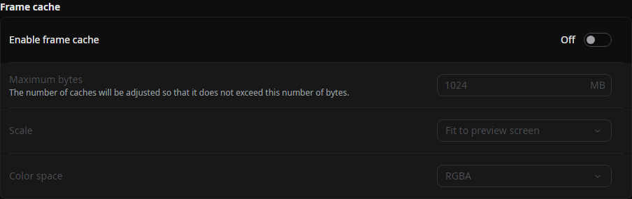
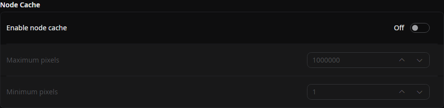
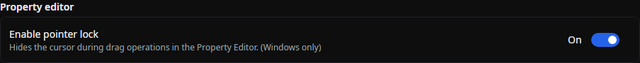

## Automatically Adjust Scene Length

When enabled, the scene length will be automatically adjusted when an element is added if necessary.

## Auto-Save

Edits are saved automatically after changes are committed. Auto-save is always enabled; the former **Enable Auto-Save** switch has been removed.

See [Editing Elements](../get-started/edit-element.md#recovering-damaged-elements) for how Beutl protects element files that could not be fully restored.

## Show Precise Boundaries

When enabled, the boundaries displayed during the preview will be shown precisely.

For objects like rectangles, the boundary lines might overlap with the drawing content, making the boundaries invisible.

## Move the Playhead with a Click on the Timeline

When on, a click on the timeline moves the playhead. When off, the playhead moves only from the ruler or by dragging its line, so an accidental click on an empty part of the timeline leaves it where it is, and a plain drag on an empty part selects elements without a modifier key. See [Timeline](../reference/tool-tabs/timeline.md#selection).

The default setting is __"On"__.

## Show Timeline Thumbnails by Default

Shows filmstrips and waveforms on timeline elements. When off, elements show none until you turn off **Disable Thumbnails** in an element's right-click menu, which keeps zooming a timeline full of media responsive. An element's own choice is kept only where it differs from this setting, so the other elements follow the setting when it changes.

The default setting is __"On"__.

## Frame Cache

### Enable Frame Cache

When enabled, frame caching is activated.

The default setting is __"Off"__.

### Maximum Byte Size

Adjust the cache size to not exceed this byte size (in megabytes).

The default value is half of the memory available to the .NET runtime. This follows a container or job memory limit when one is configured, rather than always using the device's physical memory.

### Scale

When saving the cache to memory, use this setting to reduce resolution to save memory.

- Original
- Match preview screen __(default value)__
- Half
- Quarter

:::tip
:::
  If the preview screen size is equal to or larger than the original size, the resolution remains unchanged.

### Color Space

When saving the cache to memory, use this setting to change the color space to save memory.

- RGBA __(default value)__
- YUV

:::tip
YUV uses I420.
:::

## Node Cache

### Enable Node Cache

When enabled, node caching is activated.

The default setting is __"Off"__.

### Maximum Pixel Count

Nodes exceeding this pixel count will not be cached.

The default value is __"1000000"__.

### Minimum Pixel Count

Nodes below this pixel count will not be cached.

The default value is __"1"__.

## Proxy Media

These settings control the [proxy media workflow](../reference/tool-tabs/proxies.md).

### Preview Source

Controls whether the preview uses proxy media.

- Prefer proxy __(default value)__
- Force original

### Store Location

Proxy files are stored in this folder.

The default location is the `proxies` folder in Beutl's home directory. A change takes effect after Beutl restarts.

### Maximum Store Size

When the store exceeds this size (in GiB), Beutl removes the least-recently-used proxies.

The default value is __"50"__ GiB (allowed range: 5–500). A change takes effect after Beutl restarts.

### Default Preset

Sets the quality preset initially selected in the Proxies tool tab.

- Half proxy (1/2)
- Quarter proxy (1/4) __(default value)__
- Eighth proxy (1/8)

## Property Editor

### Enable Pointer Lock

Locks the cursor and hides it during drag operations in the property editor (Windows only).

The default setting is __"On"__.

## Tone Mapping

These settings control how the preview fits frames to the display. They affect the preview, the [preview window](../reference/tool-tabs/preview-settings.md#show-the-preview-in-another-window), and the mobile preview's SDR stream, but not exports.

### HDR Preview

Uses HDR rendering for the preview, so values above SDR white can show on a display with headroom. The HDR preview works like the SDR one: transform handles, the path editor, [guides](#guides), and the crop rectangle appear over the frame, the frame zooms and pans, and the preview takes clicks, drags, the wheel, and its context menu. On macOS it draws at the display's device pixels.

The default setting is __"Off"__.

### Tone mapping

Selects how the preview fits values the display cannot show.

- Auto __(default value)__
- None
- Reinhard
- ACES
- Hable
- Fit to display

__Auto__ works as __Fit to display__ while the HDR preview is on a display that shows HDR, and as __None__ everywhere else: the SDR preview, the mobile preview's SDR stream, and the HDR preview on an SDR display. On macOS it follows the screen the preview is on, also when the window moves to another screen. On Windows a display in SDR mode counts as SDR.

__Fit to display__ rolls off only what the display cannot show and keeps hue, where the other modes clip each channel or compress the whole range. Colors outside the display's gamut move toward the gray of their own luminance, and colors the display can show stay as they are. It treats content as peaking at 1000 nits with reference white at 203 nits.

| Preview | Highlights | Colors |
|---------|------------|--------|
| HDR Preview on macOS | Core Animation tone maps the frame into the screen's current headroom and follows brightness changes. | Fit into the screen's own gamut, so P3 colors show on a P3 screen. |
| HDR Preview on Windows, display in HDR mode | Rolled off into the display's peak, or __Display peak luminance__ when set. | Fit into the display's primaries. |
| HDR Preview on Windows, display not in HDR mode | Rolled off into the display's white. | Fit into sRGB in SDR mode, or the display's primaries with Auto Color Management. |
| HDR Preview on Linux | Passed through, because the display's headroom is not known. | Left as they are. |
| Without HDR Preview, on a surface without HDR support, and the mobile preview's SDR stream | Rolled off into SDR white. | Fit into sRGB. |

:::note
__Auto__ uses __Fit to display__ only where the display shows HDR because on a display with no headroom the curve also lowers SDR white to about 0.78, so an SDR project would look darker in the preview than it exports. A __None__ saved by an earlier version, which was the old default, reads as __Auto__.
:::

On a Windows HDR display, the HDR preview shows reference white at the display's SDR white level in every mode, so it matches the white of the editor's UI.

### Exposure

Adjusts the exposure level for tone mapping, from `-5` to `5`.

The default value is __"0"__.

### Display peak luminance (nits)

The peak that __Fit to display__ rolls highlights off into on a Windows HDR display, for a monitor that reports a wrong peak or none. `0` uses the peak Windows reports. Values range from `0` to `10000`. The description shows what the display reports, or that it is not in HDR mode.

This setting appears on Windows only. The default value is __"0"__.

## Guides

The safe areas and composition guides over the preview. These are the same settings as in the [Preview Settings](../reference/tool-tabs/preview-settings.md#guides) tab, which describes each guide.

- __Show guides__: turns all guides on or off. The default setting is __"Off"__.
- __Guides to show__: Title safe, Action safe, Rule of thirds, Center cross, Diagonals, Custom grid, and Aspect ratios.
- __Guide color__, __Guide opacity__, __Grid columns__, __Grid rows__, and __Aspect ratio frames__.

## Source

- [`EditorConfig.cs`](https://github.com/b-editor/beutl/blob/dadee0db956ddb874ab88f48329bc84a5ce5cf6b/src/Beutl.Configuration/EditorConfig.cs)
- [`EditViewModel.cs`](https://github.com/b-editor/beutl/blob/f9cbaeef9da0077f6745010a2d69955e12c45187/src/Beutl/ViewModels/EditViewModel.cs)
- [`AutoSaveService.cs`](https://github.com/b-editor/beutl/blob/f9cbaeef9da0077f6745010a2d69955e12c45187/src/Beutl.Editor/AutoSaveService.cs)
- [`EditorSettingsPage.axaml`](https://github.com/b-editor/beutl/blob/dadee0db956ddb874ab88f48329bc84a5ce5cf6b/src/Beutl/Pages/SettingsPages/EditorSettingsPage.axaml)
- [`VulkanSwapchainRenderer.cs`](https://github.com/b-editor/beutl/blob/fb0eb00b07159f8c1a96c308b38958e29590686a/src/Beutl.Engine/Graphics/Backend/Vulkan/VulkanSwapchainRenderer.cs)
- [`WindowsDisplayLuminance.cs`](https://github.com/b-editor/beutl/blob/fb0eb00b07159f8c1a96c308b38958e29590686a/src/Beutl.Engine/Graphics/Backend/Vulkan/WindowsDisplayLuminance.cs)
- [`HdrBitmapView.cs`](https://github.com/b-editor/beutl/blob/dadee0db956ddb874ab88f48329bc84a5ce5cf6b/src/Beutl.Controls/HdrBitmapView.cs)
- [`HdrOverlay.cs`](https://github.com/b-editor/beutl/blob/dadee0db956ddb874ab88f48329bc84a5ce5cf6b/src/Beutl.Controls/HdrOverlay.cs)
