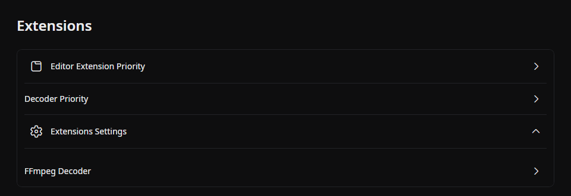
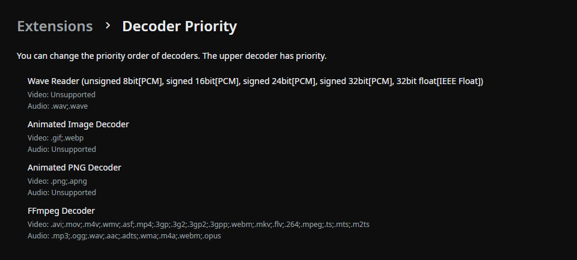
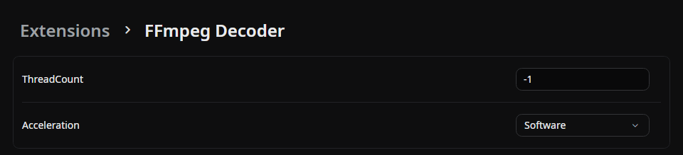
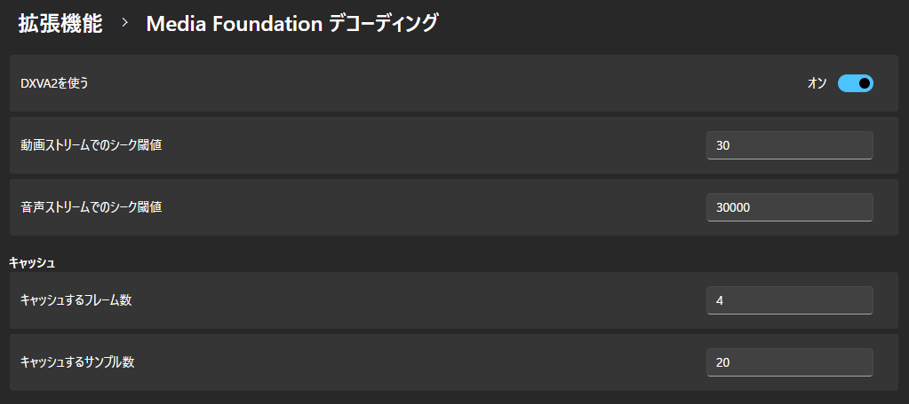

## Decoder Priority

Change the priority of decoders.
The decoder at the top of the list is given priority.

## Extension Settings

Change individual settings for extensions.

### FFmpeg Decoder

#### ThreadCount

Set the number of threads to use for decoding.

If a value less than 0 is specified, the device's thread count (up to 16) is used.  
If 0 is specified, FFmpeg will automatically detect the number of threads.

The default value is __"-1"__.

#### Acceleration

Set the hardware acceleration used for decoding.

- Software __(default value)__
- Auto
- VDPAU
- CUDA
- VAAPI
- DXVA2
- QSV
- VideoToolbox
- D3D11VA
- DRM
- OpenCL
- MediaCodec
- Vulkan

:::note
The **ForceSrgbGamma** setting in the screenshot was removed in 2.0.0-preview.10, and a saved value is ignored. The decoder now reads SDR video by its color tags. See [Before updating](../get-started/install.md#before-updating).
:::

### Media Foundation Decoding

#### Use DXVA2

Use DirectX Video Acceleration 2.0 to decode videos quickly.

The default setting is __"On"__.

#### Video Stream Seek Threshold

Seek when a frame farther than this frame count is loaded.

The default value is __"30"__.

#### Audio Stream Seek Threshold

Seek when a sample farther than this sample count is loaded.

The default value is __"30000"__.

#### Number of Frames to Cache

The default value is __"4"__.

#### Number of Samples to Cache

The default value is __"20"__.

## Source

- [`FFmpegDecodingSettings.cs`](https://github.com/b-editor/beutl/blob/fb0eb00b07159f8c1a96c308b38958e29590686a/src/Beutl.Extensions.FFmpeg.Core/Decoding/FFmpegDecodingSettings.cs)
