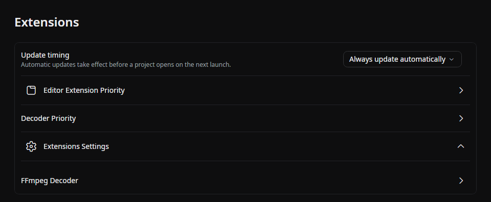
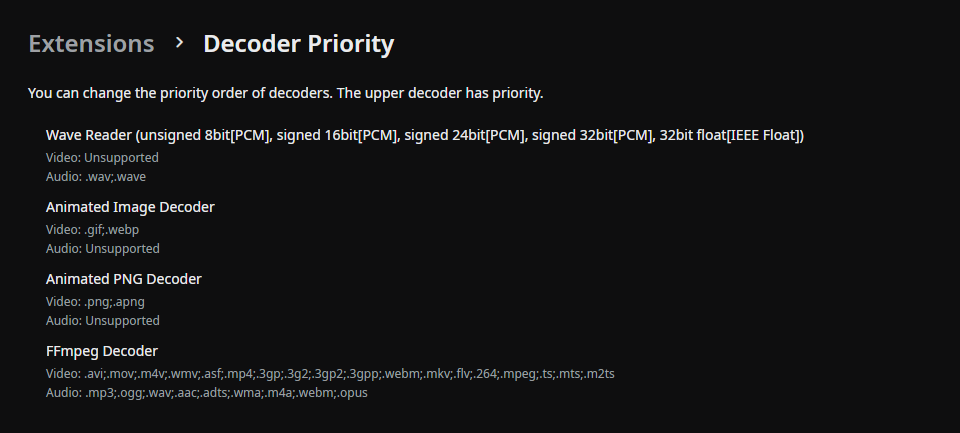
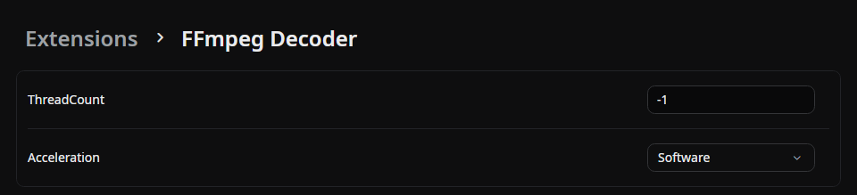
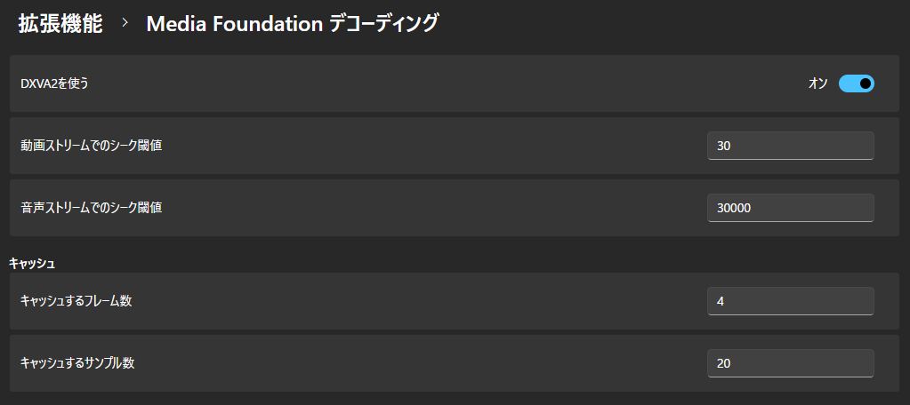

## Update timing {/* #update-timing */}

Choose when extensions installed from the store update. Automatic updates take effect before a project opens on the next launch.

- **Notify only**: When Beutl starts, it checks for updates and shows **Package updates are available.** Its **Open** button opens **Library** in the **Extensions** window, where you update them yourself.
- **With Beutl updates**: When Beutl prepares an [update of itself](../get-started/install.md#updating-beutl), it also downloads the extension releases for the new version, and the new version applies them when it starts. The ready notification says how many are included. If you update Beutl another way, the new version looks for them when it first starts. Between Beutl updates, you are notified as with **Notify only**.
- **Always update automatically** __(default value)__: Beutl also downloads extension updates when it starts, when you choose this option, and every six hours while it runs.

Beutl updates an extension only to a release that supports the Beutl version that will load it, and checks each download against the digest the store publishes. An extension that asks you to accept its license, and materials and templates, are left for you to update. After a launch that applied updates, a notification says **Automatic extension update complete**.

Change the priority of decoders.
The decoder at the top of the list is given priority.

## Extension Settings

Change individual settings for extensions.

### FFmpeg Decoder

#### ThreadCount

Set the number of threads to use for decoding.

If a value less than 0 is specified, the device's thread count (up to 16) is used.  
If 0 is specified, FFmpeg will automatically detect the number of threads.

The default value is __"-1"__.

#### Acceleration

Set the hardware acceleration used for decoding.

- Software __(default value)__
- Auto
- VDPAU
- CUDA
- VAAPI
- DXVA2
- QSV
- VideoToolbox
- D3D11VA
- DRM
- OpenCL
- MediaCodec
- Vulkan

### Media Foundation Decoding

#### Use DXVA2

Use DirectX Video Acceleration 2.0 to decode videos quickly.

The default setting is __"On"__.

#### Video Stream Seek Threshold

Seek when a frame farther than this frame count is loaded.

The default value is __"30"__.

#### Audio Stream Seek Threshold

Seek when a sample farther than this sample count is loaded.

The default value is __"30000"__.

#### Number of Frames to Cache

The default value is __"4"__.

#### Number of Samples to Cache

The default value is __"20"__.

## Source

- [`FFmpegDecodingSettings.cs`](https://github.com/b-editor/beutl/blob/fb0eb00b07159f8c1a96c308b38958e29590686a/src/Beutl.Extensions.FFmpeg.Core/Decoding/FFmpegDecodingSettings.cs)
- [`UpdateConfig.cs`](https://github.com/b-editor/beutl/blob/4ca0cc18507a50d94678d11a386fd477dd75125e/src/Beutl.Configuration/UpdateConfig.cs) / [`ExtensionsSettingsPage.axaml`](https://github.com/b-editor/beutl/blob/4ca0cc18507a50d94678d11a386fd477dd75125e/src/Beutl/Pages/SettingsPages/ExtensionsSettingsPage.axaml)
- [`CheckForPackageUpdatesTask.cs`](https://github.com/b-editor/beutl/blob/4ca0cc18507a50d94678d11a386fd477dd75125e/src/Beutl/Services/StartupTasks/CheckForPackageUpdatesTask.cs) / [`LoadInstalledExtensionTask.cs`](https://github.com/b-editor/beutl/blob/4ca0cc18507a50d94678d11a386fd477dd75125e/src/Beutl/Services/StartupTasks/LoadInstalledExtensionTask.cs)
- [`PackageManager.ExtensionUpdates.cs`](https://github.com/b-editor/beutl/blob/4ca0cc18507a50d94678d11a386fd477dd75125e/src/Beutl.Api/Services/PackageManager.ExtensionUpdates.cs) / [`PackageInstaller.ExtensionUpdates.cs`](https://github.com/b-editor/beutl/blob/4ca0cc18507a50d94678d11a386fd477dd75125e/src/Beutl.Api/Services/PackageInstaller.ExtensionUpdates.cs)
