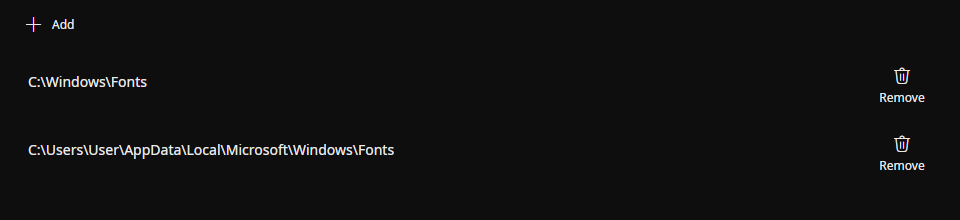
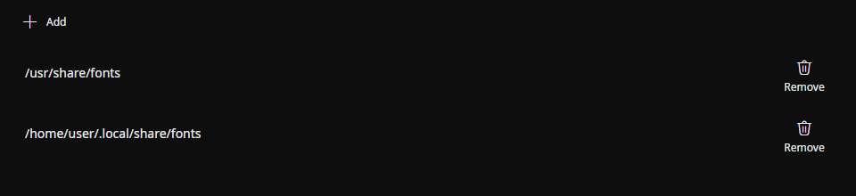

Set the directory to load fonts from.

**Example for Windows**

**Example for Linux**

## Finding a font in the property editor

The font picker searches the font family's names in all languages provided by the font. For example, both `Yu Gothic` and `游ゴシック` can find the same family, regardless of the UI language.

Search ignores letter case, full-width versus half-width forms, and hiragana versus katakana. You can omit spaces and hyphens (`notosans` finds `Noto Sans`) or enter several words to narrow the results. Closer matches appear first, ahead of pinned fonts.

## Source

- [`FontFamilyNames.cs`](https://github.com/b-editor/beutl/blob/f9cbaeef9da0077f6745010a2d69955e12c45187/src/Beutl.Controls/PropertyEditors/FontFamilyNames.cs)
- [`FontFamilySearchQuery.cs`](https://github.com/b-editor/beutl/blob/f9cbaeef9da0077f6745010a2d69955e12c45187/src/Beutl.Controls/PropertyEditors/FontFamilySearchQuery.cs)
- [`FontFamilyPickerFlyoutViewModel.cs`](https://github.com/b-editor/beutl/blob/f9cbaeef9da0077f6745010a2d69955e12c45187/src/Beutl.Controls/PropertyEditors/FontFamilyPickerFlyoutViewModel.cs)
