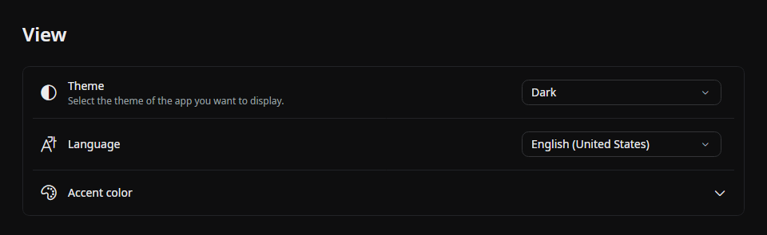
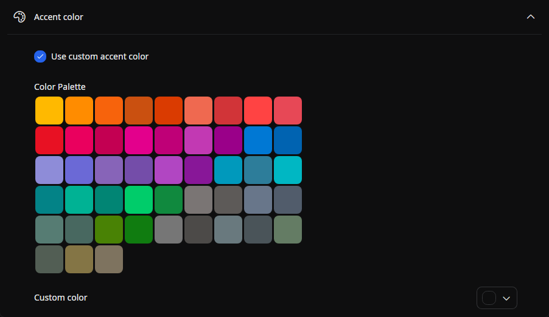

## Theme

- **Dark** — Beutl's own near-black design. This is the default.
- **Dark (Classic)** — the plain dark theme, without the design overrides that **Dark** layers on top of it.
- **Light**
- **High Contrast**
- **Follow System**

A theme can bring its own accent color, which is used unless you set an [accent color](#accent-color) of your own. **Dark** uses a blue accent (`#2563EB`); the other built-in themes leave the accent to the OS.

Extensions can add themes of their own, and any theme they register appears in this list alongside the built-in ones. See [Types of Extensions You Can Develop](../extensions/available-extensions.md).

:::note
Settings from Beutl 1.x are migrated automatically. A profile that had **Light**, **High Contrast**, or **Follow System** selected keeps that theme; one that was still on the old default gets the new **Dark** design theme.
:::

## Language

- Japanese
- English
- Simplified Chinese
- Korean
- Spanish

## Accent Color

You can set any color.

## Use Native Context Menus

Shows right-click menus as standard macOS menus, with the system's look, keyboard handling, and accessibility. The text box menu becomes a native menu too. The change applies from the next menu you open, without a restart.

Native menus follow the system's light or dark appearance rather than the Beutl theme, and they show no item icons. A menu that holds something a native menu cannot show, such as a header that is not text, keeps Beutl's own look. Turn this off to bring back Beutl's menus everywhere.

This setting appears on macOS only. The default setting is __"On"__.

## Source

- [`LocalizeService.cs`](https://github.com/b-editor/beutl/blob/v2.0.0-preview.8/src/Beutl.Language/LocalizeService.cs)
- [`ViewSettingsPageViewModel.cs`](https://github.com/b-editor/beutl/blob/dadee0db956ddb874ab88f48329bc84a5ce5cf6b/src/Beutl/ViewModels/SettingsPages/ViewSettingsPageViewModel.cs)
- [`NativeContextMenus.cs`](https://github.com/b-editor/beutl/blob/dadee0db956ddb874ab88f48329bc84a5ce5cf6b/src/Beutl.Controls/NativeContextMenu/NativeContextMenus.cs)
