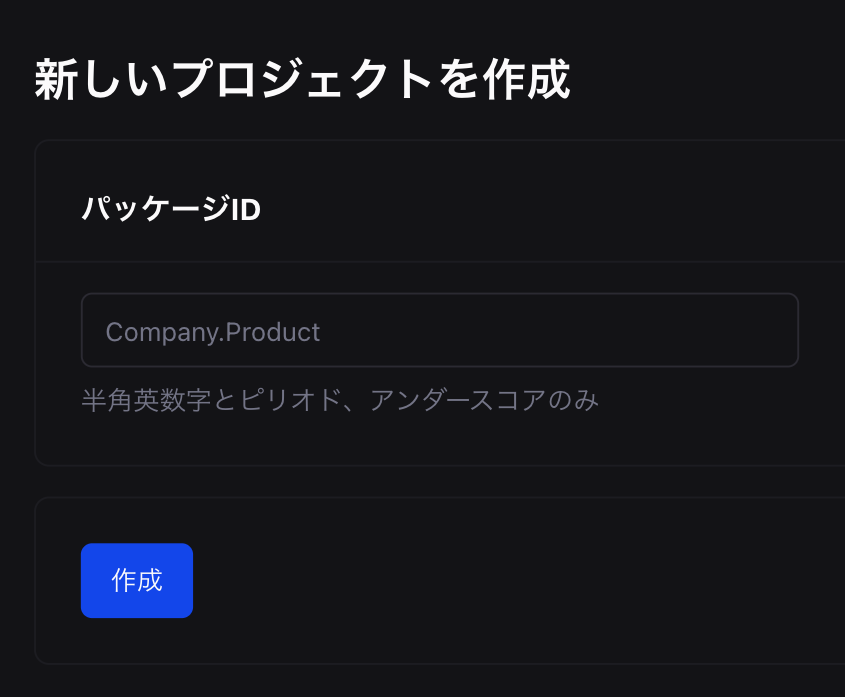
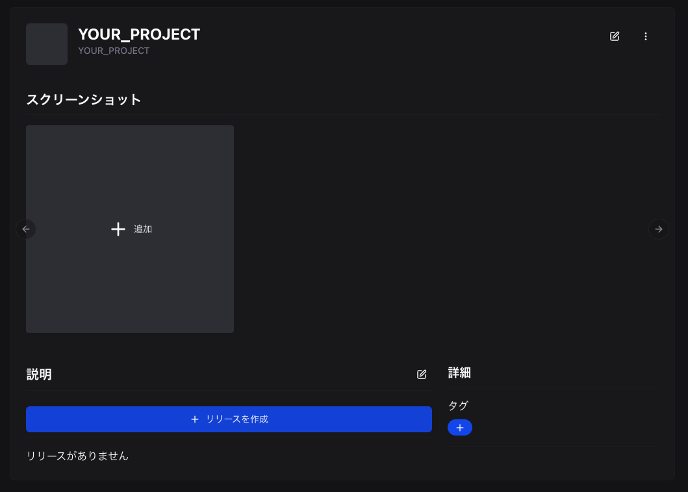
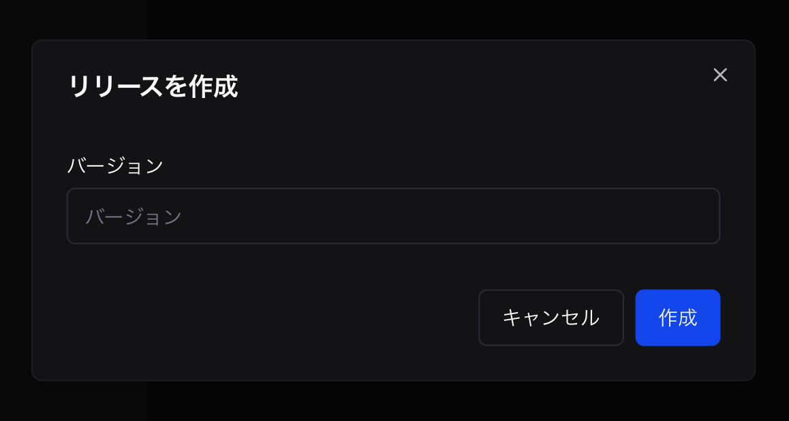
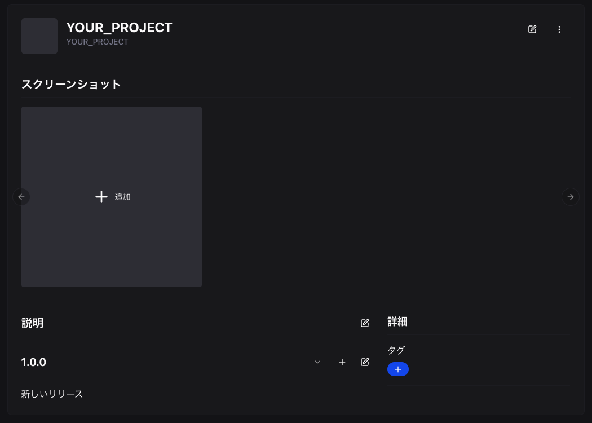
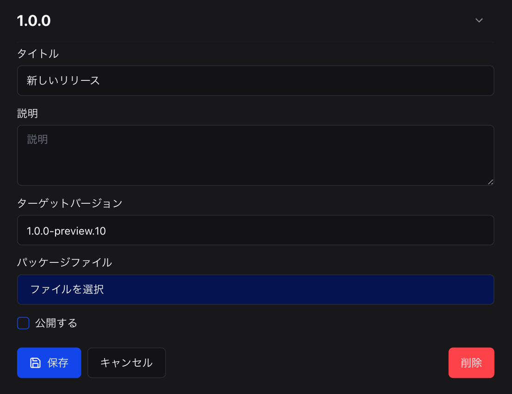
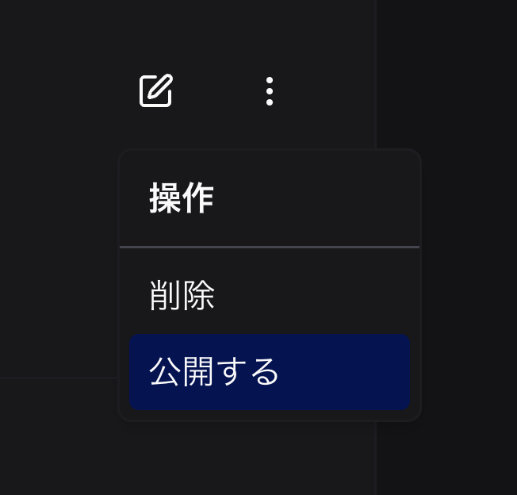

Beutlの拡張機能をストアに公開する方法を説明します。

_ここでは、C#プロジェクトの名前を`YOUR_PROJECT`としています。_

## NuGetパッケージを作成
`YOUR_PROJECT.csproj`があるディレクトリで以下のコマンドを実行します。
```sh
dotnet pack -c Release
```

実行すると以下のように`YOUR_PROJECT.1.0.0.nupkg`ファイルが生成されます。
```
YOUR_PROJECT
┣━ YOUR_PROJECT.csproj
┗━ bin
    ┗━ Release
        ┗━ YOUR_PROJECT.1.0.0.nupkg
```

## パッケージを新規作成
1. [デベロッパー](https://beutl.beditor.net/ja/developer)にアクセスします。
2. サインインしていない場合はサインインします。
3. __[新しい拡張機能を作成]__ をクリックします。
   
4. パッケージID (ここでは、YOUR_PROJECT) を入力します。
5. __[作成]__ をクリックします。
   

## リリースを作成

1. __[リリースを作成]__ をクリックします。
   
2. バージョンを入力します。
   
3. __[作成]__ をクリックします。
4. リリースが作成されます。
   
5. 編集ボタンをクリックします。
6. __[ファイルを選択]__ をクリックします。
   
7. `YOUR_PROJECT.1.0.0.nupkg` を選択します。

8. __[公開する]__ をクリックします。
   （最終的にユーザーがダウンロードできるようにするにはパッケージ側の公開設定を変更する必要があります）
9. __[保存]__ をクリックします。

## パッケージを公開


__[公開する]__ をクリックします。

## ターゲットバージョンと自動更新 {/* #target-version-and-automatic-updates */}

リリースには、そのリリースが動作する Beutl のバージョンを示す **「ターゲットバージョン」** もあります。`2.0.0-preview.16` のようなバージョン（そのバージョン以降を意味します）か、`[2.0.0-preview.16, 2.0.0-preview.17)` のような NuGet のバージョン範囲を指定します。Beutl は、ターゲットバージョンに含まれる Beutl のバージョンに対してだけ、リリースを提示またはインストールします。

preview.14 以降、Beutl はユーザーが別の設定を選ばない限り、インストール済みのストアの拡張機能を自動で更新します。**「設定」→「拡張機能」→「更新のタイミング」** の既定値が **「常に自動更新」** だからです。この場合、Beutl は起動時と、実行中は 6 時間ごとに確認し、条件に合う最新のリリースをダウンロードして検証し、次回の起動時にプロジェクトを開く前に適用します。**「Beutl本体と一緒に更新」** では、Beutl の更新時に新しいバージョンの Beutl に合うリリースを準備し、**「通知のみ」** ではユーザーがインストールします。公開したリリースは多くのユーザーにクリックなしで届くため、ターゲットバージョンには動作を確認した Beutl のバージョンだけを含めてください。

## 素材とテンプレートのパッケージ

配布する素材を `.nupkg` の最上位の `materials/` に、オブジェクトテンプレートを `templates/` に配置してください。

利用者向けの手順は[素材とテンプレート](../get-started/packages.md)を参照してください。

## ソース

- [`PackageInstaller.Data.cs`](https://github.com/b-editor/beutl/blob/v2.0.0-preview.8/src/Beutl.Api/Services/PackageInstaller.Data.cs)
- [`UpdateConfig.cs`](https://github.com/b-editor/beutl/blob/main/src/Beutl.Configuration/UpdateConfig.cs), [`CheckForPackageUpdatesTask.cs`](https://github.com/b-editor/beutl/blob/main/src/Beutl/Services/StartupTasks/CheckForPackageUpdatesTask.cs) and [`PackageCompatibility.cs`](https://github.com/b-editor/beutl/blob/main/src/Beutl.Api/Services/PackageCompatibility.cs)
