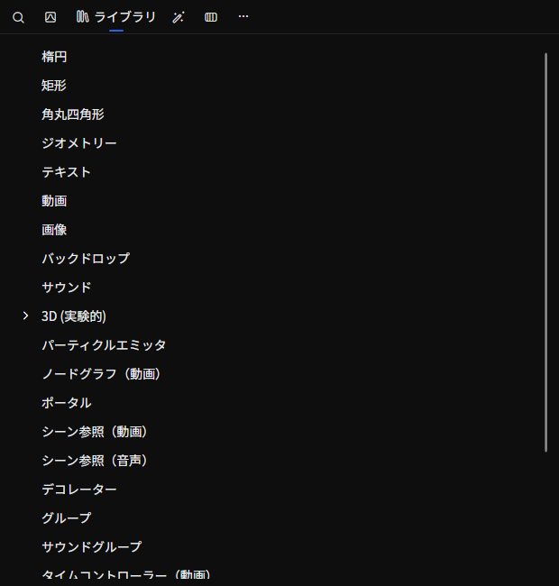

作成したプロジェクト/シーンに要素を追加するには、
3つの方法があります。

## 方法1
- 追加する要素の種類をライブラリからタイムラインの追加したい位置にドラッグアンドドロップして追加します。

<video controls muted playsInline title="" src="_images/4.add-element/timeline-drag-and-drop.mp4" />

## 方法2
- タイムライン上の追加したい位置で右クリックをします。
- __要素を追加__ をクリックし追加します。

<video controls muted playsInline title="" src="_images/4.add-element/timeline-right-click.mp4" />

この方法では、空の要素が作成されるため、
後から動画、画像、テキストなどの描画オブジェクトをライブラリからドラッグアンドドロップする必要があります。

## 方法3
- 追加したい動画、音声、画像ファイルをタイムラインの追加したい位置にドラッグアンドドロップして追加します。
- SVG ファイルは、どの大きさでもくっきり表示される画像として追加されます。
- 複数のファイルを一度にドロップすると、ドロップ位置から順に並び、音声だけのファイルは別のレイヤーに置かれます。
- 字幕ファイル（SRT、WebVTT、ASS/SSA）は、字幕ごとに 1 つのテキストクリップになります。[字幕ファイル](../reference/tool-tabs/timeline.md#subtitle-files)を参照してください。

<video controls muted playsInline title="" src="_images/4.add-element/file-drag-and-drop.mp4" />
