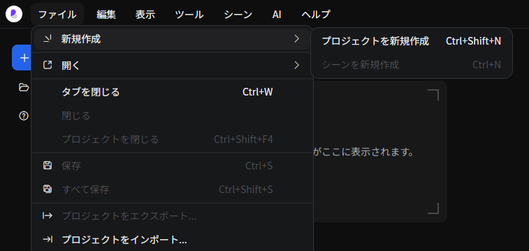
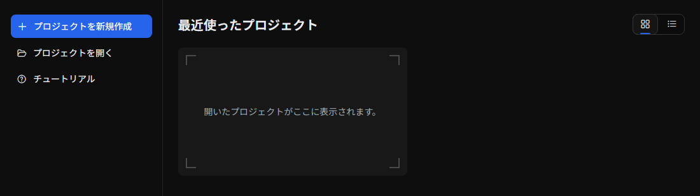
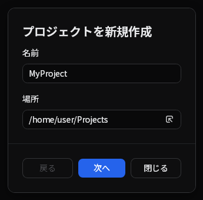
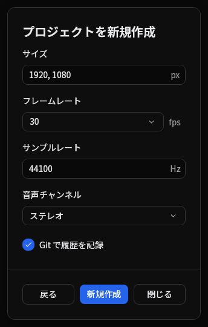

ウィンドウメニューの __ファイル > 新規作成 > プロジェクト__ または、  

スタートスクリーンの __プロジェクトを新規作成__ をクリックします。  

プロジェクトの名前と保存場所を指定します。  

__[次へ]__ をクリックします。  

フレームレートとサンプリングレート、音声チャンネル、初期シーンの横幅、高さを指定します。  
  
プロジェクトのサンプリングレートは、プレビュー音声と新しい出力設定の既定値に使われます。フレームレートは一覧の候補に加え、正の整数や `30000/1001` のような分数を入力できます。

**音声チャンネル** はプロジェクトのスピーカー配置です。**モノラル**、**ステレオ**（既定）、**5.1ch サラウンド**、**7.1ch サラウンド** から選びます。後から[シーン設定](../reference/tool-tabs/scene-settings.md)で変更できます。[マルチチャンネル音声](./multichannel-audio.md)を参照してください。

__[新規作成]__ をクリックするとプロジェクトを作成することができます。

Gitが利用できる場合は **Git で履歴を記録** を選択して、作成時からバージョン管理を開始できます。[バージョン管理](../reference/tool-tabs/version-control.md)を参照してください。

## スタート画面と最近使ったプロジェクト

スタート画面には **プロジェクトを新規作成**、**プロジェクトを開く**、**チュートリアル** があります。その横の **最近使ったプロジェクト** には、開いたプロジェクトが最近開いた順に、サムネイルのグリッドまたはリストで表示されます。**グリッド表示** と **リスト表示** のボタンで切り替えられ、選んだ表示は記憶されます。

- プロジェクトを 1 回クリックすると開き、`Enter` で選択中のプロジェクトを開きます。右クリックではメニューだけが開きます。
- サムネイルは、プロジェクトを最後に閉じたときに画面に表示されていたフレームです。再生位置に何も表示されていなかったときは、シーンの要素の中ほどのフレームを使います。更新後にまだ閉じていないプロジェクトはプレースホルダーを表示します。サムネイルはプロジェクトの `.beutl/thumbnails` フォルダーに保存されます。

ほかの種類のファイルを開いたり、シーンを作成したりするには **ファイル** メニューを使います。新しいシーンを作るには、プロジェクトを開いている必要があります。

プロジェクトを右クリックすると、**開く**、**Finderで開く**（Windows では **エクスプローラーで開く**、Linux では **ファイルマネージャーで開く**）、**削除**、**ディスクから完全に削除** を選べます。**ディスクから完全に削除** を選ぶと、ファイルを完全に削除できます。確認ダイアログには、専用のプロジェクトフォルダーとその内容を削除するのか、共有場所にあるプロジェクトファイルだけを削除するのかが表示されます。開いているプロジェクトは、閉じてから削除してください。

**削除** は最近の一覧から項目を取り除くだけで、ディスク上のファイルは残ります。

## ソース

- [`EditorHostFallback.axaml`](https://github.com/b-editor/beutl/blob/dadee0db956ddb874ab88f48329bc84a5ce5cf6b/src/Beutl/Views/EditorHostFallback.axaml) / [`.axaml.cs`](https://github.com/b-editor/beutl/blob/dadee0db956ddb874ab88f48329bc84a5ce5cf6b/src/Beutl/Views/EditorHostFallback.axaml.cs)
- [`ProjectThumbnailService.cs`](https://github.com/b-editor/beutl/blob/dadee0db956ddb874ab88f48329bc84a5ce5cf6b/src/Beutl/Services/ProjectThumbnailService.cs)
- [`ProjectDiskDeletion.cs`](https://github.com/b-editor/beutl/blob/v2.0.0-preview.8/src/Beutl/Services/ProjectDiskDeletion.cs)
- [`CreateNewProjectViewModel.cs`](https://github.com/b-editor/beutl/blob/fb0eb00b07159f8c1a96c308b38958e29590686a/src/Beutl/ViewModels/Dialogs/CreateNewProjectViewModel.cs)
- [`EditViewModel.cs`](https://github.com/b-editor/beutl/blob/f9cbaeef9da0077f6745010a2d69955e12c45187/src/Beutl/ViewModels/EditViewModel.cs)
- [`OutputViewModel.cs`](https://github.com/b-editor/beutl/blob/f9cbaeef9da0077f6745010a2d69955e12c45187/src/Beutl/ViewModels/Tools/OutputViewModel.cs)
