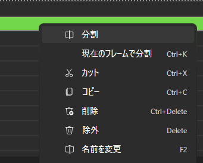

要素にエフェクトなどを追加したり、移動させたりする方法を説明します。

## 前提知識

このページでは __描画オブジェクト__ という用語を用いて説明します。
詳細は[こちら](../advanced/rendering-process.md)をご覧ください。

## エフェクトを追加
まずは追加したい要素をタイムライン上で選択します。
右側のプロパティエディターに選択している要素のプロパティが表示されます。

描画オブジェクトに直接エフェクトを追加する場合は、
__フィルタエフェクト__ の `+` ボタンをクリックして、追加したいエフェクトを選びます。  
<video controls muted playsInline title="" src="_images/5.edit-element/add-effect-in-property-editor.mp4" />

または、ライブラリから追加したいエフェクトを __フィルタエフェクト__ にドラッグアンドドロップすると追加できます。  
<video controls muted playsInline title="" src="_images/5.edit-element/add-effect-via-library.mp4" />

## トランスフォーム
トランスフォームを使用すると、移動、回転、スケール、歪みなどを表現できます。

描画オブジェクトに直接トランスフォームを設定する場合は、
__トランスフォーム__ の `+` ボタンをクリックして、追加したいトランスフォームの種類を選びます。

### プレビュー上でトランスフォームを編集

プレビューの **移動** ツールが有効で再生が停止しているとき、選択中のオブジェクトの周囲にトランスフォームハンドルが表示され、画面上で直接編集できます。

- **中央** をドラッグして位置を変更（`移動` トランスフォームを追加／更新）。
- **コーナーまたは辺** のハンドルをドラッグしてスケール（`スケール` トランスフォームを追加／更新）。
- コーナーの少し外側にある **回転** ハンドルをドラッグして回転（`回転` トランスフォームを追加／更新）。

ハンドルをドラッグすると、対応するトランスフォームがまだ無い場合は自動的に追加されます。フィルターエフェクトの中に追加したトランスフォームは、プレビューからは編集できません。

<video controls muted playsInline title="" src="_images/5.edit-element/add-transform.mp4" />

## 参照先を選ぶ {/* #reference-targets */}

既存のシーン、描画オブジェクト、エフェクト、トランスフォーム、ブラシを参照するプロパティには、対象を選ぶ欄が表示されます。欄をクリックして、一覧から対応する対象を選びます。シーンの参照にはプロジェクト内の他のシーン、オブジェクトの参照には現在のシーン内の対応する対象が表示されます。循環参照になる対象は除かれます。

欄には参照先の名前が表示されます。参照を解除するには三点メニューから **なし** を選びます。対象を選ぶと既存のオブジェクトを参照し、コピーは作成しません。

## プロパティの単位と時間の入力

単位が定義されたプロパティでは、ラベルに割合の **(%)**、角度の **(°)**、倍率の **(×)** が表示されます。ノードのポートのエディタにも同じ単位が表示されます。たとえば、2D のスケールはパーセント、3D のスケールは倍率です。

時間のプロパティは、引き続き `00:00:01.500` のような時間の文字列で表示・入力します。preview.9 ではメディアの時刻を flick 数の整数で保存しますが、この入力欄に flick 数を入力する必要はありません。

## 要素の時間を編集
タイムラインでマウスのドラッグ操作をすることで、
要素の開始時間、持続時間を編集することができます。

Beutlでは編集を簡単にするため、ドラッグ操作中に他のレイヤーの要素の時間にスナップします。
タイムラインの何もない場所を右クリックし、**スナップ** で有効・無効を切り替えられます。要素の端をリサイズするときは `Alt` を押すと一時的にスナップを無効にします。要素本体を `Alt` を押しながらドラッグすると複製します。

<video controls muted playsInline title="" src="_images/5.edit-element/move-element.mp4" />

## 要素を分割
タイムラインで分割したい要素を右クリックして、メニューの分割ボタンをクリックすることで要素を分割できます。
`Ctrl + K`（macOS では `Cmd + K`）を使うと、選択している要素を現在のフレームで分割できます。

## 要素の名前を変更
Beutlでは要素の色や名前を変えることができ、
それぞれ、右クリックメニューから変更できます。

名前は `F2`（macOS では `Enter`）または要素本体のダブルクリックで変更できます。トランジションや隣接クリップとの境界のダブルクリックは、[トランジションの操作](../reference/tool-tabs/transition.md)になります。

## 欠損メディアを再リンクする

元のファイルが移動した、または見つからない場合は、欠損メディアの通知から **修復ツールを開く** を選びます。[欠損メディアを再リンク](../reference/tool-tabs/missing-media.md) タブで差し替えるファイルを指定し、他の欠損ファイルの候補を確認して修復を適用できます。

## 破損した要素の復旧

要素のデータが破損している場合や、必要な拡張機能がインストールされていない場合は、読み込めない部分が代替の要素やオブジェクトとして表示されます。認識できないデータを保持できる場合は要素を引き続き編集でき、保存時にもそのデータを維持します。代替オブジェクトが保存に対応する共通プロパティも編集できます。

保存すると読み込んだデータの一部が失われる場合は、元の要素ファイルを保護し、読み込めなかった内容の削除・置き換えを除いて読み取り専用にします。必要な拡張機能や破損したファイルを復元してプロジェクトを開き直すか、該当する内容を修復してください。シーンの他の部分は引き続き編集できます。

## ソース

- [`SceneRecovery.cs`](https://github.com/b-editor/beutl/blob/f9cbaeef9da0077f6745010a2d69955e12c45187/src/Beutl.ProjectSystem/ProjectSystem/SceneRecovery.cs)
- [`ReferencePropertyEditorViewModel.cs`](https://github.com/b-editor/beutl/blob/f9cbaeef9da0077f6745010a2d69955e12c45187/src/Beutl.Editor.Components/PropertyEditors/ViewModels/ReferencePropertyEditorViewModel.cs)
- [`ReferencePropertyEditor.axaml`](https://github.com/b-editor/beutl/blob/f9cbaeef9da0077f6745010a2d69955e12c45187/src/Beutl.Editor.Components/PropertyEditors/Views/ReferencePropertyEditor.axaml)
- [`PropertyEditorViewModel.cs`](https://github.com/b-editor/beutl/blob/f9cbaeef9da0077f6745010a2d69955e12c45187/src/Beutl.Editor/PropertyEditors/PropertyEditorViewModel.cs)
- [`MediaTimeEditor.cs`](https://github.com/b-editor/beutl/blob/f9cbaeef9da0077f6745010a2d69955e12c45187/src/Beutl.Controls/PropertyEditors/MediaTimeEditor.cs)
- [`TimelineTabExtension.Commands.cs`](https://github.com/b-editor/beutl/blob/f9cbaeef9da0077f6745010a2d69955e12c45187/src/Beutl.Editor.Components/TimelineTab/TimelineTabExtension.Commands.cs)
- [`SceneRecovery.ElementRestore.cs`](https://github.com/b-editor/beutl/blob/f9cbaeef9da0077f6745010a2d69955e12c45187/src/Beutl.ProjectSystem/ProjectSystem/SceneRecovery.ElementRestore.cs)
- [`Element.cs`](https://github.com/b-editor/beutl/blob/f9cbaeef9da0077f6745010a2d69955e12c45187/src/Beutl.ProjectSystem/ProjectSystem/Element.cs)
- [`MediaTimeJsonConverter.cs`](https://github.com/b-editor/beutl/blob/f9cbaeef9da0077f6745010a2d69955e12c45187/src/Beutl.Core/JsonConverters/MediaTimeJsonConverter.cs)
