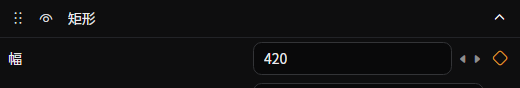
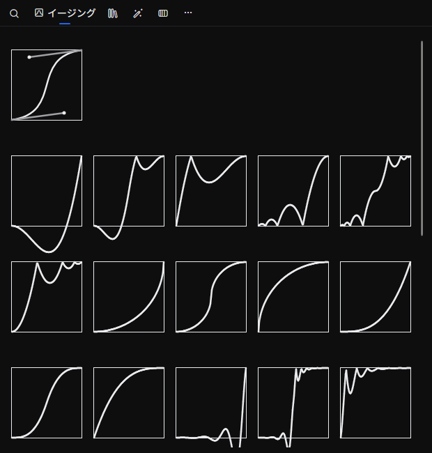
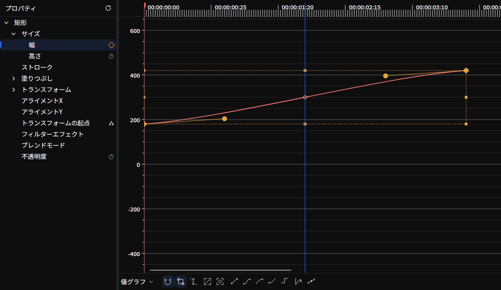

Beutlではキーフレームを用いて、
さまざまオブジェクトにアニメーション効果をつけることができます。

ここではキーフレームが何なのかについては説明しません。
すでに知っているものとして進めます。

## 準備
アニメーションを有効にする方法です。
1. アニメーション効果をつけたいプロパティの ︙ (三点リーダ縦) をクリックします。

2. __インライン表示でアニメーションを編集__ または __アニメーションを編集__ をクリックします。

3. アニメーションが有効になり、︙ (三点リーダ縦) が ◇ (ダイアモンド型) のアイコンになります。
   この状態では、右クリックすることでメニューを開けます。

<video controls muted playsInline title="" src="_images/6.keyframe/enable-animation.mp4" />

## キーフレームを追加/削除

キーフレームを追加したいフレームで、◇ をクリックします。
◆ のようになればキーフレームが追加されています。

イージング一覧から追加したいイージングをドラッグアンドドロップで追加することもできます。

◆ をもう一度クリックすると削除できます。

<video controls muted playsInline title="" src="_images/6.keyframe/edit-keyframe.mp4" />

## キーフレームのあるフレームに移動する
アニメーションが有効になっているプロパティは以下のようになっているはずです。

この `<` または `>` をクリックすることで、前後のキーフレームに移動することができます。

## イージング

メニューの __アニメーションを編集__ からアニメーションエディタを開くと、イージングを編集できます。

すでにあるキーフレームに対して、イージング一覧のイージングをドロップすると、イージングを変更できます。

また、デフォルトで設定されているイージングはスプラインイージングといい、
このイージングでは ○ 緑丸のコントロールポイントを使って、加減速を調整できます。

イージング一覧には **ホールド**（Hold）イージングもあり、次のキーフレームまで値を一定に保ちます（ステップ補間）。中間のアニメーションなしで状態を切り替えたいときに使います。

<video controls muted playsInline title="" src="_images/6.keyframe/easing.mp4" />

:::tip
コントロールポイントとキーフレームの表示が重なり、コントロールポイントが移動できなくなることがあります。  
その時は `Alt` キーを押しながらドラッグ操作をすると、コントロールポイントを移動できます。
:::

## 成分ごとにアニメーションする {/* #separate-components */}

位置の X と Y や色の各チャンネルのように複数の値を持つプロパティは、既定ではキーフレームの時刻とイージングを共有します。値ごとに別々のアニメーションを設定するには、次の手順を実行します。

1. プロパティの ︙ をクリックします。すでにアニメーションしている場合は ◇ を右クリックします。
2. __成分を分離__ をクリックします。

各成分が個別の行になり、それぞれのメニューからキーフレーム、イージング、式を設定できます。既存のキーフレームとイージングは保持されます。相対値を持つ位置や矩形では、単位の選択欄（**相対 (1 = 100%)** または **絶対 (px)**）を共有します。

__成分の分離を解除__ を選ぶと、現在時刻の値を保持し、成分のキーフレームと式を削除します。元に戻すと復元されます。

[グラフエディタ](../reference/tool-tabs/graph-editor.md#複数の成分を持つプロパティ)では、プロパティのタイマーボタンの左にあるトグルで同じ操作ができます。

## アニメーションを削除
すべてのキーフレームを削除して、アニメーションを無効化するには、
◇ を右クリックしてメニューの __アニメーション削除__ をクリックします。

複雑なシーンの場合、使っていないアニメーションを削除することで、より高速に描画できます。

## ソース

- [`ComponentAnimations.cs`](https://github.com/b-editor/beutl/blob/fb0eb00b07159f8c1a96c308b38958e29590686a/src/Beutl.Engine/Animation/ComponentAnimations.cs)
- [`PropertyEditorMenu.axaml`](https://github.com/b-editor/beutl/blob/fb0eb00b07159f8c1a96c308b38958e29590686a/src/Beutl.Editor.Components/PropertyEditors/Views/PropertyEditorMenu.axaml)
