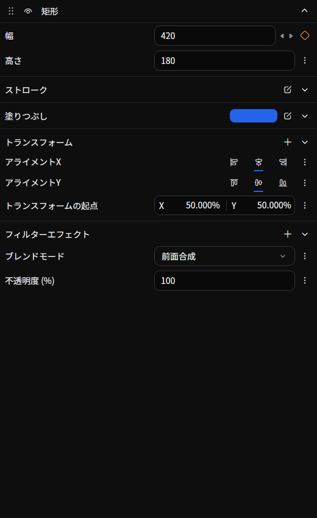

# 要素プロパティ

タイムラインで選択している要素（`*.belm` ファイルに対応する単位）に含まれる **描画オブジェクト、サウンドなど** を縦に並べて編集するタブです。
要素そのものの名前や色、開始時刻といったタイムライン上での扱いはタイムライン側で操作し、ここでは要素の中身を組み立てます。

## タブの特性

- **デフォルトで開く**: はい
- **複数同時に開く**: できる

## 開き方

タイムラインで要素を選択すると、このタブが開いて要素の中身を表示します。**「表示」→「ツール」** や空のタブのツール一覧には表示されません。

タブのヘッダーを右クリックして **タブを固定** を有効にすると、その要素を表示し続けます。その後、別の要素を選ぶと、固定していない別のタブを使うか、必要に応じて新しいタブを開きます。[タブの対象を固定する](./index.md#タブの対象を固定する)も参照してください。

## 画面構成

選択中の要素に含まれるオブジェクトが、**展開可能なパネル** として縦に並びます。
各パネルは以下の要素で構成されます。

- **並び替えハンドル**（左端のドット）: 縦方向にドラッグしてオブジェクトの順序を変更
- **表示/非表示トグル**: そのオブジェクトの有効 / 無効を切り替え
- **名前のラベル**: オブジェクトの種類名（カーソルを乗せると説明がツールチップで表示）
- **展開/折りたたみボタン**: クリックでプロパティの表示を開閉
- **プロパティ領域**: 展開時に各プロパティの専用エディタが表示される

オブジェクトの数が多い場合は、タブ全体を縦スクロールして一覧します。

トランスフォーム、フィルターエフェクト、音声エフェクト、パスの図形など、パネル内のリストも同じように項目を表示します。展開した項目の行は名前の下から始まり、並び替えハンドルの下から引かれた線が行の横に伸びます。入れ子のグループの項目はグループ名の下から始まり、階層ごとに線が引かれます。

## オブジェクトの操作

### 並び替え

各パネルの左端にあるドラッグハンドルを上下にドラッグすると、同じ要素内でオブジェクトの順序を入れ替えられます。順序は描画やエフェクトの適用順に直結します。

### 有効 / 無効の切り替え

ヘッダーの目アイコン（表示/非表示トグル）で、そのオブジェクトの有効 / 無効を切り替えます。無効化したオブジェクトは描画や処理から除外されます。

### 展開 / 折りたたみ

ヘッダー右端のボタンをクリックすると、プロパティ領域を開閉できます。開閉状態は要素ごとに保存され、次回以降同じ要素を開いたときに復元されます。

### 右クリックメニュー（パネルのヘッダー上）

| 項目 | 動作 |
|------|------|
| **削除** | このオブジェクトを要素から取り除く |
| **テンプレートとして保存** | 名前を付けて、このオブジェクトをテンプレートとしてライブラリに登録 |

## オブジェクトの追加

### ライブラリからのドラッグ&ドロップ

[ライブラリ](./library.md) の項目（描画オブジェクト、サウンドなど）をこのタブにドロップして、選択中の要素にオブジェクトを追加できます。ドロップ位置によって挿入場所が変わります。

## トランスフォームとエフェクト

### 最初から付くトランスフォーム

新しいオブジェクトには、最初から **移動**、**回転**、**スケール** のトランスフォームが付きます。タイムライン、プレビュー、ライブラリから追加したとき、このタブにドロップしたとき、画像を貼り付けたときのいずれも同じです。ドロップした位置は移動のトランスフォームに入ります。**トランスフォーム** のセクションを展開すると、これらのトランスフォームはそれぞれ開いた状態で表示されます。

### `+` での追加

`+` ボタンとドロップは常に追加します。**トランスフォーム**、**フィルターエフェクト**、**音声エフェクト** のセクションでは、トランスフォームやエフェクトが 1 つだけのとき、それが新しいものと一緒に新しいグループへ移ります。1 回の取り消し単位で行われ、何も置き換えられません。新しいトランスフォームは、プレビューのハンドルが置くのと同じ位置に入ります。最初の移動は先頭、最初の回転はそのすぐ下、それ以外は末尾なので、追加する順番が違っても結果は同じです。式で値が決まっている間は、パネルから追加しても何も起こりません。セクションの右クリックメニューの **変更** と **なし** は、読み込めなかった値を修復するときだけ表示されます。

### リスト内のトランスフォーム

開いたトランスフォームは、名前の行の代わりに種類のアイコンの横に最初のプロパティを表示し、ほかのプロパティはその下に線と並べて表示します。アイコンをクリックするとトランスフォームを開閉でき、アイコンをドラッグすると並び替えられます。トランスフォームのどこを右クリックしても、コピー、貼り付け、テンプレートに加えて **表示** と **削除** を選べます。非表示にしたトランスフォームは薄く表示されます。

閉じたトランスフォーム、グループ、型を読み込めなかったトランスフォームは、名前、目のアイコン、ゴミ箱のボタンがある行を残します。ノード内のトランスフォームもこの行を残します。

## プロパティの編集

各オブジェクトを展開すると、プロパティごとのエディタが表示されます。

アニメーションされているプロパティは、プロパティ右側の **︙（三点リーダ縦）メニュー** から [グラフエディタ](./graph-editor.md) を開いたり、タイムライン上にインライン展開したりできます。

参照のプロパティには既存の対象を選ぶ欄があり、単位が定義されたプロパティには `%`・`°`・`×` がラベルに表示されます。詳しくは [参照先を選ぶ](../../get-started/edit-element.md#reference-targets) と、その次の節を参照してください。

ファイルの入力欄には、対応する種類のローカルファイルをドラッグ&ドロップして指定することもできます。イージングのプロパティには種類の選択とカーブのプレビューがあり、スプラインイージングではカーブの制御点をドラッグして直接調整できます。カーブはキーボードでも操作できます。`Tab` で 2 つの制御点の間を移動してから次の項目へ進み、矢印キーで選択中の制御点を `0.01` ずつ、`Shift` を押しながらで `0.1` ずつ動かします。キーを 1 回押すごとに 1 回の取り消し単位になります。値の列が狭いときは、カーブが行の幅いっぱいに表示されます。

複数の値を持つプロパティ（点や色など）では、同じメニューの **成分を分離** で値ごとに別々にアニメーションできます。[成分ごとにアニメーションする](../../get-started/keyframe.md#separate-components)を参照してください。移動の X と Y のように別々のプロパティとして保存されている値は、1 つの行にまとめて表示されます。[1 行にまとめて表示される値](../../get-started/keyframe.md#joined-rows)を参照してください。

サウンドには折りたたみ可能な **パンナー** と **チャンネルの割り当て** のセクションもあります。[マルチチャンネル音声](../../get-started/multichannel-audio.md)を参照してください。

### 数値のスクラブ

数値フィールドを左右にドラッグすると、値を増減できます。**`Shift`** を押しながらで粗く（10 倍）、**`Alt`** を押しながらで細かく（0.1 倍）調整できます。macOS のトラックパッドでは、ゼロとプロパティの既定値で[触覚フィードバック](./timeline.md#トラックパッドの触覚フィードバック)が返ります。

### 色の選択とパレット

色の入力欄を押すと、Beutl のカラーピッカーが開きます。要素、レイヤー、マーカーの色、グラデーションの分岐点、プレビューのガイドの色、アクセントカラーでも同じピッカーが開きます。パレットのタブには、**新しいパレット** ボタンの下に次のものが並びます。

- **最近使った色**: ピッカーで最後に適用した 20 色。新しいものが先頭です。
- 開いているプロジェクトのパレット。**このプロジェクトに保存されています** の印が付きます。
- 自分のパレット。どのプロジェクトでも表示されます。
- **デフォルトのパレット**: CSS の名前付きの色と透明。無彩色、赤、オレンジ、黄、緑、シアン、青、紫、ピンクの順に、それぞれ明るい色から暗い色へ並びます。

色をクリックすると選択できます。現在の色と同じ色には輪が付き、ツールチップに色の名前と 16 進数の値が表示され、半透明の色には市松模様が表示されます。ブラシエディターでブラシが未設定のときに色を選ぶと、その色の単色ブラシになります。

- **新しいパレット** で、**パレット 1**、**パレット 2** のような名前の自分のパレットを追加します。
- パレットの **＋** で、現在の色を追加します。
- パレットの **…** ボタンまたは右クリックメニューでは、**名前を変更**、**上へ移動**、**下へ移動**、**このプロジェクトに保存** または **すべてのプロジェクトで使う**、**削除** を選べます。
- パレットの色を右クリックすると、**名前を変更**、**今の色に置き換え**、ほかのパレットへの **移動**、**削除** を選べます。
- 最近使った色やデフォルトのパレットの色を右クリックすると、**パレットに追加**（または **新しいパレットに追加**）を選べます。最近使った色では **最近使った色から削除** も選べ、**最近使った色** のメニューには **最近使った色を消去** があります。

自分のパレットと最近使った色は Beutl の設定に保存されます。プロジェクトのパレットは変更するとすぐに[プロジェクトファイルの隣にある専用のファイル](../../get-started/project-structure.md#palettes-file)へ書き込まれ、その変更は元に戻せません。

キーボードでは、`Tab` は各パレットで 1 回だけ、最後にフォーカスした色で止まります。矢印キーで色の間を移動し、`Left` と `Right` は順番に、`Up` と `Down` は 1 行ずつ移動します。`Enter` または `Space` でフォーカスのある色を選び、メニューキーでその色のメニューを開きます。

## 不明な型のオブジェクト

拡張機能の未インストールなどでオブジェクトの型を解決できないときは、フォールバック表示に切り替わります。元の型名と、JSON を直接編集して保存するためのコマンドバーが表示されるため、最低限の確認や修正をその場で行えます。

保持できる未知のデータは保存時にも維持されます。代替オブジェクトが変更を保存できる共通プロパティは編集できます。データの一部を保持できず要素が保護されている場合は、該当する内容の修復・置き換え・削除に編集が制限されます。[破損した要素の復旧](../../get-started/edit-element.md#破損した要素の復旧)を参照してください。

## 関連ドキュメント

- [要素を編集する](../../get-started/edit-element.md)
- [プロジェクトの構造](../../get-started/project-structure.md)
- [ライブラリ](./library.md)
- [グラフエディタ](./graph-editor.md)

## ソース

- [`ElementPropertyTabExtension.cs`](https://github.com/b-editor/beutl/blob/f9cbaeef9da0077f6745010a2d69955e12c45187/src/Beutl.Editor.Components/ElementPropertyTab/ElementPropertyTabExtension.cs)
- [`ElementPropertyTabViewModel.cs`](https://github.com/b-editor/beutl/blob/f9cbaeef9da0077f6745010a2d69955e12c45187/src/Beutl.Editor.Components/ElementPropertyTab/ViewModels/ElementPropertyTabViewModel.cs)
- [`EngineObjectPropertyViewModel.cs`](https://github.com/b-editor/beutl/blob/f9cbaeef9da0077f6745010a2d69955e12c45187/src/Beutl.Editor.Components/ElementPropertyTab/ViewModels/EngineObjectPropertyViewModel.cs)
- [`ElementPropertyTabView.axaml`](https://github.com/b-editor/beutl/blob/f9cbaeef9da0077f6745010a2d69955e12c45187/src/Beutl.Editor.Components/ElementPropertyTab/Views/ElementPropertyTabView.axaml) / [`.axaml.cs`](https://github.com/b-editor/beutl/blob/f9cbaeef9da0077f6745010a2d69955e12c45187/src/Beutl.Editor.Components/ElementPropertyTab/Views/ElementPropertyTabView.axaml.cs)
- [`EngineObjectPropertyView.axaml`](https://github.com/b-editor/beutl/blob/f9cbaeef9da0077f6745010a2d69955e12c45187/src/Beutl.Editor.Components/ElementPropertyTab/Views/EngineObjectPropertyView.axaml) / [`.axaml.cs`](https://github.com/b-editor/beutl/blob/f9cbaeef9da0077f6745010a2d69955e12c45187/src/Beutl.Editor.Components/ElementPropertyTab/Views/EngineObjectPropertyView.axaml.cs)
- [`FallbackObjectView.axaml`](https://github.com/b-editor/beutl/blob/f9cbaeef9da0077f6745010a2d69955e12c45187/src/Beutl.Editor.Components/Views/FallbackObjectView.axaml) / [`.axaml.cs`](https://github.com/b-editor/beutl/blob/f9cbaeef9da0077f6745010a2d69955e12c45187/src/Beutl.Editor.Components/Views/FallbackObjectView.axaml.cs)
- [`StorageFileEditor.cs`](https://github.com/b-editor/beutl/blob/f9cbaeef9da0077f6745010a2d69955e12c45187/src/Beutl.Controls/PropertyEditors/StorageFileEditor.cs)
- [`EasingEditor.cs`](https://github.com/b-editor/beutl/blob/f9cbaeef9da0077f6745010a2d69955e12c45187/src/Beutl.Controls/PropertyEditors/EasingEditor.cs)
- [`EasingCurveEditor.cs`](https://github.com/b-editor/beutl/blob/dadee0db956ddb874ab88f48329bc84a5ce5cf6b/src/Beutl.Controls/PropertyEditors/EasingCurveEditor.cs)
- [`ComponentEditors.cs`](https://github.com/b-editor/beutl/blob/fb0eb00b07159f8c1a96c308b38958e29590686a/src/Beutl.Editor.Components/PropertyEditors/Views/ComponentEditors.cs)
- [`SoundPannerEditor.axaml`](https://github.com/b-editor/beutl/blob/fb0eb00b07159f8c1a96c308b38958e29590686a/src/Beutl.Editor.Components/SoundPannerProperties/Views/SoundPannerEditor.axaml)
- [`ChannelMapEditor.axaml`](https://github.com/b-editor/beutl/blob/fb0eb00b07159f8c1a96c308b38958e29590686a/src/Beutl.Editor.Components/ChannelMapProperties/Views/ChannelMapEditor.axaml)
- [`TransformListItemEditor.axaml`](https://github.com/b-editor/beutl/blob/dadee0db956ddb874ab88f48329bc84a5ce5cf6b/src/Beutl.Editor.Components/PropertyEditors/Views/TransformListItemEditor.axaml) / [`ListItemRowsPanel.cs`](https://github.com/b-editor/beutl/blob/dadee0db956ddb874ab88f48329bc84a5ce5cf6b/src/Beutl.Editor.Components/PropertyEditors/Views/ListItemRowsPanel.cs)
- [`AddToGroupHelper.cs`](https://github.com/b-editor/beutl/blob/dadee0db956ddb874ab88f48329bc84a5ce5cf6b/src/Beutl.Editor.Components/Helpers/AddToGroupHelper.cs) / [`CanonicalTransformLayout.cs`](https://github.com/b-editor/beutl/blob/dadee0db956ddb874ab88f48329bc84a5ce5cf6b/src/Beutl.Engine/Graphics/Transformation/CanonicalTransformLayout.cs)
- [`ColorPaletteView.cs`](https://github.com/b-editor/beutl/blob/dadee0db956ddb874ab88f48329bc84a5ce5cf6b/src/Beutl.Controls/PropertyEditors/ColorPaletteView.cs) / [`ColorPaletteService.cs`](https://github.com/b-editor/beutl/blob/dadee0db956ddb874ab88f48329bc84a5ce5cf6b/src/Beutl.Controls/PropertyEditors/ColorPaletteService.cs) / [`DefaultColorPalette.cs`](https://github.com/b-editor/beutl/blob/dadee0db956ddb874ab88f48329bc84a5ce5cf6b/src/Beutl.Controls/PropertyEditors/DefaultColorPalette.cs)
