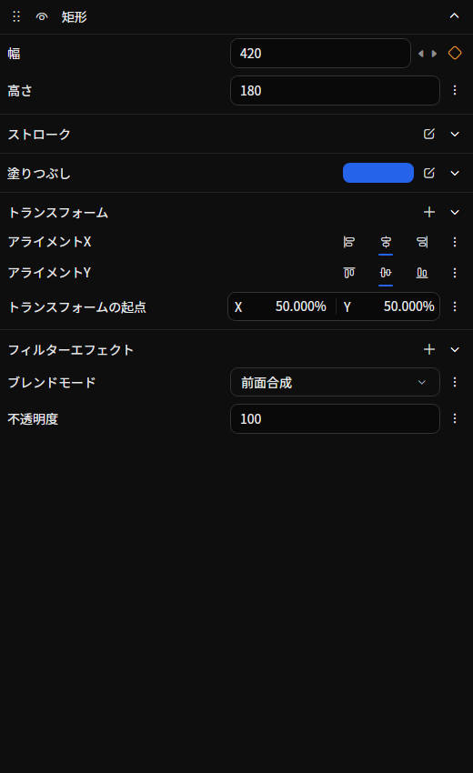

# 要素プロパティ

タイムラインで選択している要素（`*.belm` ファイルに対応する単位）に含まれる **描画オブジェクト、サウンドなど** を縦に並べて編集するタブです。
要素そのものの名前や色、開始時刻といったタイムライン上での扱いはタイムライン側で操作し、ここでは要素の中身を組み立てます。

## タブの特性

- **デフォルトで開く**: はい
- **複数同時に開く**: できる

## 開き方

タイムラインで要素を選択すると、このタブが開いて要素の中身を表示します。**「表示」→「ツール」** や空のタブのツール一覧には表示されません。

タブのヘッダーを右クリックして **タブを固定** を有効にすると、その要素を表示し続けます。その後、別の要素を選ぶと、固定していない別のタブを使うか、必要に応じて新しいタブを開きます。[タブの対象を固定する](./index.md#タブの対象を固定する)も参照してください。

## 画面構成

選択中の要素に含まれるオブジェクトが、**展開可能なパネル** として縦に並びます。
各パネルは以下の要素で構成されます。

- **並び替えハンドル**（左端のドット）: 縦方向にドラッグしてオブジェクトの順序を変更
- **表示/非表示トグル**: そのオブジェクトの有効 / 無効を切り替え
- **名前のラベル**: オブジェクトの種類名（カーソルを乗せると説明がツールチップで表示）
- **展開/折りたたみボタン**: クリックでプロパティの表示を開閉
- **プロパティ領域**: 展開時に各プロパティの専用エディタが表示される

オブジェクトの数が多い場合は、タブ全体を縦スクロールして一覧します。

## オブジェクトの操作

### 並び替え

各パネルの左端にあるドラッグハンドルを上下にドラッグすると、同じ要素内でオブジェクトの順序を入れ替えられます。順序は描画やエフェクトの適用順に直結します。

### 有効 / 無効の切り替え

ヘッダーの目アイコン（表示/非表示トグル）で、そのオブジェクトの有効 / 無効を切り替えます。無効化したオブジェクトは描画や処理から除外されます。

### 展開 / 折りたたみ

ヘッダー右端のボタンをクリックすると、プロパティ領域を開閉できます。開閉状態は要素ごとに保存され、次回以降同じ要素を開いたときに復元されます。

### 右クリックメニュー（パネルのヘッダー上）

| 項目 | 動作 |
|------|------|
| **削除** | このオブジェクトを要素から取り除く |
| **テンプレートとして保存** | 名前を付けて、このオブジェクトをテンプレートとしてライブラリに登録 |

## オブジェクトの追加

### ライブラリからのドラッグ&ドロップ

[ライブラリ](./library.md) の項目（描画オブジェクト、サウンドなど）をこのタブにドロップして、選択中の要素にオブジェクトを追加できます。ドロップ位置によって挿入場所が変わります。

## プロパティの編集

各オブジェクトを展開すると、プロパティごとのエディタが表示されます。

アニメーションされているプロパティは、プロパティ右側の **︙（三点リーダ縦）メニュー** から [グラフエディタ](./graph-editor.md) を開いたり、タイムライン上にインライン展開したりできます。

参照のプロパティには既存の対象を選ぶ欄があり、単位が定義されたプロパティには `%`・`°`・`×` がラベルに表示されます。詳しくは [参照先を選ぶ](../../get-started/edit-element.md#reference-targets) と、その次の節を参照してください。

ファイルの入力欄には、対応する種類のローカルファイルをドラッグ&ドロップして指定することもできます。イージングのプロパティには種類の選択とカーブのプレビューがあり、スプラインイージングではカーブの制御点をドラッグして直接調整できます。

### 数値のスクラブ

数値フィールドを左右にドラッグすると、値を増減できます。**`Shift`** を押しながらで粗く（10 倍）、**`Alt`** を押しながらで細かく（0.1 倍）調整できます。

## 不明な型のオブジェクト

拡張機能の未インストールなどでオブジェクトの型を解決できないときは、フォールバック表示に切り替わります。元の型名と、JSON を直接編集して保存するためのコマンドバーが表示されるため、最低限の確認や修正をその場で行えます。

保持できる未知のデータは保存時にも維持されます。代替オブジェクトが変更を保存できる共通プロパティは編集できます。データの一部を保持できず要素が保護されている場合は、該当する内容の修復・置き換え・削除に編集が制限されます。[破損した要素の復旧](../../get-started/edit-element.md#破損した要素の復旧)を参照してください。

## 関連ドキュメント

- [要素を編集する](../../get-started/edit-element.md)
- [プロジェクトの構造](../../get-started/project-structure.md)
- [ライブラリ](./library.md)
- [グラフエディタ](./graph-editor.md)

## ソース

- [`ElementPropertyTabExtension.cs`](https://github.com/b-editor/beutl/blob/f9cbaeef9da0077f6745010a2d69955e12c45187/src/Beutl.Editor.Components/ElementPropertyTab/ElementPropertyTabExtension.cs)
- [`ElementPropertyTabViewModel.cs`](https://github.com/b-editor/beutl/blob/f9cbaeef9da0077f6745010a2d69955e12c45187/src/Beutl.Editor.Components/ElementPropertyTab/ViewModels/ElementPropertyTabViewModel.cs)
- [`EngineObjectPropertyViewModel.cs`](https://github.com/b-editor/beutl/blob/f9cbaeef9da0077f6745010a2d69955e12c45187/src/Beutl.Editor.Components/ElementPropertyTab/ViewModels/EngineObjectPropertyViewModel.cs)
- [`ElementPropertyTabView.axaml`](https://github.com/b-editor/beutl/blob/f9cbaeef9da0077f6745010a2d69955e12c45187/src/Beutl.Editor.Components/ElementPropertyTab/Views/ElementPropertyTabView.axaml) / [`.axaml.cs`](https://github.com/b-editor/beutl/blob/f9cbaeef9da0077f6745010a2d69955e12c45187/src/Beutl.Editor.Components/ElementPropertyTab/Views/ElementPropertyTabView.axaml.cs)
- [`EngineObjectPropertyView.axaml`](https://github.com/b-editor/beutl/blob/f9cbaeef9da0077f6745010a2d69955e12c45187/src/Beutl.Editor.Components/ElementPropertyTab/Views/EngineObjectPropertyView.axaml) / [`.axaml.cs`](https://github.com/b-editor/beutl/blob/f9cbaeef9da0077f6745010a2d69955e12c45187/src/Beutl.Editor.Components/ElementPropertyTab/Views/EngineObjectPropertyView.axaml.cs)
- [`FallbackObjectView.axaml`](https://github.com/b-editor/beutl/blob/f9cbaeef9da0077f6745010a2d69955e12c45187/src/Beutl.Editor.Components/Views/FallbackObjectView.axaml) / [`.axaml.cs`](https://github.com/b-editor/beutl/blob/f9cbaeef9da0077f6745010a2d69955e12c45187/src/Beutl.Editor.Components/Views/FallbackObjectView.axaml.cs)
- [`StorageFileEditor.cs`](https://github.com/b-editor/beutl/blob/f9cbaeef9da0077f6745010a2d69955e12c45187/src/Beutl.Controls/PropertyEditors/StorageFileEditor.cs)
- [`EasingEditor.cs`](https://github.com/b-editor/beutl/blob/f9cbaeef9da0077f6745010a2d69955e12c45187/src/Beutl.Controls/PropertyEditors/EasingEditor.cs)
- [`EasingCurveEditor.cs`](https://github.com/b-editor/beutl/blob/f9cbaeef9da0077f6745010a2d69955e12c45187/src/Beutl.Controls/PropertyEditors/EasingCurveEditor.cs)
