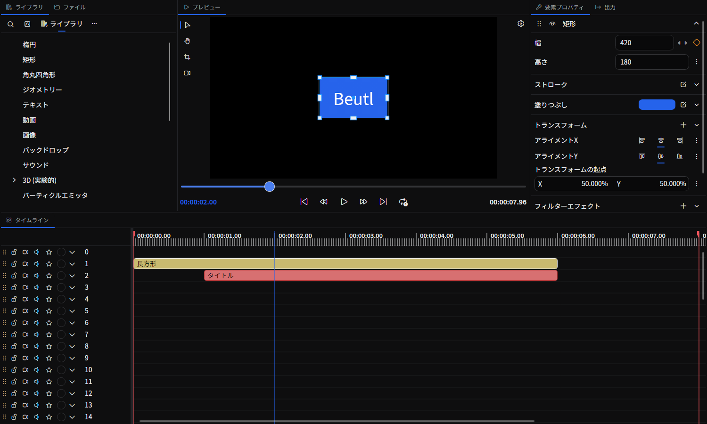

# ツールタブ

ツールタブは、シーンエディタの周囲にドッキングできる作業領域です。
タイムライン、ライブラリ、プロパティなど、それぞれのタブに役割があります。
タブをドラッグすると、配置を変えたり、複数のタブを重ねたり並べたりできます。

## タブの開き方とリセット

- 閉じているタブは、メニューバーの **「表示」→「ツール」** から開けます。
- ドックのタブヘッダにマウスを乗せて `+` ボタンを押すと、**そのドック** に空のタブが開きます。ツールを検索して選ぶと、空のタブがそのツールに置き換わります。複数同時に開けないツールが開いている場合は **既に開いています** に無効な状態で表示されます。よく使うツールは **ピン留めする** で一覧の先頭に置けます。
- タブのヘッダをドラッグすると、別のドック領域へ移動できます。
- **「表示」→「ドックレイアウトをリセット」** を選ぶと、タブの配置を初期状態に戻せます。
- 現在の配置に名前を付けて保存し、任意のシーンに適用するには [ドックレイアウト](./dock-layout.md) タブを使います。

**要素プロパティ**、**プロパティ**、**シーン設定**、**グラフエディタ**、**トランジション**、**欠損メディアを再リンク** は、**「表示」→「ツール」** ではなく、それぞれの編集操作から開きます。開き方は各ページを参照してください。

- 選択中のタブにマウスを乗せると閉じるボタンが表示されます。タブ名の左には拡張機能のアイコンが表示されます。

## キーボードでタブを切り替える

| 操作 | ショートカット |
|------|----------------|
| 次 / 前のタブ | `Ctrl + Tab` / `Ctrl + Shift + Tab` |
| 次 / 前のツールタブ | `Alt + F7` / `Alt + Shift + F7` |
| ツールタブを作成 | `Ctrl + T`（macOS では `Cmd + T`） |

切り替え画面では、開いているタブを **ツールタブ** と **ファイル** に分けて表示します。左右の矢印キーでグループ、上下の矢印キーでタブを選びます。ショートカットの修飾キーを離すか `Enter` を押すと確定し、`Esc` でキャンセルします。**ツールタブを作成** はツールの一覧を開き、`Enter` で確定します。`Alt + Tab` / `Alt + Shift + Tab` もツール切り替えに割り当てられていますが、OS が Beutl にキーを渡す場合に限り利用できます。

## タブの対象を固定する

タブのヘッダーを右クリックして **タブを固定** を有効にすると、別のものを選択しても現在の対象を表示し続けます。要素プロパティ、プロパティ、ノードグラフ、パスエディタ、カラーグレーディング、カーブ、トランジションで利用できます。固定したタブはタイトルの横にピンを表示し、クリックすると **タブの固定を解除** します。対象を削除したときも固定が解除されます。

空のタブのツール一覧にあるピン留めは、その一覧のお気に入り登録です。開いているタブの対象を保つ **タブを固定** とは別の操作です。

## タブ一覧

| タブ | 概要 |
|------|------|
| [タイムライン](./timeline.md) | 要素を時間軸上で並べ替え・分割・グループ化する |
| [ライブラリ](./library.md) | 描画オブジェクトやエフェクトをドラッグして追加する |
| [ファイル](./file-browser.md) | プロジェクトフォルダや任意のフォルダのファイルを参照する |
| [要素プロパティ](./element-property.md) | 要素に含まれる描画オブジェクトやサウンドなどを編集する |
| [出力](./output.md) | エンコード設定と出力プロファイルを管理する |
| [シーン設定](./scene-settings.md) | シーンのサイズ・開始時間・長さ・レイヤー数を設定する |
| [グラフエディタ](./graph-editor.md) | アニメーションの時間カーブを編集する |
| [ノードグラフ](./node-graph.md) | ノードを配置・接続して処理の流れを編集する |
| [スコープ](./color-scopes.md) | 映像の波形・ヒストグラム・ベクトルスコープ・フォルスカラー・ゼブラを表示する |
| [カラーグレーディング](./color-grading.md) | 色調補正・カラーグレーディングを行う |
| [カーブ](./curves.md) | トーンカーブで色調を調整する |
| [オーディオビジュアライザー](./audio-visualizer.md) | 音声の波形・スペクトラム・レベルメーター・スペクトログラム・位相スコープを表示する |
| [パスエディタ](./path-editor.md) | パス図形の制御点を編集する |
| [プレビュー設定](./preview-settings.md) | プレビュー解像度・オニオンスキン・レンダーキャッシュを設定する |
| [履歴](./history.md) | 編集履歴を一覧表示し、任意のステップへ戻る |
| [ターミナル](./terminal.md) | エディターを離れずにプロジェクトフォルダーでシェルを実行する |
| [プロキシ](./proxies.md) | プレビューを軽快にする低解像度プロキシメディアを生成・管理する |
| [ドックレイアウト](./dock-layout.md) | タブの配置に名前を付けて保存し、任意のシーンに適用する |
| [バージョン管理](./version-control.md) | Gitでプロジェクトのバージョンを記録・比較・復元する |
| [ブラウザ](./web-browser.md) | Webサイトを閲覧し、プロジェクト用の素材をダウンロードする |
| [AI](./ai-workspace.md) | 画像・動画の生成と編集、字幕生成、ジョブの管理を行う |
| [欠損メディアを再リンク](./missing-media.md) | 移動・欠損した素材やフォントの参照先を修復する |
| [トランジション](./transition.md) | クリップの開始・終了位置のトランジションを編集する |

このドキュメントの情報源は、[Beutl リポジトリ](https://github.com/b-editor/beutl)の `src/Beutl/Services/StartupTasks/LoadPrimitiveExtensionTask.cs` および `src/Beutl.Editor.Components/` 配下の `*TabExtension.cs` です。

## ソース

- [`MainViewExtension.cs`](https://github.com/b-editor/beutl/blob/f9cbaeef9da0077f6745010a2d69955e12c45187/src/Beutl/Services/PrimitiveImpls/MainViewExtension.cs)
- [`TabSwitcherViewModel.cs`](https://github.com/b-editor/beutl/blob/f9cbaeef9da0077f6745010a2d69955e12c45187/src/Beutl/ViewModels/TabSwitcherViewModel.cs) / [`TabSwitcherView.axaml.cs`](https://github.com/b-editor/beutl/blob/f9cbaeef9da0077f6745010a2d69955e12c45187/src/Beutl/Views/TabSwitcherView.axaml.cs)
- [`NewToolTabDockable.cs`](https://github.com/b-editor/beutl/blob/f9cbaeef9da0077f6745010a2d69955e12c45187/src/Beutl/ViewModels/Dock/NewToolTabDockable.cs)
- [`DockStyles.axaml`](https://github.com/b-editor/beutl/blob/f9cbaeef9da0077f6745010a2d69955e12c45187/src/Beutl/Views/Dock/DockStyles.axaml) / [`ToolTabPin.cs`](https://github.com/b-editor/beutl/blob/f9cbaeef9da0077f6745010a2d69955e12c45187/src/Beutl.Editor.Components/Helpers/ToolTabPin.cs)
