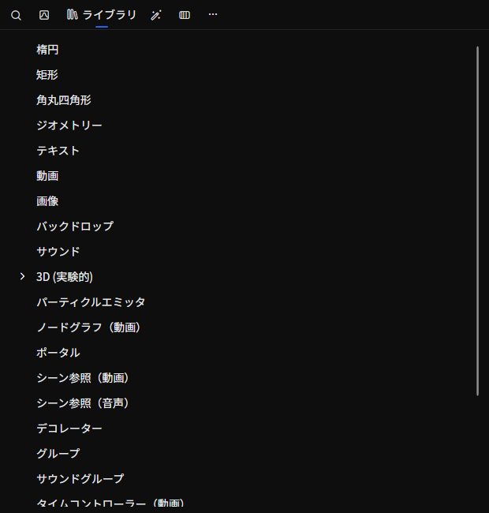
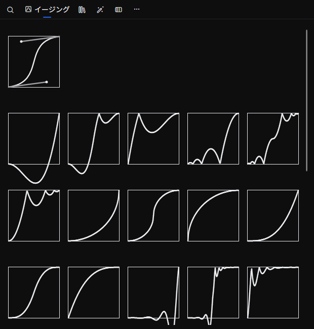

# ライブラリ

利用可能な **描画オブジェクト・エフェクト・トランスフォーム・イージング・ノード** などを一覧から選び、タイムラインや要素プロパティへドラッグ&ドロップして追加するためのタブです。

## タブの特性

- **デフォルトで開く**: はい
- **複数同時に開く**: できない

## 開き方

メニューバーの **「表示」→「ツール」→「ライブラリ」** から開けます。

## 画面構成

タブの上部にタブの切り替え、下部に選択中のタブの内容が表示されます。タブは次の6種類があります。

| タブ | 役割 |
|------|------|
| **検索** | キーワードでライブラリ全体を横断検索する |
| **イージング** | アニメーションの補間に使うイージング関数を一覧する |
| **ライブラリ** | 描画オブジェクト・エフェクトなどをカテゴリツリーで一覧する（既定で選択） |
| **フィルターエフェクト** | フィルターエフェクトを動くサムネイル付きのタイルで一覧する |
| **トランジション** | トランジションを動くサムネイル付きのタイルで一覧する |
| **ノードグラフ** | ノードベース描画で使うノードを一覧する（既定では非表示） |

タブが画面に収まらないときは、マウスホイールで横スクロールできます。

### タブの表示/非表示を切り替える

タブを右クリックして表示されるメニュー、またはタブ右端の **「…」ボタン** から、各タブの表示/非表示を切り替えられます。

- **検索 / イージング / ライブラリ / フィルターエフェクト / トランジション**: 既定で表示
- **ノードグラフ**: 既定で非表示。ノードグラフを利用するときに表示に切り替えます

## タブの内容

### 検索

入力欄にキーワードを入れると、すべてのタブの項目を横断的に検索します。検索結果には項目名・説明・種類（描画オブジェクト・エフェクトなど）が表示され、関連度順に並びます。

入力欄が空のときは、登録されているすべての項目をフラットに一覧表示します。

### イージング

アニメーションのキーフレーム間の補間に使うイージング関数の一覧です。各タイルにカーブ形状のプレビューが表示されます。

- 一覧の先頭には **スプライン補間** のタイル（制御点を 4 つ持つベジエ風のアイコン）があり、
- 続いて Linear / Quad / Cubic / Quart / Quint / Sine / Expo / Circ / Back / Elastic / Bounce 系の標準イージングと、Hold（保持）が並びます
- タイルをドラッグして、グラフエディタのキーフレームに割り当てられます

### ライブラリ

描画オブジェクトやエフェクトなどを **ツリー** で表示します。各項目にマウスを乗せると説明が表示されます。

代表的なカテゴリ:

- **図形・テキスト・メディア**: 円・矩形・角丸四角形・ジオメトリ・テキスト・動画・画像・バックドロップ など
- **音声**: サウンド・シーンサウンド・サウンドグループ など
- **3D（実験的機能）**: 3D シーン・立方体・球・平面・モデル・各種ライト
- **パーティクル / ノードグラフ描画 / シーン描画 / グループ / デコレータ / 時間制御** など、合成・制御に使うオブジェクト
- **オーディオビジュアライザ**: 音声波形・スペクトル・スペクトログラム
- **トランスフォーム**: 移動・スケール・回転・3D回転・歪み
- **フィルタエフェクト**: ぼかし・モーションブラー・ブルーム・ドロップシャドウ・ストローク・色調補正・カーブ・LUT・ブレンド・モザイク・ディスプレイスメントマップ・スクリプト系（C# / SKSL / GLSL）など
- **音声エフェクト**: ディレイ・イコライザなど

各項目の詳細は [ライブラリリファレンス](../library/index.md) を参照してください。

### フィルターエフェクトとトランジション {/* #filter-effect-and-transition */}

フィルターエフェクトとトランジションを、拡張機能が追加したものも含めてライブラリの順にタイルで表示します。各タイルには動くサムネイルと項目の名前が表示されます。タイルにポインターを乗せると、サムネイルが再生され、説明が表示されます。

タイルは **ライブラリ** のツリーの同じ項目と同じようにドラッグできます。エフェクトは[要素プロパティ](./element-property.md)タブの **フィルターエフェクト** のセクションに、トランジションはタイムラインの要素にドロップします。トランジションは、要素のポインターに近い側の端に設定されます。

サムネイルには、プレビューに表示されているフレームに、選択の枠やハンドルを除いた状態で各エフェクトを掛けた様子が表示されます。トランジションは、そのフレームが消えてまた現れる様子を示します。プレビューに別のフレームが表示され、再生が止まってしばらくすると、サムネイルは描き直されます。プレビューに何も表示されていないときは、Beutl に付属するサンプル画像を使います。

エフェクトを追加する選択画面とトランジションを変更する選択画面でもタイルを表示できます。[タイルから選ぶ](./element-property.md#picking-from-tiles)を参照してください。

### ノードグラフ

ノードベース描画で使えるノードのカテゴリツリーです。ノードの種類別にグループ化されており、ノードグラフ上にドラッグして配置します。

## 関連ドキュメント

- [要素を追加する](../../get-started/add-element.md)
- [要素を編集する](../../get-started/edit-element.md)
- [キーフレーム](../../get-started/keyframe.md)
- [グラフエディタ](./graph-editor.md)
- [ライブラリリファレンス](../library/index.md) — 各オブジェクトの詳細

## ソース

- [`LibraryTabExtension.cs`](https://github.com/b-editor/beutl/blob/main/src/Beutl.Editor.Components/LibraryTab/LibraryTabExtension.cs)
- [`LibraryTabViewModel.cs`](https://github.com/b-editor/beutl/blob/main/src/Beutl.Editor.Components/LibraryTab/ViewModels/LibraryTabViewModel.cs)
- [`LibraryTabView.axaml`](https://github.com/b-editor/beutl/blob/main/src/Beutl.Editor.Components/LibraryTab/Views/LibraryTabView.axaml) / [`.axaml.cs`](https://github.com/b-editor/beutl/blob/main/src/Beutl.Editor.Components/LibraryTab/Views/LibraryTabView.axaml.cs)
- [`SearchView.axaml`](https://github.com/b-editor/beutl/blob/main/src/Beutl.Editor.Components/LibraryTab/Views/LibraryViews/SearchView.axaml) / [`.axaml.cs`](https://github.com/b-editor/beutl/blob/main/src/Beutl.Editor.Components/LibraryTab/Views/LibraryViews/SearchView.axaml.cs)
- [`EasingsView.axaml`](https://github.com/b-editor/beutl/blob/main/src/Beutl.Editor.Components/LibraryTab/Views/LibraryViews/EasingsView.axaml) / [`.axaml.cs`](https://github.com/b-editor/beutl/blob/main/src/Beutl.Editor.Components/LibraryTab/Views/LibraryViews/EasingsView.axaml.cs)
- [`LibraryView.axaml`](https://github.com/b-editor/beutl/blob/main/src/Beutl.Editor.Components/LibraryTab/Views/LibraryViews/LibraryView.axaml) / [`.axaml.cs`](https://github.com/b-editor/beutl/blob/main/src/Beutl.Editor.Components/LibraryTab/Views/LibraryViews/LibraryView.axaml.cs)
- [`NodesView.axaml`](https://github.com/b-editor/beutl/blob/main/src/Beutl.Editor.Components/LibraryTab/Views/LibraryViews/NodesView.axaml) / [`.axaml.cs`](https://github.com/b-editor/beutl/blob/main/src/Beutl.Editor.Components/LibraryTab/Views/LibraryViews/NodesView.axaml.cs)
- [`LibraryGalleryView.axaml`](https://github.com/b-editor/beutl/blob/70d09a97d4491bf6616e248fec809faa58e47db7/src/Beutl.Editor.Components/LibraryTab/Views/LibraryViews/LibraryGalleryView.axaml) / [`.axaml.cs`](https://github.com/b-editor/beutl/blob/70d09a97d4491bf6616e248fec809faa58e47db7/src/Beutl.Editor.Components/LibraryTab/Views/LibraryViews/LibraryGalleryView.axaml.cs)
- [`LibraryGalleryItemViewModel.cs`](https://github.com/b-editor/beutl/blob/70d09a97d4491bf6616e248fec809faa58e47db7/src/Beutl.Editor.Components/LibraryTab/ViewModels/LibraryGalleryItemViewModel.cs) / [`LibraryPreviewCapture.cs`](https://github.com/b-editor/beutl/blob/70d09a97d4491bf6616e248fec809faa58e47db7/src/Beutl.Editor.Components/LibraryThumbnails/LibraryPreviewCapture.cs) / [`LibraryThumbnailSet.cs`](https://github.com/b-editor/beutl/blob/70d09a97d4491bf6616e248fec809faa58e47db7/src/Beutl.Editor.Components/LibraryThumbnails/LibraryThumbnailSet.cs)
