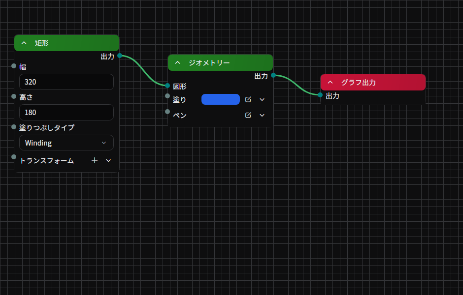

# ノードグラフ

ノードベースの描画オブジェクト（ノードグラフ系の描画オブジェクトやフィルターエフェクト）の **ノードを配置・接続して編集** するためのタブです。
ノードを追加・移動・削除し、ポート同士を線で繋いで処理の流れを組み立てます。

## タブの特性

- **デフォルトで開く**: いいえ
- **複数同時に開く**: できる（編集対象のグラフごとに別タブとして開けます）

## 開き方

開き方は 2 通りあります。

- メニューバーの **「表示」→「ツール」→「ノードグラフ」** から、現在選択している要素のノードグラフを開きます。
- プロパティタブで、ノードベースの描画オブジェクトやフィルターエフェクトが持つグラフプロパティの **「タブで開く」** ボタンからも、同じグラフをこのタブで開けます。



## 画面構成

- **パンくずバー（上部）**: 現在編集しているグラフの階層を表示します。グループノードに入った後、項目をクリックすると親のグラフへ戻れます。
- **グラフパネル（中央）**: ドット模様の背景の上にノードと接続線を配置する作業領域です。背景はパンとズームに合わせてスクロールします。
- **選択範囲オーバーレイ**: 矩形選択中だけ、半透明の青い枠が表示されます。

## ノードの追加

### 右クリックメニューから追加

グラフパネル上の何もない場所を右クリックすると、以下が表示されます。

- **ノードを追加**: 登録済みのノードがカテゴリ別のサブメニューで一覧表示されます。選んだ位置にノードが配置されます。
- **ズームをリセット**: グラフパネルの拡大率を 100% に戻します。

### ドラッグ&ドロップで追加

ライブラリのノード項目をグラフパネルへドロップすると、ドロップ位置にそのノードが追加されます。

## ノードの操作

各ノードは、上部に色付きのヘッダーがあり、その下にポートやプロパティエディタ、モニター項目が並びます。

### ヘッダー

- **展開トグル**（左の矢印）: ノードの中身（ポートとプロパティ）の表示/非表示を切り替えます。畳んだ状態では、接続線はノードの中央左右からまとめて出ます。
- **名前**: 中央にノード名を表示します。名前が空のときは登録時の表示名が使われます。
- **開く**ボタン（右、グループノードのみ）: グループノードの内側のグラフへ移動します。パンくずバーが更新され、戻るときはパンくずをクリックします。

### 移動

- ヘッダーを左ドラッグでノードを移動します。
- 複数のノードを選択していれば、選択中のすべてのノードが一緒に動きます。
- ドラッグ中のノードは前面に持ち上がり、リリース後に元の重なり順に戻ります。

### 選択

- ヘッダーをクリックするとそのノードが単一選択になります。
- **`Ctrl` + クリック**で選択を追加/解除できます。
- グラフパネルの何もない場所を **`Ctrl` + ドラッグ** すると、矩形範囲で複数のノードを一括選択します。

### 右クリックメニュー（ヘッダー）

- **削除** (`Delete`): ノードと、そのノードに繋がる接続をすべて削除します。
- **リネーム**: ノード名を編集するフライアウトを開きます。

## ポートと接続の操作

ノード内の各行の左右端にある小さい円形がポートです。色は値の型に応じて変わり、何かに繋がっているときは塗りつぶされ、未接続のときは薄い色で表示されます。

### 接続する

- ポートを左ドラッグしてワイヤーを引き、相手のポートを表示している行のどこか（ラベル、値の入力欄、行の空白部分、入れ子の行のインデント）で離すと接続されます。接続できるポートの上では、ワイヤーの先端がそのポートの円に吸い付くので、離す前にどこへ繋がるかが分かります。
- 入力と出力の組み合わせのみ繋がります。型が違っても自動変換が試みられ、変換できないときは接続線がエラー色になります。
- ポートのない行、無効なポート、すでに接続のある入力、ノードのタイトルバーにはワイヤーを繋げません。展開したエディターはヘッダーがその行になるので、自身のポートを持たないリスト項目の上で離しても何も繋がりません。
- ノードの出力を自身の入力に繋ぐなど、循環になる接続は拒否されます。
- macOS のトラックパッドでは、接続できるポートにワイヤーが吸い付くと[触覚フィードバック](./timeline.md#トラックパッドの触覚フィードバック)が返ります。

### 切断する

- ポートを **ダブルクリック** すると、そのポートに繋がっているすべての接続を切断します。
- ポートの右クリックメニューから **切断**（接続をすべて削除）を選べます。

### 接続線の色

接続線は接続状態に応じて色が変わります。

- **未接続**（ドラッグ中のみ）: 通常色
- **接続済み・成功**: 緑系
- **型変換あり**: 黄色系
- **エラー**: 赤系

### 動的ポート（追加可能なポート）

グループノードや一部のノードには、動的に増減できるポートがあります。空のプレースホルダーポートが用意されており、相手ポートからドラッグして接続するとポートが新しく追加されます。

ポートの右クリックメニュー（動的ポートのとき）

- **削除**: そのポートを削除します。繋がっていた接続も切れます。
- **リネーム**: ポート名を変更します。

### リスト型のポート

複数の接続を順序付きで受け取るリスト型のポートでは、接続ごとに別々のポイントが縦に並びます。

- リスト型ポートの行やスロットの上で離したワイヤーは、新しい接続が入るスロットの後ろの空き位置に吸い付きます。
- **縦方向のドラッグ**で、リスト内の接続スロットの順序を入れ替えます。
- **横方向のドラッグ**で、その接続を 1 回の取り消し単位で別の出力に繋ぎ直します。接続はリスト内の位置を保ち、繋ぎ先が受け付けない場合はスロットの接続は元のままです。
- **ダブルクリック**で、その接続だけを切断します。

## 入れ子のプロパティとノードの案内

オブジェクトの入れ子になったプロパティにも入力ポートを追加できます。ポートを空白部分へドラッグして離すと、互換性のあるノードの追加メニューが開きます。ポートのラベルにマウスを乗せると、説明・型・プロパティの範囲を確認できます。

拡張機能の不足などで読み込めないノードはフォールバックとして表示されます。元のデータを保った状態で表示するため、利用できないノードを通常の実行可能なノードとして扱わないでください。

## AI生成ノード

**AI生成** カテゴリーには **プロンプト**、**画像を生成**、**画像を編集**、**動画を生成**、**動画を編集** があります。プロンプトノードで指示、スタイル、構図、動き、除外事項を組み立て、複数の生成ノードに共有できます。

通常のプレビューや再生は保存済みの生成結果を表示し、課金されるリクエストを自動的には送信しません。キャンバスのメニューの **AIノードを実行** で明示的に開始し、**停止** で中断します。上流の依存ノードから順番に実行し、リクエスト全体が変わっていない結果は再利用します。明示的な再生成はその対象を新しく生成します。

生成ノードでは履歴から結果を選び、固定や整理、バリエーションの比較を行えます。生成結果の変更は取り消し履歴に記録されます。グループはテンプレートとして保存し、空白部分の **テンプレート** メニューから再利用できます。

動画生成・編集ノードは `VideoSource` を出力します。表示するには動画ソースノードの `Source` に接続し、時間入力と出力を描画の流れにつなぎます。利用できるモデルや入力条件はアカウントとモデルに依存します。[AIワークスペース](./ai-workspace.md)も参照してください。

## シェーダーノード {/* #shader-nodes */}

**シェーダー** カテゴリーには、C# を書かずにシェーダーグラフ（画像を読み書きする GPU のパス）を組み立てるノードがあります。ほとんどのシェーダーは、[ノードグラフ（エフェクト）](../library/filter-effects/node-graph-effect.md)の **エフェクト入力** と **グラフ出力** の間にパスを 1 つ置くだけで作れます。

1. **シェーダー** から **全画面パス (GLSL)** を追加します。
2. **エフェクト入力** をパスの `source` サンプラーに、パスの `color` 出力を **グラフ出力** に接続します。
3. パスの **コード** を編集します。最初のコードは入力をそのまま出力します。

```glsl
#version 450
layout(location = 0) in vec2 uv;
layout(location = 0) out vec4 color;
layout(set = 0, binding = 0) uniform sampler2D source;

void main() {
    color = texture(source, uv);
}
```

**パスのコードがポートを決めます。** パスは GLSL をコンパイルし、見つかった宣言をポートとして表示します。サンプラー、画像、バッファはワイヤーのポート、ブロックのメンバーと特殊化定数は値のポート、書き込む先は出力になります。名前と型が変わらない限り、ポートは値と接続を保ちます。コンパイルできないコードでは、すべてのポートと接続を保ったまま、ノードにコンパイラーのメッセージを表示します。

ノードは次のように分類されています。

- **シェーダー**: 全画面パス (GLSL)、コンピュートパス (GLSL)、描画パス (GLSL)、ジオメトリ・テッセレーション付き描画パス (GLSL)
- **リソース**: 画像、固定サイズの画像、画像ビュー、バッファ、テキストからデータ、値をまとめる
- **操作**: 画像をクリア、バッファをクリア、画像をコピー、バッファをコピー、ミップマップを生成、色の解釈を変換
- **反復**: 繰り返し、シミュレーションを再生、反復の情報、反復の入力、反復の出力
- **パスへの入力**: サンプリング、入力領域、画像の情報、ベクトル、色をvec4に
- **パスの設定**: ブレンド、描画数、ディスパッチ、ラスタライザー、深度・ステンシル、ステンシル面、頂点バッファ、頂点属性、インデックスバッファ、出力の初期内容、部分描画、部分画像。パスの **設定** ポートに接続します。

シェーダーグラフの動作は次のとおりです。

- **接続によって実行内容が決まります。** ワイヤーはレシピを運び、絵に届いた時点で評価されるので、どこにも繋がっていないノードは何も記録しません。順序を指定するポートはありません。
- **絵と画像のワイヤーは直接繋がります。** **エフェクト入力** などの絵はパスのサンプラーに、パスの出力は **グラフ出力** など絵を受け取る入力に直接繋がります。これらのワイヤーは型変換ありの色で表示されます。グラフが最初に読む絵がソースで、出力が覆う範囲を決めます。ほかの絵はソースに位置を揃えます。繋いでいないサンプラーはソースを読みます。**描画先** は画像のワイヤーだけを受け取り、絵を繋ぐとワイヤーが赤くなります。
- **`uv` はすべての入力を同じ位置で読みます。** 覆う範囲が違う入力は、パスの出力に揃えたコピーを使うので、出力に余白を付けても入力の位置はずれません。固定サイズの画像、メッシュ、**画像の情報** に繋いだパスは、それぞれの座標を保ちます。
- **反復はグループです。** **繰り返し** と **シミュレーションを再生** は中身を反復ごとに評価し、各状態の出力は同じ位置の状態の入力に渡ります。シミュレーションの再生は開始時刻から一定の刻みで計算し直すので、シークしても再生したときと同じ絵になり、プレビューでも書き出しでも同じです。毎フレーム計算し直し、100,000 ステップを超えるとノードは実行せずにエラーを表示します。反復の中で余白を付けると反復ごとに大きくなるので、余白は反復の前で付けます。
- **失敗はノードに表示されます。** コードや接続の誤りは、グラフを記録した時点でノードに表示されます。macOS でのジオメトリステージや上限を超える画像など、GPU だけが拒否できる失敗は、出力が絵になったノード、またはグループの出力に届く中のノードに表示されます。ワイヤーは赤くなり、そのグラフは何も描画せず、フレームのほかの部分は描画されます。書き出しも止まりません。
- **部分描画と部分画像。** **部分描画** を使うと、パスは出力のうちフレームに必要な部分だけを描画し、**入力領域** で出力の各ピクセルが入力のどの部分を読むかを指定できます。**部分画像** ではさらに、パスの画像がその部分だけを持つので、大きな[繰り返し配置](../library/filter-effects/repeat.md)のグリッドのようにフレームよりはるかに広い絵でも解像度を保ちます。このときパスは、各ピクセルの位置を **画像の情報** から求める必要があります。余白のないパスなら最初のコードはそのまま動き、入力領域のない入力は全体のままです。

## モニターノード

実行結果を可視化するモニター系のノードでは、編集中のグラフの値が次のように表示されます。

- **テキスト表示**: 等幅フォントで現在の値をそのまま表示します。
- **画像表示**: ノード内に最大 200×200 のサムネイルとして描画されます。

再生中はパフォーマンスのためにモニターの更新は止まり、ノードを **展開している** ときだけ更新されます。

## グラフパネルの操作

### マウス

- 何もない場所を **左ドラッグ** でグラフ全体をパンします。
- ホイールでズームイン/アウト（ポインタ位置を中心に拡大）します。
- タッチパッドのスクロールでパンし、ピンチでズームできます。

### キーボード

- ノード選択中に `Delete` キーで選択ノードを削除します（コンテキストメニューと同じ動作）。

## グループノードのナビゲーション

グループノードは、内側に独自のノードグラフを持ちます。

- ノードヘッダー右の **開く**ボタンでグループの内側に入ります。タブ上部のパンくずバーが 1 段深くなります。
- パンくずバーの上位項目をクリックすると、その階層へ戻ります。それより下の階層は閉じられます。
- グループの内側には、グループの入力・出力に対応する専用ノードがあり、それぞれ 1 個までしか配置できません。

## 状態の保存

ノードの位置・展開状態・グラフのパン/ズーム位置は、シーンを閉じても保持されます。次回タブを開いたときに、最後に表示していたグラフ階層と表示状態が復元されます。

## 関連ドキュメント

- [ライブラリリファレンス: ノードベース](../library/drawables/index.md)

## ソース

- [`NodesRegistrar.cs`](https://github.com/b-editor/beutl/blob/dadee0db956ddb874ab88f48329bc84a5ce5cf6b/src/Beutl.NodeGraph/Nodes/NodesRegistrar.cs) / [`ShaderNodesRegistrar.cs`](https://github.com/b-editor/beutl/blob/dadee0db956ddb874ab88f48329bc84a5ce5cf6b/src/Beutl.NodeGraph/Nodes/Shaders/ShaderNodesRegistrar.cs)
- [`ShaderPassNode.cs`](https://github.com/b-editor/beutl/blob/dadee0db956ddb874ab88f48329bc84a5ce5cf6b/src/Beutl.NodeGraph/Nodes/Shaders/ShaderPassNode.cs) / [`ShaderSettingsNodes.cs`](https://github.com/b-editor/beutl/blob/dadee0db956ddb874ab88f48329bc84a5ce5cf6b/src/Beutl.NodeGraph/Nodes/Shaders/ShaderSettingsNodes.cs) / [`ShaderLoopNode.cs`](https://github.com/b-editor/beutl/blob/dadee0db956ddb874ab88f48329bc84a5ce5cf6b/src/Beutl.NodeGraph/Nodes/Shaders/ShaderLoopNode.cs)
- [`NodeGraph README`](https://github.com/b-editor/beutl/blob/dadee0db956ddb874ab88f48329bc84a5ce5cf6b/src/Beutl.NodeGraph/README.md#shader-nodes)
- [`GenerativeNode.cs`](https://github.com/b-editor/beutl/blob/v2.0.0-preview.8/src/Beutl.NodeGraph/Generative/GenerativeNode.cs)
- [`GenerativeGraphRunner.cs`](https://github.com/b-editor/beutl/blob/v2.0.0-preview.8/src/Beutl.NodeGraph/Generative/GenerativeGraphRunner.cs)
- [`GraphNodeView.axaml.cs`](https://github.com/b-editor/beutl/blob/v2.0.0-preview.8/src/Beutl.Editor.Components/NodeGraphTab/Views/GraphNodeView.axaml.cs)

- [`NodeGraphTabExtension.cs`](https://github.com/b-editor/beutl/blob/main/src/Beutl.Editor.Components/NodeGraphTab/NodeGraphTabExtension.cs)
- [`NodeGraphTabViewModel.cs`](https://github.com/b-editor/beutl/blob/main/src/Beutl.Editor.Components/NodeGraphTab/ViewModels/NodeGraphTabViewModel.cs)
- [`NodeGraphViewModel.cs`](https://github.com/b-editor/beutl/blob/main/src/Beutl.Editor.Components/NodeGraphTab/ViewModels/NodeGraphViewModel.cs)
- [`GraphNodeViewModel.cs`](https://github.com/b-editor/beutl/blob/main/src/Beutl.Editor.Components/NodeGraphTab/ViewModels/GraphNodeViewModel.cs)
- [`NodePortViewModel.cs`](https://github.com/b-editor/beutl/blob/main/src/Beutl.Editor.Components/NodeGraphTab/ViewModels/NodePortViewModel.cs)
- [`InputPortViewModel.cs`](https://github.com/b-editor/beutl/blob/main/src/Beutl.Editor.Components/NodeGraphTab/ViewModels/InputPortViewModel.cs) / [`OutputPortViewModel.cs`](https://github.com/b-editor/beutl/blob/main/src/Beutl.Editor.Components/NodeGraphTab/ViewModels/OutputPortViewModel.cs)
- [`ConnectionViewModel.cs`](https://github.com/b-editor/beutl/blob/main/src/Beutl.Editor.Components/NodeGraphTab/ViewModels/ConnectionViewModel.cs)
- [`NodeMemberViewModel.cs`](https://github.com/b-editor/beutl/blob/main/src/Beutl.Editor.Components/NodeGraphTab/ViewModels/NodeMemberViewModel.cs) / [`NodeMonitorViewModel.cs`](https://github.com/b-editor/beutl/blob/main/src/Beutl.Editor.Components/NodeGraphTab/ViewModels/NodeMonitorViewModel.cs)
- [`NodeGraphTabView.axaml`](https://github.com/b-editor/beutl/blob/main/src/Beutl.Editor.Components/NodeGraphTab/Views/NodeGraphTabView.axaml) / [`.axaml.cs`](https://github.com/b-editor/beutl/blob/main/src/Beutl.Editor.Components/NodeGraphTab/Views/NodeGraphTabView.axaml.cs)
- [`NodeGraphView.axaml`](https://github.com/b-editor/beutl/blob/main/src/Beutl.Editor.Components/NodeGraphTab/Views/NodeGraphView.axaml) / [`.axaml.cs`](https://github.com/b-editor/beutl/blob/main/src/Beutl.Editor.Components/NodeGraphTab/Views/NodeGraphView.axaml.cs)
- [`GraphNodeView.axaml`](https://github.com/b-editor/beutl/blob/main/src/Beutl.Editor.Components/NodeGraphTab/Views/GraphNodeView.axaml) / [`.axaml.cs`](https://github.com/b-editor/beutl/blob/main/src/Beutl.Editor.Components/NodeGraphTab/Views/GraphNodeView.axaml.cs)
- [`NodePortView.axaml`](https://github.com/b-editor/beutl/blob/main/src/Beutl.Editor.Components/NodeGraphTab/Views/NodePortView.axaml) / [`.axaml.cs`](https://github.com/b-editor/beutl/blob/main/src/Beutl.Editor.Components/NodeGraphTab/Views/NodePortView.axaml.cs)
- [`NodeGraphBackground.cs`](https://github.com/b-editor/beutl/blob/main/src/Beutl.Editor.Components/NodeGraphTab/Views/NodeGraphBackground.cs) / [`NodeGraphOverlay.cs`](https://github.com/b-editor/beutl/blob/main/src/Beutl.Editor.Components/NodeGraphTab/Views/NodeGraphOverlay.cs)
- [`ConnectionLine.cs`](https://github.com/b-editor/beutl/blob/main/src/Beutl.Editor.Components/NodeGraphTab/Views/ConnectionLine.cs) / [`NodePortPoint.cs`](https://github.com/b-editor/beutl/blob/main/src/Beutl.Editor.Components/NodeGraphTab/Views/NodePortPoint.cs)
- [`ListPortDragBehavior.cs`](https://github.com/b-editor/beutl/blob/main/src/Beutl.Editor.Components/NodeGraphTab/Views/ListPortDragBehavior.cs)
- [`GraphModelEditor.axaml`](https://github.com/b-editor/beutl/blob/main/src/Beutl.Editor.Components/PropertyEditors/Views/GraphModelEditor.axaml) / [`.axaml.cs`](https://github.com/b-editor/beutl/blob/main/src/Beutl.Editor.Components/PropertyEditors/Views/GraphModelEditor.axaml.cs)（プロパティ側からタブを開く起点）
