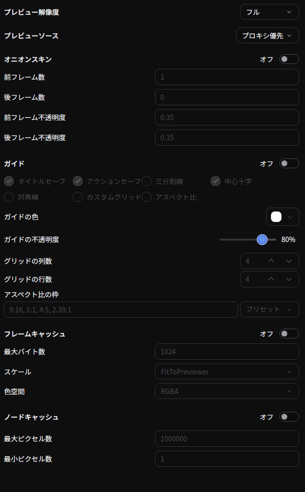

# プレビュー設定

**エディタのプレビューにのみ影響する設定** をまとめたタブです。プレビュー解像度、オニオンスキン表示、ガイド、フレーム／ノードのレンダーキャッシュを扱います。これらの設定はシーンの一部ではないため、エンコード結果には影響しません。

## タブの特徴

- **初期状態で開く**: いいえ
- **複数インスタンスを許可**: いいえ

## 開き方

メニューバーの **「表示」→「ツール」→「プレビュー設定」**、またはプレビューの歯車ボタンから開きます。

## プレビュー解像度

エディタがプレビューをレンダリングする解像度を選びます。画質と引き換えに速度を得るもので、重いシーンでは下げると再生やスクラブが滑らかになります。

- **フル** — プロジェクト解像度でレンダリング（出力スケール `1.0`）。
- **1/2** — 1/2 解像度でレンダリング（`0.5`）。
- **1/4** — 1/4 解像度でレンダリング（`0.25`）。
- **プレビューに合わせる** — フレームを画面のプレビューアに合わせて縮小（フル解像度が上限）。

このタブでは **再生中は変更できません**。プレビュー上の[解像度ボックス](#controls-on-the-preview)は、先に再生を一時停止してから変更します。この設定はプロジェクトには保存されません。[解像度非依存のレンダリングパイプライン](../../advanced/rendering-process.md) により、プレビュー品質を下げてもベクター図形・テキスト・多くのエフェクトは縮小後もシャープに保たれ、単純にピクセル化することはありません。

## プレビューソース

プレビューの再生に[プロキシメディア](./proxies.md)と元のファイルのどちらを使うかを選びます。

- **プロキシ優先** *(既定)* — 要素にプロキシがあればそれを使い、なければ元のファイルにフォールバックします。
- **オリジナル強制** — 常に元のメディアをデコードします。

変更はプロジェクトを再読み込みせずに次のフレームから反映されます。同じオプションは **設定 → エディタ → プロキシメディア** にもあります。この設定にかかわらず、書き出しは常に元のファイルを使用します。

## オニオンスキン

前後のフレームを半透明のゴーストとして重ねて表示し、フレーム間の動きを確認できます。手描きアニメーションやタイミング調整に便利です。このタブ、プレビューの **オニオンスキン** ボタン、または **`Alt + O`** ショートカットで切り替えられます。

- **オニオンスキン** — 全体のオン／オフ（既定はオフ）。
- **前フレーム数** — 現在フレームより前を何フレーム重ねるか（既定 `1`）。
- **後フレーム数** — 現在フレームより後を何フレーム重ねるか（既定 `0`）。
- **前フレーム不透明度** — 前フレームのゴーストの不透明度（既定 `0.35`）。
- **後フレーム不透明度** — 後フレームのゴーストの不透明度（既定 `0.35`）。

## ガイド

プレビューにセーフエリアや構図のガイドを重ねて表示し、編集中にフレーミングを確認できます。このタブ、プレビューの **ガイド** ボタン、または **`Alt + G`** ショートカットで切り替えられます。既定ではオフです。同じ設定は[エディタの設定](../../settings/editor.md#ガイド)ページにもあります。

ガイドは HDR プレビューを含むエディタのプレビューにだけ描画されます。書き出し、[別画面のプレビュー](#show-the-preview-in-another-window)、[スマホプレビュー](./mobile-preview.md)には表示されません。

- **タイトルセーフ** — フレーム中央の 90% の範囲（既定でオン）。
- **アクションセーフ** — フレーム中央の 95% の範囲（既定でオン）。
- **三分割線** — フレームを三等分する線。
- **中心十字** — フレーム中央の十字（既定でオン）。
- **対角線** — 向かい合う角を結ぶ線。
- **カスタムグリッド** — **グリッドの列数** × **グリッドの行数** のグリッド。それぞれ `1`〜`64`（既定は `4` × `4`）。
- **アスペクト比** — **アスペクト比の枠** で指定した比率の枠を中央に表示します。
- **ガイドの色** — 線の色（既定は白）。どのフレームでも見えるよう、各線には暗い縁取りが付きます。
- **ガイドの不透明度** — 線の不透明度（既定 80%）。

**アスペクト比の枠** には比率をカンマ区切りで入力します（既定は `9:16, 1:1, 4:5, 2.39:1`）。それぞれの比率で収まる最大の枠を中央に表示します。**プリセット** では YouTube、YouTube Shorts、TikTok、Instagram Feed、Instagram Reels、X の枠を入力できます。

## プレビュー上の操作部 {/* #controls-on-the-preview */}

よく変える設定は、プレビュー自体の操作部からも変更できます。

- **拡大率ボックス**（再生ボタンの横）: 現在の拡大率を表示します。**プレビュー全体を表示** でフレームをパネルに合わせるか、`10%` 〜 `800%` を選びます。`100%` では、フレームの 1 ピクセルが画面の 1 ピクセルになります。
- **解像度ボックス**: [プレビュー解像度](#プレビュー解像度)と同じ選択肢です。ボックスには **プレビューに合わせる** が **自動** と表示されます。
- **ガイド**、**オニオンスキン**、**市松模様** ボタン（フレームの右の列）: それぞれの表示を切り替えます。この列には **別画面にプレビューを表示** と **プレビュー設定** もあります。

### 拡大と移動

| 操作 | 方法 |
|------|------|
| 拡大 / 縮小 | どのツールでも `Ctrl` + ホイール（macOS では `Cmd` + ホイール）、ピンチ、または `Alt + =` / `Alt + -` |
| フレームをパネルに合わせる | `Alt + 0`、または拡大率ボックスの **プレビュー全体を表示** |
| 拡大したフレームを移動 | **移動** または **範囲選択** ツールでホイール（`Shift` で横方向）、または **ハンド** ツールでドラッグ |

拡大率は、パネルに合わせたサイズの 0.05 倍から 64 倍までです。**移動** と **範囲選択** ツールでは、フレームがパネルに合っている間はホイールで何も起こりません。**ハンド** ツールではホイールで拡大・縮小します。**3Dカメラ操作** では、`Ctrl` + ホイール（`Cmd` + ホイール）はカメラを動かさずにプレビューを拡大・縮小します。フレームの 1 ピクセルが画面の 2 ピクセル以上になるまで拡大すると、フレームのピクセルをくっきりした正方形で描画します。パネルに合わせた表示では滑らかなままです。

### 市松模様

**市松模様** ボタン、または **`Alt + T`** で、フレームの透明な部分を黒ではなく市松模様の上に表示し、黒い部分と見分けられるようにします。マス目は画面上で 8 ピクセルの 2 色のグレーで、拡大率にかかわらず大きさが変わらず、フレームと一緒に動きます。変わるのはエディタのプレビューだけで、別画面のプレビュー、書き出し、保存した画像の透明度はこれまでどおりです。この設定はすべてのエディタに共通で、既定ではオフです。

### シークバーと時刻

- シークバーには、各マーカーがその色の印として表示されます。
- シークバーにポインターを重ねると、ポインター位置の時刻が表示されます。印の近くでは、時刻の上にマーカー名が表示されます。
- 印をクリックすると、再生位置がマーカーの時刻にぴったり移動します。
- シークバーはキーボードのフォーカスを受け取らないので、クリックした後も矢印キーで 1 フレームずつ移動できます。
- `J` / `L` でシャトル再生している間は、合計時間の代わりに `2×` や `−4×` のような速度が表示されます。
- 再生ボタンのツールチップには、現在のショートカットが表示されます。

## プレビューを別画面に表示する {/* #show-the-preview-in-another-window */}

プレビューのディスプレイボタン（**別画面にプレビューを表示**）で、プレビューの出力を別のウィンドウに表示できます。セカンドモニターでの確認などに使います。このウィンドウはエディタの再生、音声、再生位置を共有し、選択範囲の枠、オニオンスキン、3D の編集ハンドルは表示しません。HDR とトーンマッピングの設定は引き継ぎます。

- **ウィンドウで開く** はエディタのあるディスプレイに開きます。
- **全画面: *ディスプレイ* (*幅* × *高さ*)** はそのディスプレイに全画面で開きます。接続中のディスプレイがそれぞれ表示されます。
- 開いている間、メニューには **全画面を切り替え (F11)** と **プレビュー出力を閉じる** が表示されます。
- **スマホプレビュー** は[スマホプレビュー](./mobile-preview.md)タブを開きます。

| プレビューウィンドウのキー | 動作 |
|----------------------------|------|
| `Space` | 再生 / 一時停止 |
| `←` / `→` | 一時停止して 1 フレーム戻る / 進む |
| `F11` | 全画面の切り替え |
| `Esc` | ウィンドウを閉じる |

エディタのタブを切り替える、元のタブを閉じる、エディタを閉じると、このウィンドウも閉じます。ウィンドウだけを閉じても再生は止まりません。

## トーンマッピングと HDR プレビュー

**HDRプレビュー** と、**ディスプレイに合わせる** を含むトーンマッピングのモードは、[エディタの設定](../../settings/editor.md#トーンマッピング)にあります。

## フレームキャッシュ／ノードキャッシュ

この2つのセクションでは、エディタのレンダーキャッシュの有効化と調整を行います。各キャッシュが保持する内容とサイズの目安は [レンダーキャッシュ](../../advanced/render-cache.md) を参照してください。

## ソース

- [`PreviewSettingsTabExtension.cs`](https://github.com/b-editor/beutl/blob/main/src/Beutl.Editor.Components/PreviewSettingsTab/PreviewSettingsTabExtension.cs)
- [`PreviewSettingsTabViewModel.cs`](https://github.com/b-editor/beutl/blob/main/src/Beutl.Editor.Components/PreviewSettingsTab/ViewModels/PreviewSettingsTabViewModel.cs)
- [`PreviewSettingsTabView.axaml`](https://github.com/b-editor/beutl/blob/main/src/Beutl.Editor.Components/PreviewSettingsTab/Views/PreviewSettingsTabView.axaml)
- [`PreviewGuideSettingsViewModel.cs`](https://github.com/b-editor/beutl/blob/fb0eb00b07159f8c1a96c308b38958e29590686a/src/Beutl.Editor.Components/PreviewSettingsTab/ViewModels/PreviewGuideSettingsViewModel.cs)
- [`PreviewGuideOverlay.cs`](https://github.com/b-editor/beutl/blob/fb0eb00b07159f8c1a96c308b38958e29590686a/src/Beutl/Views/PreviewGuideOverlay.cs)
- [`PlayerView.axaml.Presentation.cs`](https://github.com/b-editor/beutl/blob/fb0eb00b07159f8c1a96c308b38958e29590686a/src/Beutl/Views/PlayerView.axaml.Presentation.cs) / [`PresentationWindow.cs`](https://github.com/b-editor/beutl/blob/fb0eb00b07159f8c1a96c308b38958e29590686a/src/Beutl/Views/PresentationWindow.cs)
- [`EditorConfig.cs`](https://github.com/b-editor/beutl/blob/main/src/Beutl.Configuration/EditorConfig.cs)（オニオンスキン・キャッシュ設定）
- [`PlayerView.axaml`](https://github.com/b-editor/beutl/blob/dadee0db956ddb874ab88f48329bc84a5ce5cf6b/src/Beutl/Views/PlayerView.axaml) / [`PlayerView.axaml.Viewport.cs`](https://github.com/b-editor/beutl/blob/dadee0db956ddb874ab88f48329bc84a5ce5cf6b/src/Beutl/Views/PlayerView.axaml.Viewport.cs)
- [`PlayerSeekBar.cs`](https://github.com/b-editor/beutl/blob/dadee0db956ddb874ab88f48329bc84a5ce5cf6b/src/Beutl.Controls/PlayerSeekBar.cs) / [`PreviewCheckerboard.cs`](https://github.com/b-editor/beutl/blob/dadee0db956ddb874ab88f48329bc84a5ce5cf6b/src/Beutl.Engine/Media/PreviewCheckerboard.cs)
- [`SceneEditorExtension.Commands.cs`](https://github.com/b-editor/beutl/blob/dadee0db956ddb874ab88f48329bc84a5ce5cf6b/src/Beutl/Services/PrimitiveImpls/SceneEditorExtension.Commands.cs)（プレビューのショートカット）
