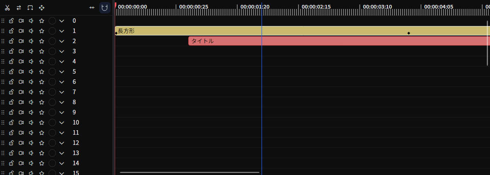

# タイムライン

このタブでは、シーンに含まれる要素を **時間軸上で並べ替え・編集** できます。
レイヤーごとに要素を追加・移動・分割・グループ化できます。再生位置の操作や、フレームキャッシュとマーカーの管理も行えます。

## タブの特性

- **デフォルトで開く**: はい
- **複数同時に開く**: できない

## 開き方

メニューバーの **「表示」→「ツール」→「タイムライン」** から開けます。

## 画面構成

- **タイムラインスケール（上部）**: 時間軸の目盛り。再生位置・シーン開始/終了バー・マーカー・フレームキャッシュを表示します。
- **ツールバー（レイヤーヘッダーの上）**: 左に **レーザーモード**・**スリップツール**・**ロールツール**・**スライドツール**、右に **リップル編集** と **スナップ** のボタンがあります。[編集モード](#編集モード)を参照してください。
- **レイヤーヘッダー（左側）**: 各レイヤーのロック・映像/音声ミュート・ソロの切替と、色・名前の変更を行います。
- **タイムラインパネル（中央）**: 要素を時間×レイヤーで配置する作業領域です。

左右の境界はスプリッタでドラッグして幅を変えられます。

## 要素の操作

### 配置・移動・リサイズ

- 要素本体をドラッグしてレイヤーや時間位置を移動
- 要素の左右端付近にカーソルを合わせるとリサイズ可能（端をドラッグして開始時刻・尺を変更）
- 要素本体をドラッグ中に **`Alt`** を押すと、移動先に **複製** を作成します（元の要素はその場に残ります）。
- 要素が極端に小さく、リサイズのハンドルのみが表示される場合は、**`Ctrl`** を押しながらドラッグしてリサイズせずに移動が可能
- ドラッグ中、端は他の要素・シーンの開始/終了・プレイヘッド・タイムライン原点・マーカーにスナップします。近くにそれらがないときは、現在の拡大率で表示されている **BPMグリッド** の線にスナップします。ドラッグ中に **`Alt`** を押している間はスナップしません。スナップはレイヤーヘッダーの上の **スナップ** ボタン、または何もない場所の右クリックメニューの **スナップ** で切り替えられます。
- 端のドラッグや、スリップ・ロール・スライドの操作中も、フィルムストリップと波形は引き伸ばされず、同じ縮尺のまま新しい位置のフレームと音声を表示します。

### 選択

- 要素のクリックで単一選択、`Ctrl` (macOS では `Cmd`) + クリックで選択の追加/解除
- 何もない場所を `Ctrl` (`Cmd`) + ドラッグで矩形範囲選択
- `Ctrl + A` (`Cmd + A`) ですべての要素を選択、`Ctrl + Shift + A` (`Cmd + Shift + A`) で選択を解除

[エディターの設定](../../settings/editor.md#タイムラインのクリックで再生位置を移動)で **タイムラインのクリックで再生位置を移動** をオフにすると、タイムラインをクリックしても再生位置は動かず、何もない場所をそのままドラッグすると要素を範囲選択します。このとき再生位置は、目盛りの操作か、再生位置のバーのドラッグで動かします。バーの上では、掴めることがカーソルで示されます。

#### 複数の要素をまとめて選択する {/* #select-multiple */}

要素または何もない場所の右クリックメニューにある **まとめて選択** サブメニューでは、位置をもとに要素を選択します。基準になるのは、右クリックした位置の時刻と、その要素または何もない場所のレイヤーです。

- **すべて選択** / **すべての選択を解除**: `Ctrl + A` / `Ctrl + Shift + A`（macOS では `Cmd`）と同じです。
- **同じグループの要素**: 右クリックした要素と同じグループの要素です。何もない場所から開いたときは、選択中の要素と同じグループの要素です。どれもグループに入っていないときは選べません。
- **同一レイヤーの要素**: そのレイヤーのすべての要素です。
- **この位置にある要素（全レイヤー）**: すべてのレイヤーで、その時刻にかかっている要素です。
- **先行要素** / **後続要素**: そのレイヤーで、その時刻以前に始まる要素、またはその時刻より後に終わる要素です。
- **全レイヤーの先行要素** / **全レイヤーの後続要素**: 同じ選択をすべてのレイヤーで行います。
- **選択を反転**: 選択されていない要素を選択し、選択中の要素の選択を解除します。

どのコマンドも選択を置き換え、ロックした要素も含めます。選択を編集するコマンドは、これまでどおりロックした要素には何もしません。

### キーボードショートカット

| 機能 | Windows / Linux | macOS |
|------|------|------|
| コピー | `Ctrl + C` | `Cmd + C` |
| 切り取り | `Ctrl + X` | `Cmd + X` |
| 貼り付け | `Ctrl + V` | `Cmd + V` |
| 選択した要素を複製 | `Ctrl + D` | `Cmd + D` |
| すべて選択 / すべての選択を解除 | `Ctrl + A` / `Ctrl + Shift + A` | `Cmd + A` / `Cmd + Shift + A` |
| 再生位置を中心に拡大 / 縮小 | `Ctrl + =` / `Ctrl + -` | `Cmd + =` / `Cmd + -` |
| 拡大率をリセット | `Ctrl + 0` | `Cmd + 0` |
| シーン全体 / 選択した要素が収まるように表示 | `F` / `Shift + F` | `F` / `Shift + F` |
| 選択した要素を削除 | `Delete` または `Ctrl + Delete` | `Back` または `Cmd + Back` |
| 現在のフレームで分割 | `Ctrl + K` | `Cmd + K` |
| グループ化 / 解除のトグル | `Ctrl + G` | `Cmd + G` |
| 要素のリネーム | `F2` | `Enter` |
| シーンの開始時刻を現在のフレームに合わせる | `[` | `[` |
| シーンの終了時刻を現在のフレームに合わせる | `]` | `]` |
| レーザーモードに切替 | `C` | `C` |
| スリップツールに切替 | `S` | `S` |
| ロールツールに切替 | `R` | `R` |
| スライドツールに切替 | `D` | `D` |
| 現在のツールモードを解除 | `V` または `Esc` | `V` または `Esc` |
| リップル編集のトグル | `B` | `B` |
| 選択した要素の後ろの隙間を詰める | `;` | `;` |
| すべての隙間を詰める | `Shift + Alt + ;` | `Shift + Alt + ;` |
| 次の隙間へ移動 | `Shift + ;` | `Shift + ;` |
| 前の隙間へ移動 | `Alt + ;` | `Alt + ;` |
| マーカーの追加 / 削除 | `M` | `M` |
| 要素を 1 フレーム左 / 右へ移動 | `,` / `.` | `,` / `.` |
| 要素を 10 フレーム左 / 右へ移動 | `Shift + ,` / `Shift + .` | `Shift + ,` / `Shift + .` |
| 要素を 1 秒左 / 右へ移動 | `Alt + ,` / `Alt + .` | `Alt + ,` / `Alt + .` |

要素本体のダブルクリックでもリネームできます。隣接要素との境界やトランジションのダブルクリックは、トランジションの操作になります。従来の **除外** は **削除** に統合されました。

### 再生とプレイヘッドの移動

| 操作 | Windows / Linux | macOS |
|------|------|------|
| 再生 / 一時停止 | `Space` | `Space` |
| 1 フレーム前 / 後へ | `←` / `→` | `←` / `→` |
| 最初 / 最後へ移動 | `Home` / `End` | `Cmd + ←` / `Cmd + →` |
| シャトル巻き戻し / 停止 / 早送り | `J` / `K` / `L` | `J` / `K` / `L` |
| シャトル巻き戻し / 早送り（低速） | `Shift + J` / `Shift + L` | `Shift + J` / `Shift + L` |
| ループ再生の切り替え | `/` | `/` |
| 前 / 次のマーカー | `Ctrl + ←` / `Ctrl + →` | `Alt + ←` / `Alt + →` |
| 前 / 次のキーフレーム（選択要素） | `Ctrl + Shift + ←` / `Ctrl + Shift + →` | `Cmd + Shift + ←` / `Cmd + Shift + →` |

**`J`** / **`L`** で巻き戻し / 早送りのシャトル再生（押すたびに加速）、**`K`** で停止します。**`Shift`** を併用すると速度ステップが細かくなります。**`/`** でループ再生を切り替えます。

**`G`** を押すか、プレビューの現在時刻をクリックすると、再生ヘッドの移動先を正確に入力できます（**タイムコードへジャンプ**）。入力したら `Enter` を押します。タイムコード（`hh:mm:ss:ff`。フレームの前の区切りは `;` でも可）、時刻（`hh:mm:ss.fff` または `mm:ss.fff`）、絶対フレーム（`#120` や `120f`。時刻をフレーム番号で表示しているときは `120` だけでも可）、相対オフセット（`+5s`・`-10f`・`+2m`）、マーカー名の先頭一致（`@intro`）を入力できます。29.97 fps と 59.94 fps のタイムコードは、ドロップフレームでフレームを数えます。時刻は[時刻の表示形式](../../settings/editor.md#time-display-format)で表示されます。

### コマンドパレット

**`Ctrl + Shift + P`**（macOS では `Cmd + Shift + P`）で検索可能なコマンドパレットを開きます。エディタやツールタブで使えるコマンドが一覧表示され、メニューを探さなくても目的の操作を検索して実行でき、ショートカットも確認できます。

コマンドはパレット内で文字列の入力や項目の選択を求めることがあります。たとえば、最近使ったプロジェクトを開く、テーマを変更する、選択した要素の名前を変更する操作に対応します。選択した要素のリネーム・現在のフレームで分割・テンプレートとして保存は、タイムラインタブを閉じていても実行できます。タブを閉じている場合のテンプレート保存では、エディターが保持している選択と各要素のグループを保存します。

### 要素の右クリックメニュー

- **要素を有効化** のトグル
- **ロック** のトグル（ロックした要素は移動・トリム・分割・削除ができなくなります）
- **編集モード** サブメニュー: [何もない場所のメニュー](#何もない場所の右クリックメニュー)と同じツールモードと **リップル編集**
- **分割 / 現在のフレームで分割**
- **無音区間で自動分割**（音声を持つ要素で利用可能。[無音区間で自動分割](./silence-split.md)タブを開きます）
- **切り取り / コピー / 削除**
- **まとめて選択** サブメニュー（[複数の要素をまとめて選択する](#select-multiple)を参照）
- **トラックマット** サブメニュー（[トラックマット](#トラックマット)を参照）
- **トランジション** サブメニュー: **開始のトランジション** / **終了のトランジション**
- **選択した要素をグループ化 / グループ化を解除**
- **リネーム**
- **オリジナルの長さに変更**（メディア要素などで元の長さに戻す）
- **色を変更**
- **サムネイルを無効化** のトグル
- **テンプレートとして保存**（[要素をテンプレートとして保存する](#クリップをテンプレートとして保存する)を参照）
- **アニメーション**サブメニュー: **すべて表示** と、キーフレームのある各プロパティ（インラインレイヤーを開く・閉じる）、続いて **編集を終了する** / **一番上に持ってくる**（[インラインアニメーション編集](#インラインアニメーション編集)を参照）

## 要素のトランジション {/* #クリップのトランジション */}

要素を右クリックして **トランジション → 開始のトランジション** または **終了のトランジション** を選ぶと、[トランジション](./transition.md) タブが開きます。その端にトランジションがなければクロスディゾルブを追加します。同じレイヤーで隣接する要素の境界をダブルクリックしてもクロスディゾルブを追加できます。既存のトランジションの傾斜部分をダブルクリックすると編集でき、ハンドルをドラッグすると長さを調整できます。

## トラックマット

トラックマットは、別のレイヤーのアルファや輝度を使って、要素のどの部分を表示するかを決めます。たとえば非表示のテキスト要素で動画を文字の形に切り抜けます。アニメーションするソースはフレームごとに反映されます。

1. マスクする要素を右クリックし、**トラックマット** を開きます。
2. モードを **アルファ**、**輝度**、**アルファ反転**、**輝度反転** から選びます。**なし**（既定）を選ぶとマットはオフになります。
3. **ソースレイヤー** で **上のレイヤー**（既定）、**下のレイヤー**、または特定のレイヤーを選びます。モードが **なし** のときにソースを選ぶと、モードは **アルファ** になります。ソースに **なし** を選ぶとマットはオフになります。
4. ソース自体を描画しないようにするには、ソースの要素を右クリックして **トラックマット → 出力に表示** をオフにします。

ソースは次のように選ばれます。

- **上のレイヤー** と **下のレイヤー** は、その方向で現在のフレームに要素がある最も近いレイヤーを使います。空のレイヤーは飛ばすので、要素の開始や終了に合わせてソースが切り替わります。
- 特定のレイヤーは、レイヤーを並べ替えても選択されたままです。

そのフレームにソースの要素がない場合、**アルファ** と **輝度** では何も表示されず、反転モードでは要素全体が表示されます。

マットのソースは **ソロ** と **出力に表示** の影響を受けませんが、**動画**（映像ミュート）をオンにしたレイヤーは何も供給しません。**出力に表示** が影響するのは映像だけなので、非表示の要素の音声は再生されます。マスクした要素は、下のレイヤーに対するブレンドモードを保ちます。

マットを設定した要素には、タイムライン上にソースが表示されます。上のレイヤーは **↑**、下のレイヤーは **↓**、特定のレイヤーは **↑ 3** のような矢印とレイヤー番号です。これらの設定はすべて元に戻す履歴に記録され、ロックした要素では変更できません。

## 要素をテンプレートとして保存する {/* #クリップをテンプレートとして保存する */}

**テンプレートとして保存** は、**コピー** の対象になる要素（選択と、それに関わるすべてのグループ）を保存します。要素が 1 つならその要素だけを保存します。複数の要素は 1 つのテンプレートとして保存され、[ファイル](./file-browser.md)タブでは種類が **複数の要素** として示されます。

**テンプレートから追加**、ライブラリ、またはテンプレートファイルのドロップで追加できます。Beutl はすべての要素を新しい ID で作り直し、相対的な開始時間、レイヤー、名前、長さ、グループを保ったまま 1 回の取り消し単位で追加します。指定した場所が使われている場合は、要素全体を最も近い空き位置に置きます。指定したレイヤーがロックされている場合、テンプレートは追加できません。同じレイヤーで重なっている要素は重なったままです。ソースレイヤーを指定したマットはセットと一緒に移動するので、同じソースを保ちます。

## 編集モード

レイヤーヘッダーの上のボタン、何もない場所の右クリックメニューにある **「編集モード」** サブメニュー、または上記のキーボードショートカットからツールモードを選びます。複数のツールモードを同時には有効にできません。有効な間はボタンが点灯し、タイムラインに同じ色の枠が表示されます。ボタンをもう一度クリックするか、`V` または `Esc` を押すと通常の選択ツールに戻ります。ボタンにポインターを乗せると、名前、現在のキー、機能の説明が表示されます。

- **レーザーモード** (`C`): 要素をクリックすると、その位置で分割します。
- **スリップツール** (`S`): 要素をドラッグして、要素を移動せずにソースメディアの表示位置（イン/アウト点）をずらします。
- **ロールツール** (`R`): 要素の端をドラッグして隣接要素との境界を移動し、全体の長さを保ちます。
- **スライドツール** (`D`): 要素をドラッグして移動し、両隣の要素が補正して全体の長さを保ちます。

### リップル編集

**リップル編集** (`B`) はツールモードではなく、オンとオフを切り替える設定です。レイヤーヘッダーの上のボタン、**「編集モード」** サブメニュー、または `B` で切り替えます。オフにするまで有効なままで、状態はセッションをまたいで記憶されます。有効な間は、以下の操作に合わせて同じレイヤー上の後続要素が詰められ(または空けられ)ます。

- **削除** / **切り取り**
- 要素の端のトリム

ロックされたレイヤーは動きません。ロックされた要素はアンカーとして扱われ、そこでリップルの伝播が止まります。

## 隙間を詰める・隙間へ移動する

同じレイヤー上にある要素間の空白は **隙間** として扱われます。何もない場所の右クリックメニューにある **「隙間」** サブメニュー、または以下のキーボードショートカットで操作します。

- **隙間を詰める**: 1つの隙間を詰めます。メニューでは右クリック位置の隙間、ショートカット (`;`) では選択した要素の後ろの隙間が対象になります。要素は隙間の幅ちょうどだけ移動します。移動するとロックされた要素に重なる場合は何も移動せず、**詰める隙間がありません** と表示されます。
- **すべての隙間を詰める** (`Shift + Alt + ;`): すべてのレイヤーのすべての隙間を詰めます。ロックされたレイヤーはスキップされます。ロックされた要素で移動は止まります。それを越えて移動するものはなく、その後ろの隙間はその要素に向かって詰まり、詰めるとロックされた要素に重なる隙間は残ります。
- **次の隙間へ移動** (`Shift + ;`) / **前の隙間へ移動** (`Alt + ;`): 現在のフレームから次/前の隙間へ再生位置を移動します。

## ロック・ミュート・ソロ

### 要素のロック

要素の右クリックメニューにある **「ロック」** で、ロックのオンとオフを切り替えます。ロックされた要素は半透明になり、ロックアイコンが表示されます。移動・トリム・分割・リネーム・削除はできず、リップルや隙間の操作ではアンカーとして扱われます。

### レイヤーのトグル

各レイヤーヘッダーには、4つのトグルボタンがあります。

- **ロック**: レイヤー上のすべての要素をロックします。ロックされたレイヤーはリップルや隙間の操作からも除外されます。
- **動画**（映像ミュート）: 映像の合成時にそのレイヤーをスキップします。音声はそのまま再生されます。
- **音声**（音声ミュート）: 音声の合成時にそのレイヤーをスキップします。映像はそのまま表示されます。
- **ソロ**: いずれかのレイヤーがソロになっている間、ソロでないレイヤーは表示も再生もされません。複数のレイヤーを同時にソロにできます。

## 要素の警告 {/* #element-warnings */}

確認が必要な要素には、名前の前にアイコンが表示されます。要素にポインターを乗せると、アイコンの内容が表示されます。

- 枠線だけの警告マークは、要素の一部を読み込めなかったため、要素が読み取り専用になっていることを示します。[破損した要素の復旧](../../get-started/edit-element.md#破損した要素の復旧)を参照してください。
- エラーマーク付きの文書アイコンは、インストールされていない拡張機能のオブジェクト、読み込めなかったデータ、移行されていない Beutl 1.x の内容など、このビルドの Beutl では表示できないデータが要素にあることを示します。ツールチップには種類ごとの件数が表示されます。[表示できないデータ](./undisplayable-data.md)タブで各項目を確認でき、**場所を表示** ボタンで要素を選択し、タイムラインをその位置までスクロールします。
- 塗りつぶしの警告マークは、**グループ**、**デコレーター**、**タイムコントローラー（動画）**、**2D描画オブジェクト**、**3Dシーン**、**サウンドグループ** のように下のレイヤーの要素を取り込むオブジェクトが、取り込むものを持っていないことを示します。自身の子要素がなく、[ポータル](../library/portal/portal-object.md)が範囲に含むレイヤーに、必要な種類（描画・3D・音声）の要素が時間の重なる位置にない場合です。ツールチップには、オブジェクトに必要なものが表示されます。下のレイヤーに時間が重なるように要素を置き、そのレイヤーまで届く **個数** のポータルをオブジェクトの前に追加するか有効にします。タイムラインを縮小して要素が細い帯で描かれるときは、上端の小さな印でこの警告を示します。

## タイムラインパネルの操作

### マウスホイール

- ホイールで時間軸方向にスクロール
- `Ctrl` (`Cmd`) + ホイールでズームイン/アウト
- `Shift` + ホイールで縦スクロール
- トラックパッド（Windows ではプレシジョンタッチパッド）のピンチでも、トラックやルーラーの上でズームイン/アウト

ホイールやピンチでズームすると、ポインタ位置の時刻がその場にとどまります。

### シーンや選択範囲に合わせて表示する {/* #fit-the-view */}

**全体を表示**（`F`）は、シーンの開始から終了までがタイムラインの幅に収まるように、拡大率とスクロール位置を変えます。**選択範囲を表示**（`Shift + F`）は、選択した要素の最初の開始から最後の終了までを同じように表示し、選択した要素のうち最も上のレイヤーが見えていないときは、そのレイヤーまでスクロールします。何も選択していないときは使えません。どちらも、何もない場所の右クリックメニューの **拡大率** サブメニューの先頭と、コマンドパレットにあります。

### 何もない場所の右クリックメニュー

- **編集モード** サブメニュー: **レーザーモード** / **スリップツール** / **ロールツール** / **スライドツール** / **リップル編集** のトグル
- **要素を追加** / **テンプレートから追加**（ライブラリの登録項目から選択）
- **調整レイヤーを追加**（[バックドロップ](../library/drawables/sources/backdrop.md)ベースの要素を追加。付けたフィルターエフェクトが下のレイヤーに適用される）
- **貼り付け**（要素・ファイル・クリップボードの画像）。ロックしたレイヤーへの貼り付けや、プロジェクトを保存する前など、貼り付けられないときはその理由が表示されます。
- **開始時間を設定 / 終了時間を設定**（クリック位置に合わせる）
- **隙間** サブメニュー: **隙間を詰める**（クリック位置の隙間）/ **すべての隙間を詰める** / **次の隙間へ移動** / **前の隙間へ移動**
- **まとめて選択** サブメニュー（[複数の要素をまとめて選択する](#select-multiple)を参照）
- **自動でシーンの長さを調整** のトグル
- **スナップ** のトグル
- **シーン設定**（シーン設定タブを開く）
- **BPMグリッド**（BPM・拍子・オフセットの設定）
- **拡大率** サブメニュー: **全体を表示** / **選択範囲を表示**（[シーンや選択範囲に合わせて表示する](#fit-the-view)を参照）、続いて 200% / 170% / 150% / 120% / 100% / 70% / 50% / 20%

### ドラッグ&ドロップ

- ライブラリの項目（描画オブジェクト・テンプレートなど）をドロップして要素を追加
- ライブラリのトランジションを要素にドロップして、要素のポインターに近い側の端に設定
- ファイル（[SVG](../library/drawables/sources/image.md) を含む画像・動画・音声・テンプレート JSON）をドロップして要素を追加
- 複数のファイルをドロップすると、1 回の取り消し単位ですべて追加します。ファイル名の順（数字は `1`、`2`、`10` の順）に、ドロップ位置から順に並べます。音声だけのファイルは同じフレームから別のレイヤーに置くので、BGM が映像の下で流れます。どのデコーダーでも開けないファイルは追加しません。
- 字幕ファイル（SRT、WebVTT、ASS/SSA）をドロップすると、字幕ごとに 1 つのテキスト要素を、ファイルが指定する時刻でシーンの上の新しいレイヤーに追加します。[字幕ファイル](#subtitle-files)を参照してください。

### 字幕ファイル {/* #subtitle-files */}

ドロップした字幕ファイルは、字幕ごとに 1 つのテキスト要素になり、要素にはファイル名が付きます。時間が重なる字幕は別々のレイヤーに置き、ロックしたレイヤーは避けます。1 回の取り消しでドロップ全体を元に戻せます。Windows の字幕ツールが書き出したファイル（BOM 付きの UTF-16 や、システムの従来のコードページ）も正しく読み込めます。

テキストを含む[テンプレート](#クリップをテンプレートとして保存する)を保存している場合は、ドロップした位置に **テキストテンプレート** のメニューが開きます。**既定** かテンプレートをクリックすると要素を追加し、`Esc` を押すかほかの場所をクリックするとドロップ全体を取りやめます。前回選んだテンプレートが先頭の、ポインターの下に表示されます。テンプレートには、保存したテキストオブジェクト、要素、複数の要素を使えます。

- テンプレート内のすべてのテキストオブジェクトが、字幕のテキストになります。描画オブジェクトのグループ内のテキストも対象です。
- 要素 1 つのテンプレートは、字幕の開始時刻と長さに合わせ、位置はそのまま保ちます。
- 複数の要素のテンプレートでは、テキスト要素と同じ長さの要素（文字の後ろの帯など）が、テキストと一緒に字幕の長さに合わせられます。飾りなどほかの要素は長さを保ち、字幕より後にはみ出す部分だけが削られます。相対的なレイヤー、グループ、トラックマットは保たれます。

## インラインアニメーション編集

要素直下にプロパティ専用のレーンを表示し、グラフエディタタブを開かずにキーフレームアニメーションをタイムライン上で編集する機能です。

### 要素のキーフレームの印 {/* #keyframe-marks */}

要素の下端には、キーフレームの時刻ごとに小さなダイヤモンド形の印が表示されます。印は、トランスフォーム・ブラシ・エフェクトのものを含め、要素のアニメーションするすべてのプロパティのキーフレームを示し、キーフレームの追加・移動・削除に合わせて更新されます。近すぎて重なる印は 1 つにまとめて描くので、縮小した要素でも見やすく保たれます。キーフレームを編集するには、要素の **アニメーション** サブメニューからインラインレイヤーを開きます。

### 開き方・閉じ方

- プロパティの右側にある **︙（三点リーダ縦）メニュー** から **「インライン表示でアニメーションを編集」** を選ぶと、その要素の下にインラインレイヤーが追加されます。
- または、要素を右クリックして **アニメーション** を開きます。サブメニューには、キーフレームのあるプロパティが `矩形 › 塗りつぶし › 不透明度` のようなパスで並びます。プロパティをクリックするとインラインレイヤーを開き、開いているときは閉じます。**すべて表示** をクリックすると、すべてのプロパティのインラインレイヤーを開きます。キーフレームのない要素では **アニメーションはありません** と表示され、ロックした要素では項目を選べません。
- 同じプロパティのアニメーションを二重に開くことはできません。
- インラインレイヤーのヘッダーにある **× ボタン** で閉じられます（プロパティのアニメーション自体は残ります）。
- 要素の右クリックメニュー → **アニメーション → 編集を終了する** で、その要素のインラインをすべてまとめて閉じられます。

### インラインレイヤーの構成

- **ヘッダー（レイヤーヘッダー側）**
  - 並び替えハンドル（縦ドラッグで同じ要素内のインラインの順序を変更）
  - **×（閉じる）** ボタン
  - **開く** ボタン: 同じアニメーションをグラフエディタタブで開く
  - プロパティ名のテキストボックス（読み取り専用）
- **タイムライン側**
  - 要素の枠を示すボーダー
  - 要素の範囲にわたる **値のグラフ**。キーフレームとイージングが到達する最小値から最大値の間で描きます。最初のキーフレームより前と最後のキーフレームより後は、値を保持します。点・サイズ・ベクトル・色のように複数の成分を持つ値は、成分ごとにグラフエディタと同じ色の線を描きます。グラフエディタで描けない値では、代わりに隣接キーフレーム間の **イージング曲線**（値が大きい/小さい/同じに応じて上下方向に描画）を表示します。
  - 各キーフレームの **◆ ダイヤモンドアイコン**

### キーフレームの操作

- **左ドラッグ**でキーフレームの時刻を変更します。
  - ドラッグ中、キーフレームはプレイヘッド・マーカー・シーンの開始/終了・タイムライン原点・すべての要素の端・ほかに開いているインラインレイヤーのキーフレームにスナップします。近くにそれらがないときは、現在の拡大率で表示されている **BPMグリッド** の線にスナップします。同じインラインレイヤーのほかのキーフレームにはスナップしません。**`Alt`** を押しながらドラッグするとスナップしません。スナップはタイムラインの **スナップ** の設定に従います。
  - リリース時にシーンのフレームレートにスナップ（丸め）されます。
  - ドロップ後の値は履歴（Undo/Redo）に記録されます。
- **`Shift` + ドラッグ**で、同じインライン内の他のキーフレームも一緒に移動します（相対関係を維持）。ドラッグしたキーフレームがスナップし、ほかのキーフレームはそれについて動きます。**`Alt`** も押すと、スナップせずに移動します。
- キーフレーム上の右クリックメニュー
  - **コピー** — そのキーフレーム単体を JSON としてクリップボードへ
  - **貼り付け** — そのキーフレームの位置に貼り付け（型が一致しない場合はイージングのみ適用）
  - **削除** — そのキーフレームを削除

### インラインレイヤーの右クリックメニュー

レーン上のキーフレーム以外の領域を右クリックすると以下が表示されます。

- **すべてコピー** — このプロパティのアニメーション全体を JSON としてコピー
- **貼り付け** — マウス位置にキーフレームまたはアニメーションを貼り付け
  - クリップボードがキーフレームのとき: マウス位置にキーフレームを挿入。同じ時刻に既存のキーフレームがあれば、その値とイージングを上書きします。
  - クリップボードがアニメーション全体のとき: 既存のアニメーションを丸ごと置き換えます。
  - プロパティの型が一致しないキーフレームを貼り付けた場合は、イージングのみが適用されます。
- **削除** — このプロパティのアニメーションを丸ごと削除（プロパティは静的な値に戻ります）

### イージングのドラッグ&ドロップ

ライブラリのイージング項目をインラインレイヤーへドロップすると、ドロップ位置を基準に動作が変わります。

- ドロップ位置の近くに既存のキーフレームがある場合は、そのキーフレームの **イージングを変更** します。
- 近くにキーフレームがない場合は、ドロップ位置に **新しいキーフレームを挿入** し、その遷移区間に指定したイージングを設定します。

### 並び替えと表示順

- 同じレイヤー上で複数のインラインを開いている場合、ヘッダーの並び替えハンドルを縦にドラッグして順序を変更できます。
- 要素の右クリックメニュー → **アニメーション → 一番上に持ってくる** で、その要素のインラインをまとめてレイヤー内の最上部に並び替えます。

### グローバルクロックと要素クロック

アニメーションの **グローバル時計を使う** が有効なとき、要素を移動してもキーフレームの表示位置は変わりません（要素の開始時刻に関係なく、常に同じ時間に同じ位置に表示されます）。

## タイムラインスケール（上部目盛り）

- スケールをクリックまたはドラッグで再生位置を移動
- スケールの時刻は[時刻の表示形式](../../settings/editor.md#time-display-format)に従います（既定はタイムコード。時間やフレーム番号も選べます）
- 赤いシーン開始/終了バーをドラッグでシーンの開始時間・尺を変更
- スケール上端のマーカーをクリックで編集、ドラッグで移動
- 下端のフレームキャッシュ表示を右クリックで **すべて削除 / 削除 / ロック / ロック解除**

## レイヤーヘッダー

- 左端のハンドルを上下にドラッグして、レイヤーを要素ごと別の行へ移動。ロックしたレイヤーは移動できません
- レイヤーの行と、その下のインラインレイヤーの高さは、[エディターの設定](../../settings/editor.md#timeline-layer-height)の **タイムラインのレイヤーの高さ** で **小**（既定）・**中**・**大** から選べます
- 4つのボタンで **ロック** / **動画**（映像ミュート）/ **音声**（音声ミュート）/ **ソロ** を切替（[ロック・ミュート・ソロ](#ロックミュートソロ)を参照）
- カラーピッカーでレイヤー色を変更
- テキストボックスにレイヤー名を入力し、`Enter` を押すかフォーカスを外して変更。名前はヘッダーをドラッグして別の行に移したレイヤーについて移動し、シーンに保存され、元に戻せます（**レイヤーの名前を変更**）。ボックスを空にするか、その行の番号を入力すると、名前が消えます

## トラックパッドの触覚フィードバック

macOS のトラックパッドでは、ドラッグが揃える対象に達すると触覚フィードバックが返ります。

- **タイムライン**: 要素の移動、端のトリム、スリップ・ロール・スライドのトリム、インラインレイヤーでのキーフレームのドラッグが新しいスナップ先に達したとき。
- **プレビュー**: トランスフォームハンドルの `Shift` による回転が新しい 15° の刻みに達したとき。
- **数値フィールド**: [スクラブ](./element-property.md#数値のスクラブ)がゼロまたはプロパティの既定値に達した、または通過したとき。ベクトルの各成分も対象です。
- **[ノードグラフ](./node-graph.md)**: ワイヤーが接続できるポートに吸い付いたとき。

対象に留まっている間、ドラッグを離したとき、キーボードでの編集、元に戻す・やり直しでは繰り返されません。Beutl に設定項目はなく、macOS のトラックパッドのフィードバック設定に従います。

## 再生中の自動スクロール

**設定 > エディタ > 再生時のタイムライン自動スクロール** の設定に応じて、再生中は再生位置に合わせて自動でスクロールします。

## 関連ドキュメント

- [要素を追加する](../../get-started/add-element.md)
- [要素を編集する](../../get-started/edit-element.md)
- [キーフレーム](../../get-started/keyframe.md)
- [シーン設定](./scene-settings.md)
- [グラフエディタ](./graph-editor.md)

## ソース

- [`TimelineTabExtension.cs`](https://github.com/b-editor/beutl/blob/f9cbaeef9da0077f6745010a2d69955e12c45187/src/Beutl.Editor.Components/TimelineTab/TimelineTabExtension.cs)
- [`TimelineTabViewModel.cs`](https://github.com/b-editor/beutl/blob/f9cbaeef9da0077f6745010a2d69955e12c45187/src/Beutl.Editor.Components/TimelineTab/ViewModels/TimelineTabViewModel.cs)
- [`TimelineTabView.axaml`](https://github.com/b-editor/beutl/blob/f9cbaeef9da0077f6745010a2d69955e12c45187/src/Beutl.Editor.Components/TimelineTab/Views/TimelineTabView.axaml) / [`.axaml.cs`](https://github.com/b-editor/beutl/blob/f9cbaeef9da0077f6745010a2d69955e12c45187/src/Beutl.Editor.Components/TimelineTab/Views/TimelineTabView.axaml.cs)
- [`ElementView.axaml`](https://github.com/b-editor/beutl/blob/f9cbaeef9da0077f6745010a2d69955e12c45187/src/Beutl.Editor.Components/TimelineTab/Views/ElementView.axaml) / [`.axaml.cs`](https://github.com/b-editor/beutl/blob/f9cbaeef9da0077f6745010a2d69955e12c45187/src/Beutl.Editor.Components/TimelineTab/Views/ElementView.axaml.cs)
- [`InlineAnimationLayerViewModel.cs`](https://github.com/b-editor/beutl/blob/f9cbaeef9da0077f6745010a2d69955e12c45187/src/Beutl.Editor.Components/TimelineTab/ViewModels/InlineAnimationLayerViewModel.cs)
- [`InlineKeyFrameViewModel.cs`](https://github.com/b-editor/beutl/blob/f9cbaeef9da0077f6745010a2d69955e12c45187/src/Beutl.Editor.Components/TimelineTab/ViewModels/InlineKeyFrameViewModel.cs)
- [`InlineAnimationLayer.axaml`](https://github.com/b-editor/beutl/blob/f9cbaeef9da0077f6745010a2d69955e12c45187/src/Beutl.Editor.Components/TimelineTab/Views/InlineAnimationLayer.axaml) / [`.axaml.cs`](https://github.com/b-editor/beutl/blob/f9cbaeef9da0077f6745010a2d69955e12c45187/src/Beutl.Editor.Components/TimelineTab/Views/InlineAnimationLayer.axaml.cs)
- [`InlineAnimationLayerHeader.axaml`](https://github.com/b-editor/beutl/blob/f9cbaeef9da0077f6745010a2d69955e12c45187/src/Beutl.Editor.Components/TimelineTab/Views/InlineAnimationLayerHeader.axaml) / [`.axaml.cs`](https://github.com/b-editor/beutl/blob/f9cbaeef9da0077f6745010a2d69955e12c45187/src/Beutl.Editor.Components/TimelineTab/Views/InlineAnimationLayerHeader.axaml.cs)
- [`InlineEasingGraphControl.cs`](https://github.com/b-editor/beutl/blob/f9cbaeef9da0077f6745010a2d69955e12c45187/src/Beutl.Editor.Components/TimelineTab/Views/InlineEasingGraphControl.cs)
- [`PropertyEditorMenu.axaml.cs`](https://github.com/b-editor/beutl/blob/f9cbaeef9da0077f6745010a2d69955e12c45187/src/Beutl.Editor.Components/PropertyEditors/Views/PropertyEditorMenu.axaml.cs)（インライン表示の起点）
- [`LayerHeader.axaml`](https://github.com/b-editor/beutl/blob/f9cbaeef9da0077f6745010a2d69955e12c45187/src/Beutl.Editor.Components/TimelineTab/Views/LayerHeader.axaml) / [`LayerHeaderViewModel.cs`](https://github.com/b-editor/beutl/blob/f9cbaeef9da0077f6745010a2d69955e12c45187/src/Beutl.Editor.Components/TimelineTab/ViewModels/LayerHeaderViewModel.cs)（レイヤーのロック・ミュート・ソロ）
- [`RippleHelper.cs`](https://github.com/b-editor/beutl/blob/f9cbaeef9da0077f6745010a2d69955e12c45187/src/Beutl.Editor/Services/RippleHelper.cs)（リップル編集）
- [`ElementGapService.cs`](https://github.com/b-editor/beutl/blob/f9cbaeef9da0077f6745010a2d69955e12c45187/src/Beutl.Editor/Services/ElementGapService.cs)（隙間の操作）
- [`ElementSlipService.cs`](https://github.com/b-editor/beutl/blob/f9cbaeef9da0077f6745010a2d69955e12c45187/src/Beutl.Editor/Services/ElementSlipService.cs) / [`ElementResizeService.cs`](https://github.com/b-editor/beutl/blob/f9cbaeef9da0077f6745010a2d69955e12c45187/src/Beutl.Editor/Services/ElementResizeService.cs)（スリップ / ロール / スライド）
- [`TimelineTabExtension.Commands.cs`](https://github.com/b-editor/beutl/blob/dadee0db956ddb874ab88f48329bc84a5ce5cf6b/src/Beutl.Editor.Components/TimelineTab/TimelineTabExtension.Commands.cs)
- [`MainViewExtension.cs`](https://github.com/b-editor/beutl/blob/f9cbaeef9da0077f6745010a2d69955e12c45187/src/Beutl/Services/PrimitiveImpls/MainViewExtension.cs)
- [`ElementStructureService.cs`](https://github.com/b-editor/beutl/blob/f9cbaeef9da0077f6745010a2d69955e12c45187/src/Beutl.Editor/Services/ElementStructureService.cs)
- [`Scene.Gaps.cs`](https://github.com/b-editor/beutl/blob/fb0eb00b07159f8c1a96c308b38958e29590686a/src/Beutl.ProjectSystem/ProjectSystem/Scene.Gaps.cs)
- [`ElementView.TrackMatte.cs`](https://github.com/b-editor/beutl/blob/fb0eb00b07159f8c1a96c308b38958e29590686a/src/Beutl.Editor.Components/TimelineTab/Views/ElementView.TrackMatte.cs) / [`SceneCompositor.TrackMatte.cs`](https://github.com/b-editor/beutl/blob/fb0eb00b07159f8c1a96c308b38958e29590686a/src/Beutl.ProjectSystem/SceneCompositor.TrackMatte.cs)
- [`TemplateSaving.cs`](https://github.com/b-editor/beutl/blob/fb0eb00b07159f8c1a96c308b38958e29590686a/src/Beutl.Editor.Components/Helpers/TemplateSaving.cs) / [`ElementSet.cs`](https://github.com/b-editor/beutl/blob/fb0eb00b07159f8c1a96c308b38958e29590686a/src/Beutl.ProjectSystem/ProjectSystem/ElementSet.cs)
- [`NativeHapticFeedback.cs`](https://github.com/b-editor/beutl/blob/fb0eb00b07159f8c1a96c308b38958e29590686a/src/Beutl.Controls/Helpers/NativeHapticFeedback.cs)
- [`FileDropLayout.cs`](https://github.com/b-editor/beutl/blob/dadee0db956ddb874ab88f48329bc84a5ce5cf6b/src/Beutl.Editor.Components/TimelineTab/FileDropLayout.cs) / [`CaptionFileDrop.cs`](https://github.com/b-editor/beutl/blob/dadee0db956ddb874ab88f48329bc84a5ce5cf6b/src/Beutl.Editor.Components/TimelineTab/CaptionFileDrop.cs)（ドロップしたファイルと字幕ファイル）
- [`ElementCaptionTemplateAdapter.cs`](https://github.com/b-editor/beutl/blob/dadee0db956ddb874ab88f48329bc84a5ce5cf6b/src/Beutl.Editor/Services/Captions/ElementCaptionTemplateAdapter.cs)（要素のテンプレートを字幕に使う処理）
- [`TimelineSelectionMenu.cs`](https://github.com/b-editor/beutl/blob/70d09a97d4491bf6616e248fec809faa58e47db7/src/Beutl.Editor.Components/TimelineTab/Views/TimelineSelectionMenu.cs) / [`TimelineTabViewModel.Selection.cs`](https://github.com/b-editor/beutl/blob/70d09a97d4491bf6616e248fec809faa58e47db7/src/Beutl.Editor.Components/TimelineTab/ViewModels/TimelineTabViewModel.Selection.cs)（まとめて選択）
- [`GotoTimecodeParser.cs`](https://github.com/b-editor/beutl/blob/70d09a97d4491bf6616e248fec809faa58e47db7/src/Beutl.ProjectSystem/GotoTimecodeParser.cs) / [`TimeDisplayFormatter.cs`](https://github.com/b-editor/beutl/blob/70d09a97d4491bf6616e248fec809faa58e47db7/src/Beutl.ProjectSystem/TimeDisplayFormatter.cs) / [`TimelineScale.cs`](https://github.com/b-editor/beutl/blob/70d09a97d4491bf6616e248fec809faa58e47db7/src/Beutl.Editor.Components/Views/TimelineScale.cs)（時刻とスケール）
- [`TimelineTabView.DragDrop.cs`](https://github.com/b-editor/beutl/blob/70d09a97d4491bf6616e248fec809faa58e47db7/src/Beutl.Editor.Components/TimelineTab/Views/TimelineTabView.DragDrop.cs)（ドラッグ&ドロップ）
- [`TimelineTabView.axaml.cs`](https://github.com/b-editor/beutl/blob/002aefdf04748db026dfeaf506d5e465576ca08c/src/Beutl.Editor.Components/TimelineTab/Views/TimelineTabView.axaml.cs) / [`NativeScrollInput.Windows.cs`](https://github.com/b-editor/beutl/blob/002aefdf04748db026dfeaf506d5e465576ca08c/src/Beutl.Editor.Components/Helpers/NativeScrollInput.Windows.cs)（ピンチでのズーム）
- [`TimelineTabView.axaml`](https://github.com/b-editor/beutl/blob/2c662378061e338f16e0f6f70e03704c172c5891/src/Beutl.Editor.Components/TimelineTab/Views/TimelineTabView.axaml) / [`TimelineTabExtension.Commands.cs`](https://github.com/b-editor/beutl/blob/2c662378061e338f16e0f6f70e03704c172c5891/src/Beutl.Editor.Components/TimelineTab/TimelineTabExtension.Commands.cs)（ツールバー、拡大率サブメニュー、シーンや選択範囲に合わせた表示）
- [`SnapHelper.cs`](https://github.com/b-editor/beutl/blob/2c662378061e338f16e0f6f70e03704c172c5891/src/Beutl.Editor.Components/Helpers/SnapHelper.cs) / [`BpmGridLines.cs`](https://github.com/b-editor/beutl/blob/2c662378061e338f16e0f6f70e03704c172c5891/src/Beutl.Editor.Components/Helpers/BpmGridLines.cs) / [`InlineKeyFrameViewModel.cs`](https://github.com/b-editor/beutl/blob/2c662378061e338f16e0f6f70e03704c172c5891/src/Beutl.Editor.Components/TimelineTab/ViewModels/InlineKeyFrameViewModel.cs) / [`TimelineSnapFeedback.cs`](https://github.com/b-editor/beutl/blob/2c662378061e338f16e0f6f70e03704c172c5891/src/Beutl.Editor.Components/TimelineTab/Views/TimelineSnapFeedback.cs)（スナップ先）
- [`ElementView.Animation.cs`](https://github.com/b-editor/beutl/blob/2c662378061e338f16e0f6f70e03704c172c5891/src/Beutl.Editor.Components/TimelineTab/Views/ElementView.Animation.cs) / [`ElementAnimations.cs`](https://github.com/b-editor/beutl/blob/2c662378061e338f16e0f6f70e03704c172c5891/src/Beutl.Editor.Components/TimelineTab/ViewModels/ElementAnimations.cs) / [`ElementKeyFrameMarks.cs`](https://github.com/b-editor/beutl/blob/2c662378061e338f16e0f6f70e03704c172c5891/src/Beutl.Editor.Components/TimelineTab/Views/ElementKeyFrameMarks.cs) / [`InlineEasingGraphControl.cs`](https://github.com/b-editor/beutl/blob/2c662378061e338f16e0f6f70e03704c172c5891/src/Beutl.Editor.Components/TimelineTab/Views/InlineEasingGraphControl.cs)（アニメーションのサブメニュー、キーフレームの印、値のグラフ）
- [`ElementViewModel.cs`](https://github.com/b-editor/beutl/blob/2c662378061e338f16e0f6f70e03704c172c5891/src/Beutl.Editor.Components/TimelineTab/ViewModels/ElementViewModel.cs) / [`TimelineTabViewModel.FlowInputs.cs`](https://github.com/b-editor/beutl/blob/2c662378061e338f16e0f6f70e03704c172c5891/src/Beutl.Editor.Components/TimelineTab/ViewModels/TimelineTabViewModel.FlowInputs.cs) / [`FlowInputDiagnostics.cs`](https://github.com/b-editor/beutl/blob/2c662378061e338f16e0f6f70e03704c172c5891/src/Beutl.ProjectSystem/ProjectSystem/FlowInputDiagnostics.cs)（要素の警告）
- [`ElementViewModel.Thumbnails.cs`](https://github.com/b-editor/beutl/blob/2c662378061e338f16e0f6f70e03704c172c5891/src/Beutl.Editor.Components/TimelineTab/ViewModels/ElementViewModel.Thumbnails.cs)（ドラッグ中のフィルムストリップと波形）
- [`LayerHeader.axaml.cs`](https://github.com/b-editor/beutl/blob/2c662378061e338f16e0f6f70e03704c172c5891/src/Beutl.Editor.Components/TimelineTab/Views/LayerHeader.axaml.cs)（レイヤーの移動）
