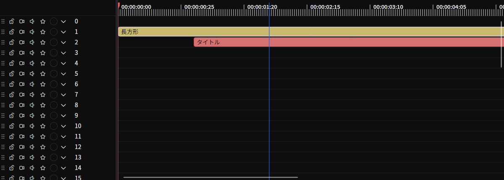

# タイムライン

このタブでは、シーンに含まれる要素を **時間軸上で並べ替え・編集** できます。
レイヤーごとに要素を追加・移動・分割・グループ化できます。再生位置の操作や、フレームキャッシュとマーカーの管理も行えます。

## タブの特性

- **デフォルトで開く**: はい
- **複数同時に開く**: できない

## 開き方

メニューバーの **「表示」→「ツール」→「タイムライン」** から開けます。

## 画面構成

- **タイムラインスケール（上部）**: 時間軸の目盛り。再生位置・シーン開始/終了バー・マーカー・フレームキャッシュを表示します。
- **レイヤーヘッダー（左側）**: 各レイヤーのロック・映像/音声ミュート・ソロの切替と、色・名前の変更を行います。
- **タイムラインパネル（中央）**: 要素を時間×レイヤーで配置する作業領域です。

左右の境界はスプリッタでドラッグして幅を変えられます。

## 要素の操作

### 配置・移動・リサイズ

- 要素本体をドラッグしてレイヤーや時間位置を移動
- 要素の左右端付近にカーソルを合わせるとリサイズ可能（端をドラッグして開始時刻・尺を変更）
- 要素本体をドラッグ中に **`Alt`** を押すと、移動先に **複製** を作成します（元の要素はその場に残ります）。要素の端をドラッグしてリサイズする場合は、**`Alt`** でスナップが一時的に無効になります。
- 要素が極端に小さく、リサイズのハンドルのみが表示される場合は、**`Ctrl`** を押しながらドラッグしてリサイズせずに移動が可能
- ドラッグ中、端は他の要素・シーンの開始/終了・プレイヘッド・タイムライン原点にスナップします。スナップは何もない場所の右クリックメニューの **スナップ** で切り替えられます。

### 選択

- 要素のクリックで単一選択、`Ctrl` (macOS では `Cmd`) + クリックで選択の追加/解除
- 何もない場所を `Ctrl` (`Cmd`) + ドラッグで矩形範囲選択
- `Ctrl + A` (`Cmd + A`) ですべてのクリップを選択、`Ctrl + Shift + A` (`Cmd + Shift + A`) で選択を解除

[エディターの設定](../../settings/editor.md#タイムラインのクリックで再生位置を移動)で **タイムラインのクリックで再生位置を移動** をオフにすると、タイムラインをクリックしても再生位置は動かず、何もない場所をそのままドラッグするとクリップを範囲選択します。このとき再生位置は、目盛りの操作か、再生位置のバーのドラッグで動かします。バーの上では、掴めることがカーソルで示されます。

#### 複数の要素をまとめて選択する {/* #select-multiple */}

要素または何もない場所の右クリックメニューにある **まとめて選択** サブメニューでは、位置をもとに要素を選択します。基準になるのは、右クリックした位置の時刻と、その要素または何もない場所のレイヤーです。

- **すべて選択** / **すべての選択を解除**: `Ctrl + A` / `Ctrl + Shift + A`（macOS では `Cmd`）と同じです。
- **同じグループの要素**: 右クリックした要素と同じグループの要素です。何もない場所から開いたときは、選択中の要素と同じグループの要素です。どれもグループに入っていないときは選べません。
- **同一レイヤーの要素**: そのレイヤーのすべての要素です。
- **この位置にある要素（全レイヤー）**: すべてのレイヤーで、その時刻にかかっている要素です。
- **先行要素** / **後続要素**: そのレイヤーで、その時刻以前に始まる要素、またはその時刻より後に終わる要素です。
- **全レイヤーの先行要素** / **全レイヤーの後続要素**: 同じ選択をすべてのレイヤーで行います。
- **選択を反転**: 選択されていない要素を選択し、選択中の要素の選択を解除します。

どのコマンドも選択を置き換え、ロックした要素も含めます。選択を編集するコマンドは、これまでどおりロックした要素には何もしません。

### キーボードショートカット

| 機能 | Windows / Linux | macOS |
|------|------|------|
| コピー | `Ctrl + C` | `Cmd + C` |
| 切り取り | `Ctrl + X` | `Cmd + X` |
| 貼り付け | `Ctrl + V` | `Cmd + V` |
| 選択した要素を複製 | `Ctrl + D` | `Cmd + D` |
| すべて選択 / すべての選択を解除 | `Ctrl + A` / `Ctrl + Shift + A` | `Cmd + A` / `Cmd + Shift + A` |
| 再生位置を中心に拡大 / 縮小 | `Ctrl + =` / `Ctrl + -` | `Cmd + =` / `Cmd + -` |
| 拡大率をリセット | `Ctrl + 0` | `Cmd + 0` |
| 選択した要素を削除 | `Delete` または `Ctrl + Delete` | `Back` または `Cmd + Back` |
| 現在のフレームで分割 | `Ctrl + K` | `Cmd + K` |
| グループ化 / 解除のトグル | `Ctrl + G` | `Cmd + G` |
| 要素のリネーム | `F2` | `Enter` |
| シーンの開始時刻を現在のフレームに合わせる | `[` | `[` |
| シーンの終了時刻を現在のフレームに合わせる | `]` | `]` |
| レーザーモードに切替 | `C` | `C` |
| スリップツールに切替 | `S` | `S` |
| ロールツールに切替 | `R` | `R` |
| スライドツールに切替 | `D` | `D` |
| 現在のツールモードを解除 | `V` または `Esc` | `V` または `Esc` |
| リップル編集のトグル | `B` | `B` |
| 選択した要素の後ろの隙間を詰める | `;` | `;` |
| すべての隙間を詰める | `Shift + Alt + ;` | `Shift + Alt + ;` |
| 次の隙間へ移動 | `Shift + ;` | `Shift + ;` |
| 前の隙間へ移動 | `Alt + ;` | `Alt + ;` |
| マーカーの追加 / 削除 | `M` | `M` |
| 要素を 1 フレーム左 / 右へ移動 | `,` / `.` | `,` / `.` |
| 要素を 10 フレーム左 / 右へ移動 | `Shift + ,` / `Shift + .` | `Shift + ,` / `Shift + .` |
| 要素を 1 秒左 / 右へ移動 | `Alt + ,` / `Alt + .` | `Alt + ,` / `Alt + .` |

要素本体のダブルクリックでもリネームできます。隣接クリップとの境界やトランジションのダブルクリックは、トランジションの操作になります。従来の **除外** は **削除** に統合されました。

### 再生とプレイヘッドの移動

| 操作 | Windows / Linux | macOS |
|------|------|------|
| 再生 / 一時停止 | `Space` | `Space` |
| 1 フレーム前 / 後へ | `←` / `→` | `←` / `→` |
| 最初 / 最後へ移動 | `Home` / `End` | `Cmd + ←` / `Cmd + →` |
| シャトル巻き戻し / 停止 / 早送り | `J` / `K` / `L` | `J` / `K` / `L` |
| シャトル巻き戻し / 早送り（低速） | `Shift + J` / `Shift + L` | `Shift + J` / `Shift + L` |
| ループ再生の切り替え | `/` | `/` |
| 前 / 次のマーカー | `Ctrl + ←` / `Ctrl + →` | `Alt + ←` / `Alt + →` |
| 前 / 次のキーフレーム（選択要素） | `Ctrl + Shift + ←` / `Ctrl + Shift + →` | `Cmd + Shift + ←` / `Cmd + Shift + →` |

**`J`** / **`L`** で巻き戻し / 早送りのシャトル再生（押すたびに加速）、**`K`** で停止します。**`Shift`** を併用すると速度ステップが細かくなります。**`/`** でループ再生を切り替えます。

**`G`** を押すか、プレビューの現在時刻をクリックすると、再生ヘッドの移動先を正確に入力できます（**タイムコードへジャンプ**）。入力したら `Enter` を押します。タイムコード（`hh:mm:ss:ff`。フレームの前の区切りは `;` でも可）、時刻（`hh:mm:ss.fff` または `mm:ss.fff`）、絶対フレーム（`#120` や `120f`。時刻をフレーム番号で表示しているときは `120` だけでも可）、相対オフセット（`+5s`・`-10f`・`+2m`）、マーカー名の先頭一致（`@intro`）を入力できます。29.97 fps と 59.94 fps のタイムコードは、ドロップフレームでフレームを数えます。時刻は[時刻の表示形式](../../settings/editor.md#time-display-format)で表示されます。

### コマンドパレット

**`Ctrl + Shift + P`**（macOS では `Cmd + Shift + P`）で検索可能なコマンドパレットを開きます。エディタやツールタブで使えるコマンドが一覧表示され、メニューを探さなくても目的の操作を検索して実行でき、ショートカットも確認できます。

コマンドはパレット内で文字列の入力や項目の選択を求めることがあります。たとえば、最近使ったプロジェクトを開く、テーマを変更する、選択した要素の名前を変更する操作に対応します。選択した要素のリネーム・現在のフレームで分割・テンプレートとして保存は、タイムラインタブを閉じていても実行できます。タブを閉じている場合のテンプレート保存では、エディターが保持している選択と各クリップのグループを保存します。

### 要素の右クリックメニュー

- **要素を有効化** のトグル
- **ロック** のトグル（ロックした要素は移動・トリム・分割・削除ができなくなります）
- **編集モード** サブメニュー: [何もない場所のメニュー](#何もない場所の右クリックメニュー)と同じツールモードと **リップル編集**
- **分割 / 現在のフレームで分割**
- **無音区間で自動分割**（音声を持つ要素で利用可能。[無音区間で自動分割](./silence-split.md)タブを開きます）
- **切り取り / コピー / 削除**
- **まとめて選択** サブメニュー（[複数の要素をまとめて選択する](#select-multiple)を参照）
- **トラックマット** サブメニュー（[トラックマット](#トラックマット)を参照）
- **トランジション** サブメニュー: **開始のトランジション** / **終了のトランジション**
- **選択した要素をグループ化 / グループ化を解除**
- **リネーム**
- **オリジナルの長さに変更**（メディア要素などで元の長さに戻す）
- **色を変更**
- **サムネイルを無効化** のトグル
- **テンプレートとして保存**（[クリップをテンプレートとして保存する](#クリップをテンプレートとして保存する)を参照）
- **アニメーション**サブメニュー: **編集を終了する** / **一番上に持ってくる**

## クリップのトランジション

クリップを右クリックして **トランジション → 開始のトランジション** または **終了のトランジション** を選ぶと、[トランジション](./transition.md) タブが開きます。その端にトランジションがなければクロスディゾルブを追加します。同じレイヤーで隣接するクリップの境界をダブルクリックしてもクロスディゾルブを追加できます。既存のトランジションの傾斜部分をダブルクリックすると編集でき、ハンドルをドラッグすると長さを調整できます。

## トラックマット

トラックマットは、別のレイヤーのアルファや輝度を使って、クリップのどの部分を表示するかを決めます。たとえば非表示のテキストクリップで動画を文字の形に切り抜けます。アニメーションするソースはフレームごとに反映されます。

1. マスクするクリップを右クリックし、**トラックマット** を開きます。
2. モードを **アルファ**、**輝度**、**アルファ反転**、**輝度反転** から選びます。**なし**（既定）を選ぶとマットはオフになります。
3. **ソースレイヤー** で **上のレイヤー**（既定）、**下のレイヤー**、または特定のレイヤーを選びます。モードが **なし** のときにソースを選ぶと、モードは **アルファ** になります。ソースに **なし** を選ぶとマットはオフになります。
4. ソース自体を描画しないようにするには、ソースのクリップを右クリックして **トラックマット → 出力に表示** をオフにします。

ソースは次のように選ばれます。

- **上のレイヤー** と **下のレイヤー** は、その方向で現在のフレームにクリップがある最も近いレイヤーを使います。空のレイヤーは飛ばすので、クリップの開始や終了に合わせてソースが切り替わります。
- 特定のレイヤーは、レイヤーを並べ替えても選択されたままです。

そのフレームにソースのクリップがない場合、**アルファ** と **輝度** では何も表示されず、反転モードではクリップ全体が表示されます。

マットのソースは **ソロ** と **出力に表示** の影響を受けませんが、**動画**（映像ミュート）をオンにしたレイヤーは何も供給しません。**出力に表示** が影響するのは映像だけなので、非表示のクリップの音声は再生されます。マスクしたクリップは、下のレイヤーに対するブレンドモードを保ちます。

マットを設定したクリップには、タイムライン上にソースが表示されます。上のレイヤーは **↑**、下のレイヤーは **↓**、特定のレイヤーは **↑ 3** のような矢印とレイヤー番号です。これらの設定はすべて元に戻す履歴に記録され、ロックしたクリップでは変更できません。

## クリップをテンプレートとして保存する

**テンプレートとして保存** は、**コピー** の対象になるクリップ（選択と、それに関わるすべてのグループ）を保存します。クリップが 1 つならそのクリップだけを保存します。複数のクリップは 1 つのテンプレートとして保存され、[ファイル](./file-browser.md)タブでは種類が **複数の要素** として示されます。

**テンプレートから追加**、ライブラリ、またはテンプレートファイルのドロップで追加できます。Beutl はすべてのクリップを新しい ID で作り直し、相対的な開始時間、レイヤー、名前、長さ、グループを保ったまま 1 回の取り消し単位で追加します。指定した場所が使われている場合は、クリップ全体を最も近い空き位置に置きます。指定したレイヤーがロックされている場合、テンプレートは追加できません。同じレイヤーで重なっているクリップは重なったままです。ソースレイヤーを指定したマットはセットと一緒に移動するので、同じソースを保ちます。

## 編集モード

何もない場所の右クリックメニューにある **「編集モード」** サブメニュー、または上記のキーボードショートカットからツールモードを選びます。複数のツールモードを同時には有効にできません。有効な間はタイムラインに色付きの枠とモード名が表示されます。`V` または `Esc` で通常の選択ツールに戻ります。

- **レーザーモード** (`C`): 要素をクリックすると、その位置で分割します。
- **スリップツール** (`S`): クリップをドラッグして、クリップを移動せずにソースメディアの表示位置（イン/アウト点）をずらします。
- **ロールツール** (`R`): クリップの端をドラッグして隣接クリップとの境界を移動し、全体の長さを保ちます。
- **スライドツール** (`D`): クリップをドラッグして移動し、両隣のクリップが補正して全体の長さを保ちます。

### リップル編集

**リップル編集** (`B`) はツールモードではなく、オンとオフを切り替える設定です。オフにするまで有効なままで、状態はセッションをまたいで記憶されます。有効な間は、以下の操作に合わせて同じレイヤー上の後続クリップが詰められ(または空けられ)ます。

- **削除** / **切り取り**
- 要素の端のトリム

ロックされたレイヤーは動きません。ロックされたクリップはアンカーとして扱われ、そこでリップルの伝播が止まります。

## 隙間を詰める・隙間へ移動する

同じレイヤー上にあるクリップ間の空白は **隙間** として扱われます。何もない場所の右クリックメニューにある **「隙間」** サブメニュー、または以下のキーボードショートカットで操作します。

- **隙間を詰める**: 1つの隙間を詰めます。メニューでは右クリック位置の隙間、ショートカット (`;`) では選択した要素の後ろの隙間が対象になります。クリップは隙間の幅ちょうどだけ移動します。移動するとロックされたクリップに重なる場合は何も移動せず、**詰める隙間がありません** と表示されます。
- **すべての隙間を詰める** (`Shift + Alt + ;`): すべてのレイヤーのすべての隙間を詰めます。ロックされたレイヤーはスキップされます。ロックされたクリップで移動は止まります。それを越えて移動するものはなく、その後ろの隙間はそのクリップに向かって詰まり、詰めるとロックされたクリップに重なる隙間は残ります。
- **次の隙間へ移動** (`Shift + ;`) / **前の隙間へ移動** (`Alt + ;`): 現在のフレームから次/前の隙間へ再生位置を移動します。

## ロック・ミュート・ソロ

### 要素のロック

要素の右クリックメニューにある **「ロック」** で、ロックのオンとオフを切り替えます。ロックされた要素は半透明になり、ロックアイコンが表示されます。移動・トリム・分割・リネーム・削除はできず、リップルや隙間の操作ではアンカーとして扱われます。

### レイヤーのトグル

各レイヤーヘッダーには、4つのトグルボタンがあります。

- **ロック**: レイヤー上のすべてのクリップをロックします。ロックされたレイヤーはリップルや隙間の操作からも除外されます。
- **動画**（映像ミュート）: 映像の合成時にそのレイヤーをスキップします。音声はそのまま再生されます。
- **音声**（音声ミュート）: 音声の合成時にそのレイヤーをスキップします。映像はそのまま表示されます。
- **ソロ**: いずれかのレイヤーがソロになっている間、ソロでないレイヤーは表示も再生もされません。複数のレイヤーを同時にソロにできます。

## タイムラインパネルの操作

### マウスホイール

- ホイールで時間軸方向にスクロール
- `Ctrl` (`Cmd`) + ホイールでズームイン/アウト
- `Shift` + ホイールで縦スクロール

### 何もない場所の右クリックメニュー

- **編集モード** サブメニュー: **レーザーモード** / **スリップツール** / **ロールツール** / **スライドツール** / **リップル編集** のトグル
- **要素を追加** / **テンプレートから追加**（ライブラリの登録項目から選択）
- **調整レイヤーを追加**（[バックドロップ](../library/drawables/sources/backdrop.md)ベースの要素を追加。付けたフィルターエフェクトが下のレイヤーに適用される）
- **貼り付け**（要素・ファイル・クリップボードの画像）。ロックしたレイヤーへの貼り付けや、プロジェクトを保存する前など、貼り付けられないときはその理由が表示されます。
- **開始時間を設定 / 終了時間を設定**（クリック位置に合わせる）
- **隙間** サブメニュー: **隙間を詰める**（クリック位置の隙間）/ **すべての隙間を詰める** / **次の隙間へ移動** / **前の隙間へ移動**
- **まとめて選択** サブメニュー（[複数の要素をまとめて選択する](#select-multiple)を参照）
- **自動でシーンの長さを調整** のトグル
- **スナップ** のトグル
- **シーン設定**（シーン設定タブを開く）
- **BPMグリッド**（BPM・拍子・オフセットの設定）
- **拡大率**: 20% / 50% / 70% / 100% / 120% / 150% / 170% / 200%

### ドラッグ&ドロップ

- ライブラリの項目（描画オブジェクト・テンプレートなど）をドロップして要素を追加
- ライブラリのトランジションを要素にドロップして、要素のポインターに近い側の端に設定
- ファイル（[SVG](../library/drawables/sources/image.md) を含む画像・動画・音声・テンプレート JSON）をドロップして要素を追加
- 複数のファイルをドロップすると、1 回の取り消し単位ですべて追加します。ファイル名の順（数字は `1`、`2`、`10` の順）に、ドロップ位置から順に並べます。音声だけのファイルは同じフレームから別のレイヤーに置くので、BGM が映像の下で流れます。どのデコーダーでも開けないファイルは追加しません。
- 字幕ファイル（SRT、WebVTT、ASS/SSA）をドロップすると、字幕ごとに 1 つのテキストクリップを、ファイルが指定する時刻でシーンの上の新しいレイヤーに追加します。[字幕ファイル](#subtitle-files)を参照してください。

### 字幕ファイル {/* #subtitle-files */}

ドロップした字幕ファイルは、字幕ごとに 1 つのテキストクリップになり、クリップにはファイル名が付きます。時間が重なる字幕は別々のレイヤーに置き、ロックしたレイヤーは避けます。1 回の取り消しでドロップ全体を元に戻せます。Windows の字幕ツールが書き出したファイル（BOM 付きの UTF-16 や、システムの従来のコードページ）も正しく読み込めます。

テキストを含む[テンプレート](#クリップをテンプレートとして保存する)を保存している場合は、ドロップした位置に **テキストテンプレート** のメニューが開きます。**既定** かテンプレートをクリックするとクリップを追加し、`Esc` を押すかほかの場所をクリックするとドロップ全体を取りやめます。前回選んだテンプレートが先頭の、ポインターの下に表示されます。テンプレートには、保存したテキストオブジェクト、要素、複数の要素を使えます。

- テンプレート内のすべてのテキストオブジェクトが、字幕のテキストになります。描画オブジェクトのグループ内のテキストも対象です。
- 要素 1 つのテンプレートは、字幕の開始時刻と長さに合わせ、位置はそのまま保ちます。
- 複数の要素のテンプレートでは、テキスト要素と同じ長さの要素（文字の後ろの帯など）が、テキストと一緒に字幕の長さに合わせられます。飾りなどほかの要素は長さを保ち、字幕より後にはみ出す部分だけが削られます。相対的なレイヤー、グループ、トラックマットは保たれます。

## インラインアニメーション編集

要素直下にプロパティ専用のレーンを表示し、グラフエディタタブを開かずにキーフレームアニメーションをタイムライン上で編集する機能です。

### 開き方・閉じ方

- プロパティの右側にある **︙（三点リーダ縦）メニュー** から **「インライン表示でアニメーションを編集」** を選ぶと、その要素の下にインラインレイヤーが追加されます。
- 同じプロパティのアニメーションを二重に開くことはできません。
- インラインレイヤーのヘッダーにある **× ボタン** で閉じられます（プロパティのアニメーション自体は残ります）。
- 要素の右クリックメニュー → **アニメーション → 編集を終了する** で、その要素のインラインをすべてまとめて閉じられます。

### インラインレイヤーの構成

- **ヘッダー（レイヤーヘッダー側）**
  - 並び替えハンドル（縦ドラッグで同じ要素内のインラインの順序を変更）
  - **×（閉じる）** ボタン
  - **開く** ボタン: 同じアニメーションをグラフエディタタブで開く
  - プロパティ名のテキストボックス（読み取り専用）
- **タイムライン側**
  - 要素の枠を示すボーダー
  - 隣接キーフレーム間の **イージング曲線**（値が大きい/小さい/同じに応じて上下方向に描画）
  - 各キーフレームの **◆ ダイヤモンドアイコン**

### キーフレームの操作

- **左ドラッグ**でキーフレームの時刻を変更します。
  - リリース時にシーンのフレームレートにスナップ（丸め）されます。
  - ドロップ後の値は履歴（Undo/Redo）に記録されます。
- **`Shift` + ドラッグ**で、同じインライン内の他のキーフレームも一緒に移動します（相対関係を維持）。
- キーフレーム上の右クリックメニュー
  - **コピー** — そのキーフレーム単体を JSON としてクリップボードへ
  - **貼り付け** — そのキーフレームの位置に貼り付け（型が一致しない場合はイージングのみ適用）
  - **削除** — そのキーフレームを削除

### インラインレイヤーの右クリックメニュー

レーン上のキーフレーム以外の領域を右クリックすると以下が表示されます。

- **すべてコピー** — このプロパティのアニメーション全体を JSON としてコピー
- **貼り付け** — マウス位置にキーフレームまたはアニメーションを貼り付け
  - クリップボードがキーフレームのとき: マウス位置にキーフレームを挿入。同じ時刻に既存のキーフレームがあれば、その値とイージングを上書きします。
  - クリップボードがアニメーション全体のとき: 既存のアニメーションを丸ごと置き換えます。
  - プロパティの型が一致しないキーフレームを貼り付けた場合は、イージングのみが適用されます。
- **削除** — このプロパティのアニメーションを丸ごと削除（プロパティは静的な値に戻ります）

### イージングのドラッグ&ドロップ

ライブラリのイージング項目をインラインレイヤーへドロップすると、ドロップ位置を基準に動作が変わります。

- ドロップ位置の近くに既存のキーフレームがある場合は、そのキーフレームの **イージングを変更** します。
- 近くにキーフレームがない場合は、ドロップ位置に **新しいキーフレームを挿入** し、その遷移区間に指定したイージングを設定します。

### 並び替えと表示順

- 同じレイヤー上で複数のインラインを開いている場合、ヘッダーの並び替えハンドルを縦にドラッグして順序を変更できます。
- 要素の右クリックメニュー → **アニメーション → 一番上に持ってくる** で、その要素のインラインをまとめてレイヤー内の最上部に並び替えます。

### グローバルクロックと要素クロック

アニメーションの **グローバル時計を使う** が有効なとき、要素を移動してもキーフレームの表示位置は変わりません（要素の開始時刻に関係なく、常に同じ時間に同じ位置に表示されます）。

## タイムラインスケール（上部目盛り）

- スケールをクリックまたはドラッグで再生位置を移動
- スケールの時刻は[時刻の表示形式](../../settings/editor.md#time-display-format)に従います（既定はタイムコード。時間やフレーム番号も選べます）
- 赤いシーン開始/終了バーをドラッグでシーンの開始時間・尺を変更
- スケール上端のマーカーをクリックで編集、ドラッグで移動
- 下端のフレームキャッシュ表示を右クリックで **すべて削除 / 削除 / ロック / ロック解除**

## レイヤーヘッダー

- 左端のハンドルを上下にドラッグしてレイヤーの高さを変更
- 4つのボタンで **ロック** / **動画**（映像ミュート）/ **音声**（音声ミュート）/ **ソロ** を切替（[ロック・ミュート・ソロ](#ロックミュートソロ)を参照）
- カラーピッカーでレイヤー色を変更
- テキストボックスでレイヤー名を変更

## トラックパッドの触覚フィードバック

macOS のトラックパッドでは、ドラッグが揃える対象に達すると触覚フィードバックが返ります。

- **タイムライン**: クリップの移動、端のトリム、ロールやスライドのトリムが新しいスナップ先に達したとき。
- **プレビュー**: トランスフォームハンドルの `Shift` による回転が新しい 15° の刻みに達したとき。
- **数値フィールド**: [スクラブ](./element-property.md#数値のスクラブ)がゼロまたはプロパティの既定値に達した、または通過したとき。ベクトルの各成分も対象です。
- **[ノードグラフ](./node-graph.md)**: ワイヤーが接続できるポートに吸い付いたとき。

対象に留まっている間、ドラッグを離したとき、キーボードでの編集、元に戻す・やり直しでは繰り返されません。Beutl に設定項目はなく、macOS のトラックパッドのフィードバック設定に従います。

## 再生中の自動スクロール

**設定 > エディタ > 再生時のタイムライン自動スクロール** の設定に応じて、再生中は再生位置に合わせて自動でスクロールします。

## 関連ドキュメント

- [要素を追加する](../../get-started/add-element.md)
- [要素を編集する](../../get-started/edit-element.md)
- [キーフレーム](../../get-started/keyframe.md)
- [シーン設定](./scene-settings.md)
- [グラフエディタ](./graph-editor.md)

## ソース

- [`TimelineTabExtension.cs`](https://github.com/b-editor/beutl/blob/f9cbaeef9da0077f6745010a2d69955e12c45187/src/Beutl.Editor.Components/TimelineTab/TimelineTabExtension.cs)
- [`TimelineTabViewModel.cs`](https://github.com/b-editor/beutl/blob/f9cbaeef9da0077f6745010a2d69955e12c45187/src/Beutl.Editor.Components/TimelineTab/ViewModels/TimelineTabViewModel.cs)
- [`TimelineTabView.axaml`](https://github.com/b-editor/beutl/blob/f9cbaeef9da0077f6745010a2d69955e12c45187/src/Beutl.Editor.Components/TimelineTab/Views/TimelineTabView.axaml) / [`.axaml.cs`](https://github.com/b-editor/beutl/blob/f9cbaeef9da0077f6745010a2d69955e12c45187/src/Beutl.Editor.Components/TimelineTab/Views/TimelineTabView.axaml.cs)
- [`ElementView.axaml`](https://github.com/b-editor/beutl/blob/f9cbaeef9da0077f6745010a2d69955e12c45187/src/Beutl.Editor.Components/TimelineTab/Views/ElementView.axaml) / [`.axaml.cs`](https://github.com/b-editor/beutl/blob/f9cbaeef9da0077f6745010a2d69955e12c45187/src/Beutl.Editor.Components/TimelineTab/Views/ElementView.axaml.cs)
- [`InlineAnimationLayerViewModel.cs`](https://github.com/b-editor/beutl/blob/f9cbaeef9da0077f6745010a2d69955e12c45187/src/Beutl.Editor.Components/TimelineTab/ViewModels/InlineAnimationLayerViewModel.cs)
- [`InlineKeyFrameViewModel.cs`](https://github.com/b-editor/beutl/blob/f9cbaeef9da0077f6745010a2d69955e12c45187/src/Beutl.Editor.Components/TimelineTab/ViewModels/InlineKeyFrameViewModel.cs)
- [`InlineAnimationLayer.axaml`](https://github.com/b-editor/beutl/blob/f9cbaeef9da0077f6745010a2d69955e12c45187/src/Beutl.Editor.Components/TimelineTab/Views/InlineAnimationLayer.axaml) / [`.axaml.cs`](https://github.com/b-editor/beutl/blob/f9cbaeef9da0077f6745010a2d69955e12c45187/src/Beutl.Editor.Components/TimelineTab/Views/InlineAnimationLayer.axaml.cs)
- [`InlineAnimationLayerHeader.axaml`](https://github.com/b-editor/beutl/blob/f9cbaeef9da0077f6745010a2d69955e12c45187/src/Beutl.Editor.Components/TimelineTab/Views/InlineAnimationLayerHeader.axaml) / [`.axaml.cs`](https://github.com/b-editor/beutl/blob/f9cbaeef9da0077f6745010a2d69955e12c45187/src/Beutl.Editor.Components/TimelineTab/Views/InlineAnimationLayerHeader.axaml.cs)
- [`InlineEasingGraphControl.cs`](https://github.com/b-editor/beutl/blob/f9cbaeef9da0077f6745010a2d69955e12c45187/src/Beutl.Editor.Components/TimelineTab/Views/InlineEasingGraphControl.cs)
- [`PropertyEditorMenu.axaml.cs`](https://github.com/b-editor/beutl/blob/f9cbaeef9da0077f6745010a2d69955e12c45187/src/Beutl.Editor.Components/PropertyEditors/Views/PropertyEditorMenu.axaml.cs)（インライン表示の起点）
- [`LayerHeader.axaml`](https://github.com/b-editor/beutl/blob/f9cbaeef9da0077f6745010a2d69955e12c45187/src/Beutl.Editor.Components/TimelineTab/Views/LayerHeader.axaml) / [`LayerHeaderViewModel.cs`](https://github.com/b-editor/beutl/blob/f9cbaeef9da0077f6745010a2d69955e12c45187/src/Beutl.Editor.Components/TimelineTab/ViewModels/LayerHeaderViewModel.cs)（レイヤーのロック・ミュート・ソロ）
- [`RippleHelper.cs`](https://github.com/b-editor/beutl/blob/f9cbaeef9da0077f6745010a2d69955e12c45187/src/Beutl.Editor/Services/RippleHelper.cs)（リップル編集）
- [`ElementGapService.cs`](https://github.com/b-editor/beutl/blob/f9cbaeef9da0077f6745010a2d69955e12c45187/src/Beutl.Editor/Services/ElementGapService.cs)（隙間の操作）
- [`ElementSlipService.cs`](https://github.com/b-editor/beutl/blob/f9cbaeef9da0077f6745010a2d69955e12c45187/src/Beutl.Editor/Services/ElementSlipService.cs) / [`ElementResizeService.cs`](https://github.com/b-editor/beutl/blob/f9cbaeef9da0077f6745010a2d69955e12c45187/src/Beutl.Editor/Services/ElementResizeService.cs)（スリップ / ロール / スライド）
- [`TimelineTabExtension.Commands.cs`](https://github.com/b-editor/beutl/blob/dadee0db956ddb874ab88f48329bc84a5ce5cf6b/src/Beutl.Editor.Components/TimelineTab/TimelineTabExtension.Commands.cs)
- [`MainViewExtension.cs`](https://github.com/b-editor/beutl/blob/f9cbaeef9da0077f6745010a2d69955e12c45187/src/Beutl/Services/PrimitiveImpls/MainViewExtension.cs)
- [`ElementStructureService.cs`](https://github.com/b-editor/beutl/blob/f9cbaeef9da0077f6745010a2d69955e12c45187/src/Beutl.Editor/Services/ElementStructureService.cs)
- [`Scene.Gaps.cs`](https://github.com/b-editor/beutl/blob/fb0eb00b07159f8c1a96c308b38958e29590686a/src/Beutl.ProjectSystem/ProjectSystem/Scene.Gaps.cs)
- [`ElementView.TrackMatte.cs`](https://github.com/b-editor/beutl/blob/fb0eb00b07159f8c1a96c308b38958e29590686a/src/Beutl.Editor.Components/TimelineTab/Views/ElementView.TrackMatte.cs) / [`SceneCompositor.TrackMatte.cs`](https://github.com/b-editor/beutl/blob/fb0eb00b07159f8c1a96c308b38958e29590686a/src/Beutl.ProjectSystem/SceneCompositor.TrackMatte.cs)
- [`TemplateSaving.cs`](https://github.com/b-editor/beutl/blob/fb0eb00b07159f8c1a96c308b38958e29590686a/src/Beutl.Editor.Components/Helpers/TemplateSaving.cs) / [`ElementSet.cs`](https://github.com/b-editor/beutl/blob/fb0eb00b07159f8c1a96c308b38958e29590686a/src/Beutl.ProjectSystem/ProjectSystem/ElementSet.cs)
- [`NativeHapticFeedback.cs`](https://github.com/b-editor/beutl/blob/fb0eb00b07159f8c1a96c308b38958e29590686a/src/Beutl.Controls/Helpers/NativeHapticFeedback.cs)
- [`FileDropLayout.cs`](https://github.com/b-editor/beutl/blob/dadee0db956ddb874ab88f48329bc84a5ce5cf6b/src/Beutl.Editor.Components/TimelineTab/FileDropLayout.cs) / [`CaptionFileDrop.cs`](https://github.com/b-editor/beutl/blob/dadee0db956ddb874ab88f48329bc84a5ce5cf6b/src/Beutl.Editor.Components/TimelineTab/CaptionFileDrop.cs)（ドロップしたファイルと字幕ファイル）
- [`ElementCaptionTemplateAdapter.cs`](https://github.com/b-editor/beutl/blob/dadee0db956ddb874ab88f48329bc84a5ce5cf6b/src/Beutl.Editor/Services/Captions/ElementCaptionTemplateAdapter.cs)（要素のテンプレートを字幕に使う処理）
- [`TimelineSelectionMenu.cs`](https://github.com/b-editor/beutl/blob/70d09a97d4491bf6616e248fec809faa58e47db7/src/Beutl.Editor.Components/TimelineTab/Views/TimelineSelectionMenu.cs) / [`TimelineTabViewModel.Selection.cs`](https://github.com/b-editor/beutl/blob/70d09a97d4491bf6616e248fec809faa58e47db7/src/Beutl.Editor.Components/TimelineTab/ViewModels/TimelineTabViewModel.Selection.cs)（まとめて選択）
- [`GotoTimecodeParser.cs`](https://github.com/b-editor/beutl/blob/70d09a97d4491bf6616e248fec809faa58e47db7/src/Beutl.ProjectSystem/GotoTimecodeParser.cs) / [`TimeDisplayFormatter.cs`](https://github.com/b-editor/beutl/blob/70d09a97d4491bf6616e248fec809faa58e47db7/src/Beutl.ProjectSystem/TimeDisplayFormatter.cs) / [`TimelineScale.cs`](https://github.com/b-editor/beutl/blob/70d09a97d4491bf6616e248fec809faa58e47db7/src/Beutl.Editor.Components/Views/TimelineScale.cs)（時刻とスケール）
- [`TimelineTabView.DragDrop.cs`](https://github.com/b-editor/beutl/blob/70d09a97d4491bf6616e248fec809faa58e47db7/src/Beutl.Editor.Components/TimelineTab/Views/TimelineTabView.DragDrop.cs)（ドラッグ&ドロップ）
