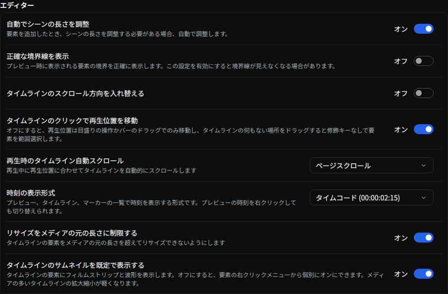
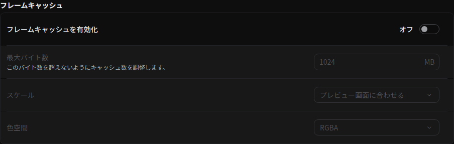
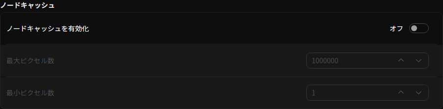
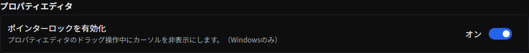

## 自動でシーンの長さを調整

オンにすると、要素を追加したとき、シーンの長さを調整する必要がある場合、自動で調整します。

## 自動保存

編集内容は変更の確定後に自動で保存されます。自動保存は常に有効で、以前の **自動保存を有効化** スイッチは削除されました。

完全に復元できなかった要素ファイルの保護については、[要素の編集](../get-started/edit-element.md#破損した要素の復旧)を参照してください。

## 正確な境界線を表示

オンにすると、プレビュー時に表示される境界を正確に表示します。

四角形などのオブジェクトは、境界線と描画内容が被さるため、境界線が見えなくなります。

## フレームキャッシュ

### フレームキャッシュを有効化

オンにすると、フレームキャッシュが有効になります。

デフォルト値は __"オフ"__ です。

### 最大バイト数

このバイト数 (メガバイト数) を超えないようにキャッシュ数を調整します。

デフォルト値は .NET ランタイムが利用できるメモリの半分です。コンテナーやジョブのメモリ制限が設定されている場合は、デバイスの物理メモリではなく、その制限を反映します。

### スケール

キャッシュをメモリに保存するとき、メモリ容量を節約するため、この設定を使用して解像度を下げます。

- オリジナル
- プレビュー画面に合わせる __(デフォルト値)__
- 二分の一
- 四分の一

:::tip
:::
  プレビュー画面のサイズがオリジナルサイズ以上の場合、解像度はそのままになります。

### 色空間

キャッシュをメモリに保存するとき、メモリ容量を節約するため、この設定を使用して色空間を変更します。

- RGBA __(デフォルト値)__
- YUV

:::tip
YUVはI420を使用します。
:::

## ノードキャッシュ

### ノードキャッシュを有効化

オンにすると、ノードキャッシュが有効になります。

デフォルト値は __"オフ"__ です。

### 最大ピクセル数

このピクセル数を超えるノードはキャッシュされません。

デフォルト値は __"1000000"__ です。

### 最少ピクセル数

このピクセル数未満のノードはキャッシュされません。

デフォルト値は __"1"__ です。

## プロキシメディア

ここでは、[プロキシメディアワークフロー](../reference/tool-tabs/proxies.md)に関する設定を変更できます。

### プレビューソース

プレビューでプロキシメディアを使用するかどうかを設定します。

- プロキシ優先 __(デフォルト値)__
- オリジナル強制

### 保存場所

プロキシファイルは、このフォルダーに保存されます。

既定の保存先は、Beutlのホームディレクトリ内にある `proxies` フォルダーです。変更はBeutlの再起動後に反映されます。

### 最大ストアサイズ

ストアがこのサイズ (GiB) を超えると、Beutlが最も使われていないプロキシから削除します。

デフォルト値は __"50"__ GiB です (設定可能範囲: 5〜500)。変更はBeutlの再起動後に反映されます。

### 既定のプリセット

プロキシツールタブで最初に選択される品質プリセットを設定します。

- プロキシ 1/2
- プロキシ 1/4 __(デフォルト値)__
- プロキシ 1/8

## プロパティエディター

### ポインターロックを有効化

プロパティエディターのドラッグ操作中にカーソルを非表示にして、固定します。(Windowsのみ)

デフォルト値は __"オン"__ です。

## トーンマッピング

プレビューでフレームをディスプレイに合わせる方法を設定します。プレビュー、[別画面のプレビュー](../reference/tool-tabs/preview-settings.md#show-the-preview-in-another-window)、スマホプレビューの SDR ストリームに影響し、書き出しには影響しません。

### HDRプレビュー

プレビューに HDR レンダリングを使い、余裕のあるディスプレイでは SDR の白を超える値を表示します。HDR プレビューはエディターのオーバーレイを覆うネイティブビューなので、プレビュー上のマウス操作が制限され、トランスフォームハンドル、パスエディタ、[ガイド](#ガイド)は表示されません。macOS ではディスプレイのデバイスピクセルで描画します。

デフォルト値は __"オフ"__ です。

### トーンマッピング

ディスプレイで表示できない値をプレビューでどう合わせるかを選びます。

- なし __(デフォルト値)__
- Reinhard
- ACES
- Hable
- ディスプレイに合わせる

__ディスプレイに合わせる__ は、ディスプレイで表示できない部分だけを丸めて色相を保ちます。ほかのモードはチャンネルごとにクリップするか、全体の範囲を圧縮します。ディスプレイの色域の外にある色は、その色の輝度のグレーに向かって移動し、表示できる色は変わりません。素材のピークは 1000 nit、基準の白は 203 nit として扱います。

| プレビュー | ハイライト | 色 |
|------------|------------|----|
| macOS の HDR プレビュー | Core Animation が画面の現在の余裕に合わせてトーンマッピングし、明るさの変更に追従します。 | 画面自身の色域に合わせるので、P3 の画面には P3 の色が表示されます。 |
| Windows の HDR プレビュー（ディスプレイが HDR モード） | ディスプレイのピーク、または設定した __ディスプレイのピーク輝度__ に丸めます。 | ディスプレイの原色に合わせます。 |
| Windows の HDR プレビュー（ディスプレイが HDR モード以外） | ディスプレイの白に丸めます。 | SDR モードでは sRGB に、自動カラーマネジメントではディスプレイの原色に合わせます。 |
| Linux の HDR プレビュー | ディスプレイの余裕が分からないため、そのまま渡します。 | そのままです。 |
| HDR プレビューなし、HDR に対応しないサーフェス、スマホプレビューの SDR ストリーム | SDR の白に丸めます。 | sRGB に合わせます。 |

:::note
__ディスプレイに合わせる__ が既定でないのは、余裕のないディスプレイでは SDR の白も約 0.78 に下がるためです。SDR のプロジェクトは、書き出しよりもプレビューのほうが暗く見えます。
:::

Windows の HDR ディスプレイでは、HDR プレビューはどのモードでも基準の白をディスプレイの SDR 白レベルで表示するので、エディターの UI の白と揃います。

### 露出

トーンマッピングの露出レベルを `-5` から `5` の範囲で調整します。

デフォルト値は __"0"__ です。

### ディスプレイのピーク輝度（nit）

Windows の HDR ディスプレイで、__ディスプレイに合わせる__ がハイライトを丸める先の明るさです。誤ったピークを報告するモニターや、報告しないモニターのために使います。`0` なら Windows が報告する値を使います。値の範囲は `0` から `10000` です。説明欄には、ディスプレイの報告値、または HDR モードではないことが表示されます。

この設定は Windows でのみ表示されます。デフォルト値は __"0"__ です。

## ガイド

プレビューに重ねるセーフエリアと構図のガイドです。[プレビュー設定](../reference/tool-tabs/preview-settings.md#ガイド)タブと同じ設定で、各ガイドの説明はそちらにあります。

- __ガイドを表示__: すべてのガイドのオン・オフを切り替えます。デフォルト値は __"オフ"__ です。
- __表示するガイド__: タイトルセーフ、アクションセーフ、三分割線、中心十字、対角線、カスタムグリッド、アスペクト比。
- __ガイドの色__、__ガイドの不透明度__、__グリッドの列数__、__グリッドの行数__、__アスペクト比の枠__。

## ソース

- [`EditorConfig.cs`](https://github.com/b-editor/beutl/blob/fb0eb00b07159f8c1a96c308b38958e29590686a/src/Beutl.Configuration/EditorConfig.cs)
- [`EditViewModel.cs`](https://github.com/b-editor/beutl/blob/f9cbaeef9da0077f6745010a2d69955e12c45187/src/Beutl/ViewModels/EditViewModel.cs)
- [`AutoSaveService.cs`](https://github.com/b-editor/beutl/blob/f9cbaeef9da0077f6745010a2d69955e12c45187/src/Beutl.Editor/AutoSaveService.cs)
- [`EditorSettingsPage.axaml`](https://github.com/b-editor/beutl/blob/fb0eb00b07159f8c1a96c308b38958e29590686a/src/Beutl/Pages/SettingsPages/EditorSettingsPage.axaml)
- [`VulkanSwapchainRenderer.cs`](https://github.com/b-editor/beutl/blob/fb0eb00b07159f8c1a96c308b38958e29590686a/src/Beutl.Engine/Graphics/Backend/Vulkan/VulkanSwapchainRenderer.cs)
- [`WindowsDisplayLuminance.cs`](https://github.com/b-editor/beutl/blob/fb0eb00b07159f8c1a96c308b38958e29590686a/src/Beutl.Engine/Graphics/Backend/Vulkan/WindowsDisplayLuminance.cs)
- [`HdrBitmapView.cs`](https://github.com/b-editor/beutl/blob/fb0eb00b07159f8c1a96c308b38958e29590686a/src/Beutl.Controls/HdrBitmapView.cs)
