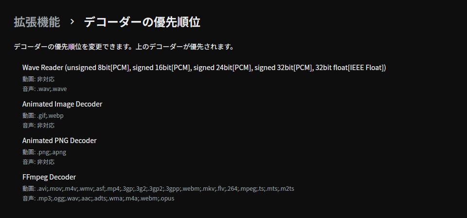
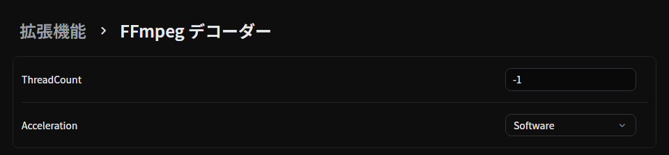
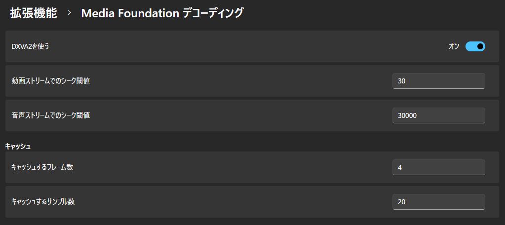

## 更新のタイミング {/* #update-timing */}

ストアからインストールした拡張機能を、いつ更新するかを選びます。自動更新は、次回起動時にプロジェクトを開く前に適用します。

- **通知のみ**: 起動時に更新を確認し、**パッケージの更新が利用可能です。** と通知します。通知の **開く** で **拡張機能** ウィンドウの **ライブラリ** が開くので、そこで自分で更新します。
- **Beutl本体と一緒に更新**: Beutl が[本体の更新](../get-started/install.md#beutl-を更新する)を準備するときに、新しいバージョン用の拡張機能のリリースもダウンロードし、新しいバージョンの起動時に適用します。準備完了の通知に、一緒に更新する件数が表示されます。ほかの方法で Beutl を更新した場合は、新しいバージョンが最初の起動時に探します。本体の更新がないときは、**通知のみ** と同じように通知します。
- **常に自動更新** __(デフォルト値)__: 起動時、この項目を選んだとき、実行中の 6 時間ごとにも、拡張機能の更新をダウンロードします。

拡張機能は、それを読み込む Beutl のバージョンに対応したリリースにだけ更新され、ダウンロードしたファイルはストアが公開するダイジェストと照合してから使われます。ライセンスへの同意を求める拡張機能と、素材やテンプレートは、自分で更新します。更新を適用した起動では、**拡張機能を自動更新しました** と通知されます。

デコーダーの優先順位を変更します。
リストの上のデコーダーが優先されます。

## 拡張機能の設定

拡張機能の個別の設定を変更します。
### FFmpeg Decoder

#### ThreadCount

デコードに使用するスレッド数を設定します。

0未満を指定すると、デバイスのスレッド数 (最大16) を使用します。  
0を指定すると、FFmpegが自動でスレッド数を検出するらしいです。

デフォルト値は __"-1"__ です。

#### Acceleration

デコードに使用するハードウェアアクセラレーションを設定します。

- Software __(デフォルト値)__
- Auto
- VDPAU
- CUDA
- VAAPI
- DXVA2
- QSV
- VideoToolbox
- D3D11VA
- DRM
- OpenCL
- MediaCodec
- Vulkan

### Media Foundation デコーディング

#### DXVA2を使う

DirectX ビデオ アクセラレータ 2.0を使用して高速に動画をデコードします。

デフォルト値は __"オン"__ です。

#### 動画ストリームのシーク閾値

このフレーム数より遠いフレームが読み込まれる場合、シークします。

デフォルト値は __"30"__ です。

#### 音声ストリームのシーク閾値

このサンプル数より遠いサンプルが読み込まれる場合、シークします。

デフォルト値は __"30000"__ です。

#### キャッシュするフレーム数

デフォルト値は __"4"__ です。

#### キャッシュするサンプル数

デフォルト値は __"20"__ です。

## ソース

- [`FFmpegDecodingSettings.cs`](https://github.com/b-editor/beutl/blob/fb0eb00b07159f8c1a96c308b38958e29590686a/src/Beutl.Extensions.FFmpeg.Core/Decoding/FFmpegDecodingSettings.cs)
- [`UpdateConfig.cs`](https://github.com/b-editor/beutl/blob/4ca0cc18507a50d94678d11a386fd477dd75125e/src/Beutl.Configuration/UpdateConfig.cs) / [`ExtensionsSettingsPage.axaml`](https://github.com/b-editor/beutl/blob/4ca0cc18507a50d94678d11a386fd477dd75125e/src/Beutl/Pages/SettingsPages/ExtensionsSettingsPage.axaml)
- [`CheckForPackageUpdatesTask.cs`](https://github.com/b-editor/beutl/blob/4ca0cc18507a50d94678d11a386fd477dd75125e/src/Beutl/Services/StartupTasks/CheckForPackageUpdatesTask.cs) / [`LoadInstalledExtensionTask.cs`](https://github.com/b-editor/beutl/blob/4ca0cc18507a50d94678d11a386fd477dd75125e/src/Beutl/Services/StartupTasks/LoadInstalledExtensionTask.cs)
- [`PackageManager.ExtensionUpdates.cs`](https://github.com/b-editor/beutl/blob/4ca0cc18507a50d94678d11a386fd477dd75125e/src/Beutl.Api/Services/PackageManager.ExtensionUpdates.cs) / [`PackageInstaller.ExtensionUpdates.cs`](https://github.com/b-editor/beutl/blob/4ca0cc18507a50d94678d11a386fd477dd75125e/src/Beutl.Api/Services/PackageInstaller.ExtensionUpdates.cs)
