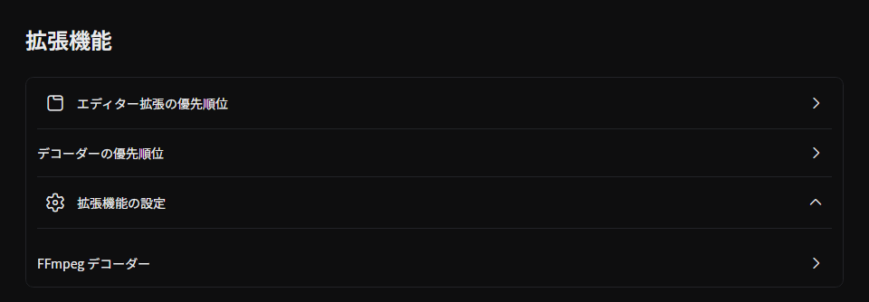
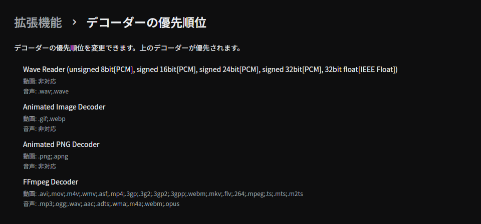
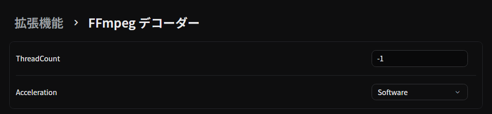
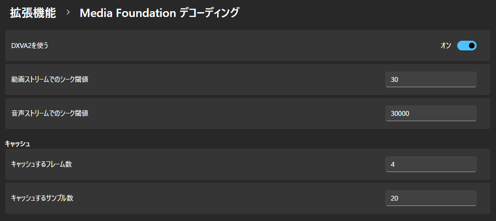

## デコーダーの優先順位

デコーダーの優先順位を変更します。
リストの上のデコーダーが優先されます。

## 拡張機能の設定

拡張機能の個別の設定を変更します。
### FFmpeg Decoder

#### ThreadCount

デコードに使用するスレッド数を設定します。

0未満を指定すると、デバイスのスレッド数 (最大16) を使用します。  
0を指定すると、FFmpegが自動でスレッド数を検出するらしいです。

デフォルト値は __"-1"__ です。

#### Acceleration

デコードに使用するハードウェアアクセラレーションを設定します。

- Software __(デフォルト値)__
- Auto
- VDPAU
- CUDA
- VAAPI
- DXVA2
- QSV
- VideoToolbox
- D3D11VA
- DRM
- OpenCL
- MediaCodec
- Vulkan

:::note
スクリーンショットにある **ForceSrgbGamma** の設定は 2.0.0-preview.10 で削除され、保存された値は無視されます。デコーダーは SDR の動画を色のタグに従って読み込みます。[更新する前に](../get-started/install.md#更新する前に)を参照してください。
:::

### Media Foundation デコーディング

#### DXVA2を使う

DirectX ビデオ アクセラレータ 2.0を使用して高速に動画をデコードします。

デフォルト値は __"オン"__ です。

#### 動画ストリームのシーク閾値

このフレーム数より遠いフレームが読み込まれる場合、シークします。

デフォルト値は __"30"__ です。

#### 音声ストリームのシーク閾値

このサンプル数より遠いサンプルが読み込まれる場合、シークします。

デフォルト値は __"30000"__ です。

#### キャッシュするフレーム数

デフォルト値は __"4"__ です。

#### キャッシュするサンプル数

デフォルト値は __"20"__ です。

## ソース

- [`FFmpegDecodingSettings.cs`](https://github.com/b-editor/beutl/blob/fb0eb00b07159f8c1a96c308b38958e29590686a/src/Beutl.Extensions.FFmpeg.Core/Decoding/FFmpegDecodingSettings.cs)
