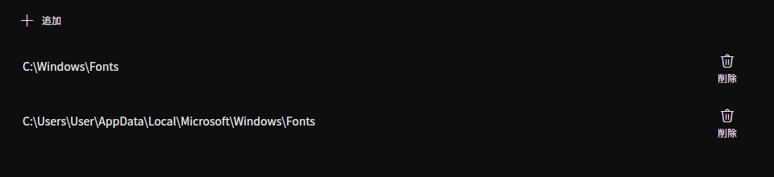
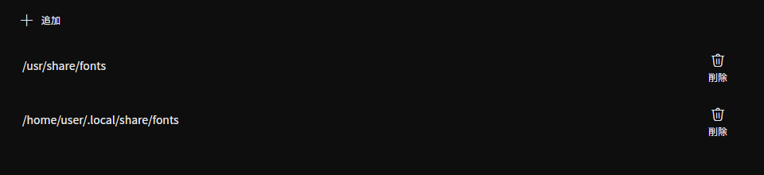

フォントを読み込むディレクトリを設定します

**Windowsの例**

**Linuxの例**

## プロパティエディタでフォントを探す

フォントの選択欄では、フォントに含まれる各言語のファミリー名を検索できます。たとえば、UI の言語に関係なく `Yu Gothic` と `游ゴシック` のどちらでも同じファミリーを見つけられます。

大文字・小文字、全角・半角、ひらがな・カタカナを区別しません。空白やハイフンを省いた検索（`notosans` で `Noto Sans`）や、複数の単語による絞り込みもできます。ピン留めしたフォントよりも、一致度の高い候補が先に表示されます。

## ソース

- [`FontFamilyNames.cs`](https://github.com/b-editor/beutl/blob/f9cbaeef9da0077f6745010a2d69955e12c45187/src/Beutl.Controls/PropertyEditors/FontFamilyNames.cs)
- [`FontFamilySearchQuery.cs`](https://github.com/b-editor/beutl/blob/f9cbaeef9da0077f6745010a2d69955e12c45187/src/Beutl.Controls/PropertyEditors/FontFamilySearchQuery.cs)
- [`FontFamilyPickerFlyoutViewModel.cs`](https://github.com/b-editor/beutl/blob/f9cbaeef9da0077f6745010a2d69955e12c45187/src/Beutl.Controls/PropertyEditors/FontFamilyPickerFlyoutViewModel.cs)
