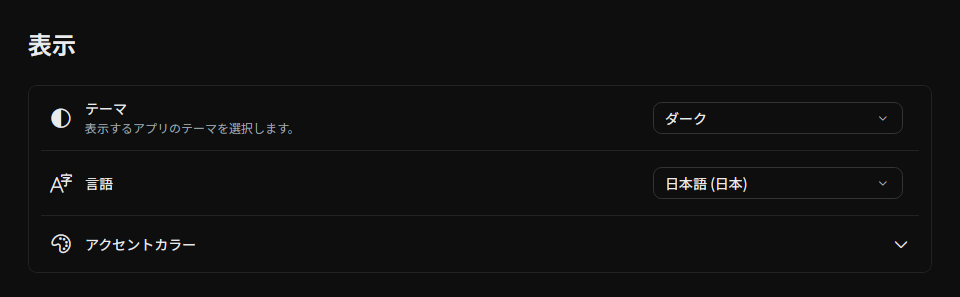
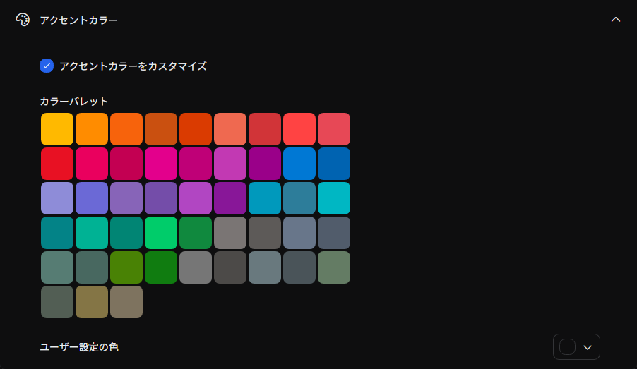

## テーマ

- **ダーク** — Beutl 独自のニアブラックのデザイン。既定値です。
- **ダーク (クラシック)** — **ダーク** が上に重ねているデザイン用の上書きを適用しない、素のダークテーマ。
- **ライト**
- **ハイコントラスト**
- **システムに従う**

テーマは独自のアクセントカラーを持つことができ、[アクセントカラー](#アクセントカラー) を自分で設定していない場合はそちらが使われます。**ダーク** は青系のアクセント（`#2563EB`）を使い、その他の組み込みテーマはアクセントを OS に任せます。

拡張機能から独自のテーマを追加することもでき、登録されたテーマは組み込みのテーマと並んでこの一覧に表示されます。[開発可能な拡張機能](../extensions/available-extensions.md) を参照してください。

:::note
Beutl 1.x の設定は自動的に移行されます。**ライト**・**ハイコントラスト**・**システムに従う** を選んでいた場合はそのテーマが引き継がれ、以前の既定値のままだった場合は新しい **ダーク** のデザインテーマになります。
:::

## 言語

- 日本語
- 英語
- 中国語（簡体字）
- 韓国語
- スペイン語

## アクセントカラー

任意の色を設定できます。

## ネイティブのコンテキストメニューを使用

右クリックメニューを macOS 標準のメニューで表示します。見た目、キーボード操作、アクセシビリティはシステムのものになります。テキストボックスのメニューもネイティブのメニューになります。変更は再起動なしで、次に開くメニューから反映されます。

ネイティブのメニューは Beutl のテーマではなくシステムのライト/ダークの外観に従い、項目のアイコンは表示されません。テキスト以外の見出しなど、ネイティブのメニューで表示できないものを含むメニューは、Beutl のメニューのまま表示されます。すべて Beutl のメニューに戻すには、この設定をオフにします。

この設定は macOS でのみ表示されます。デフォルト値は __"オン"__ です。

## ソース

- [`LocalizeService.cs`](https://github.com/b-editor/beutl/blob/v2.0.0-preview.8/src/Beutl.Language/LocalizeService.cs)
- [`ViewSettingsPageViewModel.cs`](https://github.com/b-editor/beutl/blob/dadee0db956ddb874ab88f48329bc84a5ce5cf6b/src/Beutl/ViewModels/SettingsPages/ViewSettingsPageViewModel.cs)
- [`NativeContextMenus.cs`](https://github.com/b-editor/beutl/blob/dadee0db956ddb874ab88f48329bc84a5ce5cf6b/src/Beutl.Controls/NativeContextMenu/NativeContextMenus.cs)
